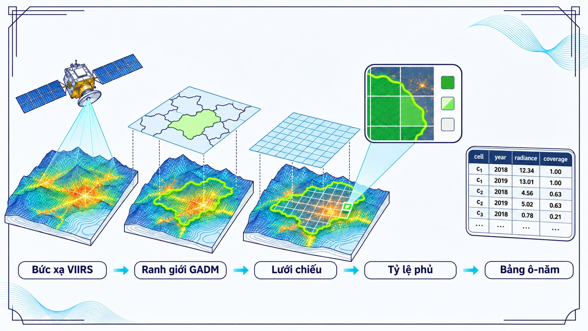
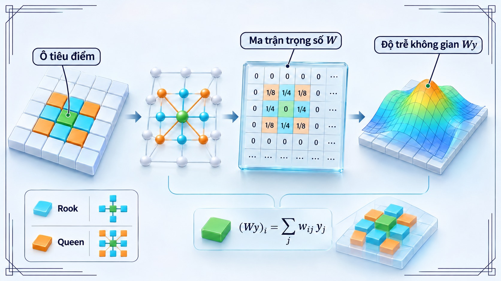
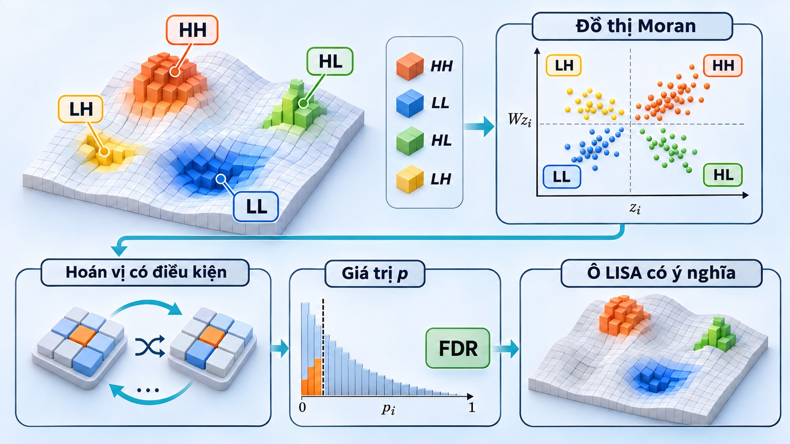
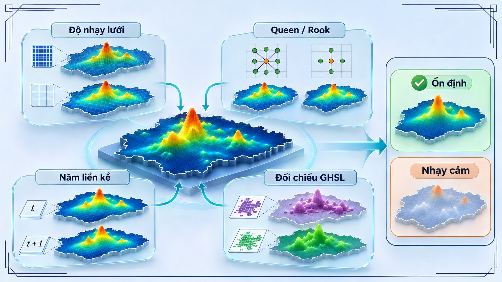

<a id="top"></a>

[Hướng dẫn dữ liệu và GADM](docs/README-vi.md) · [Tình trạng kiểm chứng và bằng chứng](validation/README-vi.md)

<div align="center">

# Sổ tay kỹ thuật và khung phương pháp luận

**Bộ trích xuất dữ liệu ánh sáng ban đêm (NTL) & công cụ kinh tế lượng không gian**

[English](README.md) &nbsp;|&nbsp; [Tiếng Việt](README-vi.md) &nbsp;|&nbsp; [Dùng thử trực tiếp](https://spatial-app.streamlit.app/?)

</div>

---

> [!TIP]
> **TL;DR: chỉ có 30 giây để đọc?**
>
> Bạn thấy ngợp trước đống công thức bên dưới? Đây là bản "nói tiếng người" về việc hệ thống này làm được gì.
>
> - **Bài toán.** Muốn biết một vùng giàu hay nghèo khi không có số liệu GDP, người ta nhìn ảnh vệ tinh chụp ánh sáng ban đêm. **Nhưng** đống dữ liệu này rất nặng: chạy trên máy tính thường là tràn RAM, làm thủ công thì mất cả tuần.
> - **App làm gì.** Bạn chọn một khu vực $\rightarrow$ app tự kết nối *Google Earth Engine* để tải ảnh $\rightarrow$ engine C/C++ gom hàng triệu điểm ảnh vào từng ô lưới $\rightarrow$ **các giới hạn an toàn kiểm soát khối lượng xử lý; khả năng chạy ổn định trong 1GB vẫn cần kiểm thử toàn bộ hệ thống triển khai.**
> - **Bạn nhận lại gì.** Một nút bấm, một file CSV đã dọn sẵn các chỉ số kinh tế: đâu là lõi đô thị? chỗ nào là "điểm nóng" (LISA)? mức bất bình đẳng (Gini) cao hay thấp? Việc của bạn chỉ còn là tải về và đưa thẳng vào mô hình hồi quy.


Dự án này là một hệ thống dành cho **kinh tế lượng không gian**, ghép hạ tầng lưới không gian với luồng trích xuất dữ liệu ánh sáng ban đêm (nighttime lights – NTL).

Ứng dụng đi qua ba chặng: chuẩn hóa các ranh giới hành chính bất quy tắc thành ma trận lưới vuông; kết nối trực tiếp với Google Earth Engine (GEE) để tải dữ liệu raster (SNPP-VIIRS); rồi tự tính các chỉ số thống kê không gian vi mô (LISA) và xuất dữ liệu bảng cho các mô hình vĩ mô.

### Bạn nên đọc phần nào?

| Bạn là... | Nên đọc |
| :--- | :--- |
| Người làm chính sách, không chuyên về kỹ thuật | [Mục 0](#s0), nhất là nhóm câu hỏi app có thể trả lời và nguyên tắc diễn giải |
| Nhà kinh tế cần biến số để chạy hồi quy | [Mục 0](#s0), [Mục V](#s5), sau đó là [Mục III](#s3) để hiểu nguồn gốc chỉ số |
| Nhà nghiên cứu muốn kiểm tra phương pháp | [Mục 0](#s0), [Mục II](#s2) và [Mục III](#s3) |
| Người triển khai, vận hành hệ thống | [Khởi động nhanh](#quick-start), [Mục I](#s1), [Mục IV](#s4) và [Mục VI](#s6) |

<details>
<summary><b>Bảng thuật ngữ nhanh (bấm để mở)</b></summary>

<br>

| Thuật ngữ | Hiểu nôm na |
| :--- | :--- |
| **NTL** (Nighttime Lights) | Ánh sáng ban đêm quan sát từ vệ tinh. Ở đây là bức xạ trung bình của một ô lưới. |
| **VIIRS** | Cảm biến/bộ dữ liệu vệ tinh cung cấp ảnh ánh sáng ban đêm mà hệ thống sử dụng. |
| **GEE** | Google Earth Engine, nơi hệ thống lấy ảnh vệ tinh về. |
| **Dữ liệu vectơ / raster** | Vectơ là các đa giác ranh giới (tỉnh, huyện...). Raster là ảnh gồm các điểm ảnh. |
| **SOL** (Sum of Lights) | Tổng lượng ánh sáng của một ô = bức xạ trung bình × diện tích ô. |
| **LISA** | Chỉ số cho biết *từng ô lưới* có tụ cụm với các ô xung quanh hay không (tụ cụm sáng, tụ cụm tối, hay lạc quẻ). |
| **HH / LL / HL / LH** | Bốn loại nhãn của LISA: High-High, Low-Low, High-Low, Low-High (xem [Mục 3.1](#s3)). |
| **MAUP** | Thiên lệch thống kê khi so sánh các đơn vị hành chính có diện tích và hình dạng chênh nhau quá lớn. |
| **FDR** | Cách kiểm soát số "phát hiện sai" khi kiểm định hàng loạt ô cùng lúc. |
| **CBD** | Central Business District, tâm lõi kinh tế của một vùng. |
| **Gini** | Thước đo mức độ tập trung/bất bình đẳng. Càng gần 0 càng đều, càng gần 1 càng dồn vào ít ô. |
| **UTM** | Hệ tọa độ phẳng tính bằng mét, thuận tiện cho việc đo diện tích và khoảng cách. |
| **OOM** | Out-Of-Memory: hết bộ nhớ, tiến trình bị hệ điều hành cưỡng chế dừng. |

</details>

---

<a id="s0"></a>

## 0. Kinh tế lượng không gian và phạm vi thực sự của ứng dụng

### 0.1. Kinh tế lượng không gian là gì?

Kinh tế lượng thông thường thường bắt đầu từ giả định rằng, sau khi đã kiểm soát các biến giải thích, một quan sát không phụ thuộc vào quan sát khác. Dữ liệu địa lý hiếm khi thỏa mãn giả định đó. Một trung tâm thương mại sáng mạnh có thể ảnh hưởng tới đất đai xung quanh, một dự án giao thông có thể tạo tác động vượt ranh giới hành chính, còn các huyện lân cận có thể dùng chung hạ tầng, thị trường lao động và các cú sốc chưa quan sát được.

**Kinh tế lượng không gian** mở rộng kinh tế lượng để đưa vị trí và quan hệ giữa các vị trí vào phân tích một cách tường minh (Anselin, 1988; LeSage & Pace, 2009). Hai hiện tượng cốt lõi là:

1. **Phụ thuộc không gian:** giá trị hoặc nhiễu tại vị trí $i$ có liên hệ với giá trị hoặc nhiễu ở các vị trí lân cận.
2. **Dị biệt không gian:** quan hệ, phương sai hoặc chế độ có thể khác nhau giữa các địa điểm.

Đối tượng trung tâm là ma trận trọng số không gian $W$. Mỗi phần tử $w_{ij}$ biểu diễn vị trí $j$ có kết nối với vị trí $i$ hay không, hoặc mức kết nối mạnh đến đâu. Biến trễ không gian

$$
(Wy)_i = \sum_j w_{ij}y_j
$$

vì vậy là một tóm tắt các giá trị xung quanh vị trí $i$. Trên lưới đều, dự án chủ yếu dùng tiếp giáp Queen, tức ô chung cạnh hoặc chung góc đều là láng giềng. Kiểm định độ vững còn dùng tiếp giáp Rook, chỉ tính các ô chung cạnh (Anselin, 1988; Rey và cộng sự, 2023).

Phụ thuộc không gian quan trọng vì nó làm thay đổi cả câu hỏi nghiên cứu lẫn suy luận thống kê. Hồi quy thông thường có thể hỏi $X_i$ liên hệ với $y_i$ như thế nào. Mô hình không gian còn có thể hỏi $y_j$ ở vùng lân cận ảnh hưởng tới $y_i$ hay không, một cú sốc lan truyền qua không gian ra sao, và phần dư có còn tụ cụm theo địa lý hay không (LeSage & Pace, 2009; Elhorst, 2014).

> [!IMPORTANT]
> Ứng dụng này trước hết là một **hệ thống đo lường, phân tích dữ liệu không gian khám phá và chuẩn bị dữ liệu**. App tính chỉ số NTL, Global Moran's I, Local Moran's I, chẩn đoán, độ vững và xuất dữ liệu sẵn sàng cho panel. Giao diện **không** tự ước lượng trọn vẹn mô hình nhân quả SAR, SEM hoặc SDM. Các mô hình đó cần biến kết quả, biến giải thích và chiến lược nhận dạng do nhà nghiên cứu cung cấp.

### 0.2. Từ khám phá không gian tới hồi quy không gian

Thống kê không gian và kinh tế lượng không gian có phần giao nhau, nhưng không trả lời cùng một câu hỏi. Phân tích dữ liệu không gian khám phá hỏi **mẫu hình nào đang tồn tại và nằm ở đâu**. Kinh tế lượng không gian bổ sung một mô hình tường minh cho biến kết quả và hỏi **cơ chế phụ thuộc nào phù hợp với thiết kế nghiên cứu, tham số cần được ước lượng ra sao, và bất định cùng tác động lan tỏa nên được diễn giải thế nào** (Anselin, 1988; Rey và cộng sự, 2023).

| Giai đoạn | Câu hỏi điển hình | Công cụ hoặc mô hình | Quan hệ với app này |
| :--- | :--- | :--- | :--- |
| **Mô tả** | Địa phương sáng, bất bình đẳng hoặc tập trung đến mức nào? | Bản đồ, phân vị, Gini, Lorenz và hồ sơ theo khoảng cách | Tính trực tiếp |
| **Khám phá toàn cục** | Có tự tương quan không gian trên toàn vùng không? | Global Moran's I | Tính trực tiếp |
| **Khám phá cục bộ** | Cụm và ngoại lệ không gian nằm ở đâu? | Local Moran's I / LISA | Tính trực tiếp |
| **Chẩn đoán mô hình** | Sau khi kiểm soát biến giải thích, cấu trúc không gian có còn không? | Moran trên phần dư và kiểm định đặc tả | App xuất đầu vào chẩn đoán; hồi quy nội dung được chạy bên ngoài |
| **Hồi quy không gian** | Phụ thuộc nằm ở biến kết quả, biến giải thích, nhiễu hay nhiều kênh? | SLX, SAR, SEM, SDM và các mô hình liên quan | Giao diện không tự ước lượng |
| **Thiết kế nhân quả** | Tác động của một can thiệp là gì khi có tương tác giữa các địa điểm? | Bộ ước lượng phù hợp với thiết kế, giả định phơi nhiễm và lan tỏa | App cung cấp thước đo, khoảng cách, vành đai và bằng chứng độ nhạy, không tự tạo nhận dạng |

Các họ mô hình tuyến tính phổ biến giúp hình dung cấu trúc của lĩnh vực:

| Mô hình | Dạng rút gọn | Ý tưởng chính |
| :--- | :--- | :--- |
| **OLS cơ sở** | $y = X\beta + \varepsilon$ | Không còn kênh không gian tường minh sau khi kiểm soát $X$ |
| **SLX** | $y = X\beta + WX\theta + \varepsilon$ | Biến giải thích ở vùng lân cận có thể ảnh hưởng tới kết quả tại chỗ |
| **SAR / trễ không gian** | $y = \rho Wy + X\beta + \varepsilon$ | Kết quả tương tác đồng thời giữa các vị trí có kết nối |
| **SEM / sai số không gian** | $y = X\beta + u$, $u = \lambda Wu + \varepsilon$ | Các cú sốc chưa quan sát có tương quan không gian |
| **SDM / Spatial Durbin** | $y = \rho Wy + X\beta + WX\theta + \varepsilon$ | Kết hợp tương tác kết quả với tác động của biến giải thích lân cận |

Các phương trình này không phải những nhãn có thể thay thế tùy ý. Trong SAR hoặc SDM, hệ số thường chưa phải tác động biên cuối cùng vì phản hồi qua $(I-\rho W)^{-1}$ tạo ra tác động trực tiếp và gián tiếp. Moran có ý nghĩa không tự chọn mô hình. Cần chọn đặc tả dựa trên cơ chế nội dung, cách dựng $W$, chẩn đoán phần dư và các giả định nhận dạng (LeSage & Pace, 2009).

### 0.3. Từ câu hỏi nghiên cứu tới đầu ra của app

| Câu hỏi nghiên cứu | Đầu ra của app | Giá trị sử dụng | Điều chưa thể kết luận |
| :--- | :--- | :--- | :--- |
| Ánh sáng ban đêm tập trung ở đâu? | Bản đồ NTL, SOL, đường Lorenz, Gini, tỷ trọng của 10% ô sáng nhất và biểu đồ hạng-quy mô | Mô tả mức độ và độ tập trung của bức xạ quan sát được (Henderson và cộng sự, 2012; Donaldson & Storeygard, 2016) | Thu nhập hộ, GDP hoặc phúc lợi nếu chưa có mô hình kiểm chứng ngoài |
| Độ sáng có tụ cụm trên toàn địa phương không? | Global Moran's I với p-value giả từ hoán vị | Kiểm tra các ô gần nhau có giống nhau hơn mức kỳ vọng theo thủ tục hoán vị hay không (Moran, 1950) | Nguyên nhân của tụ cụm hoặc phụ thuộc không gian trong phần dư hồi quy |
| Ô nào tạo thành cụm cục bộ hoặc ngoại lệ không gian? | Các lớp LISA `HH`, `LL`, `HL`, `LH`, `NS`, `DARK` và `EDGE` | Định vị cụm cục bộ và các ô trái chiều sau kiểm định ý nghĩa (Anselin, 1995; Caldas de Castro & Singer, 2006) | Tác động nhân quả hoặc ranh giới đô thị chính thức |
| Kết quả có nhạy với lựa chọn phân tích không? | Kiểm tra Rook/Queen, ngưỡng, phép biến đổi, FDR, seed, lưới thô và năm kề | Cho biết mẫu High-High có tồn tại qua các đặc tả hợp lý hay không | Độ ổn định phổ quát ngoài các đặc tả đã thử |
| Vị thế không gian tương đối thay đổi thế nào giữa hai năm? | Chế độ Không-Thời gian, biên độ rộng/sâu và ma trận Markov có điều kiện | Tách thay đổi của bản thân ô khỏi thay đổi của biến trễ láng giềng | Tăng trưởng kinh tế tuyệt đối hoặc kết quả nhân quả panel đa kỳ |
| NTL có đồng thuận với một đại lượng đô thị độc lập không? | Tương quan Spearman, khoảng bootstrap theo khối và AUC với diện tích xây dựng hoặc dân số GHSL | Kiểm tra mức đồng thuận ngoài trên cùng hệ lưới (Pesaresi & Politis, 2023; Schiavina và cộng sự, 2023) | Kiểm chứng bằng GDP, giá nhà hoặc kết quả cấp hộ |
| Có thể đưa gì sang quy trình kinh tế lượng khác? | CSV cấp ô, CSV LISA, CSV một dòng vùng-năm, CSV Không-Thời gian và GeoJSON tùy chọn | Giữ định danh, cờ chất lượng, phương pháp và biến dẫn xuất | Một đặc tả thực nghiệm có thể thay thế thiết kế nghiên cứu |

### 0.4. Bản đồ đầy đủ các công năng trong app

Giao diện đi theo đúng thứ tự của một quy trình nghiên cứu có thể bảo vệ được. Những phần tốn nhiều thời gian như chạy độ vững, kiểm chứng GHSL và tải năm đối chiếu chỉ thực hiện khi người dùng yêu cầu.

| Màn hình hoặc điều khiển | Công năng chính | Đầu ra cần xem |
| :--- | :--- | :--- |
| **Bộ chọn địa phương và độ phân giải** | Tìm kiếm hoặc duyệt quốc gia, đơn vị cấp một và địa phương; chọn năm 2014-2025 và ô lưới 500-5.000 m; ước lượng khối lượng trước khi chạy | Diện tích ranh giới, số ô dự kiến, CRS UTM động và cảnh báo hoặc chặn tác vụ quá lớn |
| **Pipeline trích xuất** | Dựng lưới vuông căn chỉnh nhất quán, tạo ảnh VIIRS trung vị năm, trích xuất trung bình ô theo tỷ lệ diện tích và ghi hiệu năng từng bước | Hình học lưới, `ntl_mean`, `area_km2`, tâm ô và thông tin nguồn gốc pipeline |
| **Tab Bản đồ** | Chuyển giữa NTL liên tục, nhóm kinh tế toàn cục và vị thế nội bộ; chọn thang màu tuyến tính, căn bậc hai hoặc logarit; ẩn ô tối, viền Top 10, đường biên ô và lớp che ngoài vùng | Tooltip từng ô với hạng, phân vị, tỷ trọng SOL, điểm chuẩn hóa, lớp và tọa độ |
| **Tab Dữ liệu: tổng quan** | Báo trung bình có/không trọng số, phân vị, độ phân tán, độ lệch, Gini, tỷ lệ ô sáng và các ô sáng nhất | Nhận định nhanh, bảng mô tả, bảng Top 10 và bảng xem trước đầy đủ |
| **Tab Dữ liệu: cấu trúc không gian** | Tính Global Moran's I với láng giềng Queen và suy luận bằng hoán vị | $I$ quan sát, $I$ kỳ vọng, p-value giả và số láng giềng trung bình |
| **Tab Dữ liệu: phân phối** | So sánh tỷ trọng số ô với tỷ trọng ánh sáng; vẽ Lorenz, hạng-quy mô và hồ sơ theo khoảng cách | Gini, hình dạng đuôi Pareto và bằng chứng mô tả về cấu trúc đơn tâm hoặc đa tâm |
| **Khối chất lượng dữ liệu** | Gắn cờ thiếu, âm, 0 và hỗ trợ quan sát thấp; tùy chọn so sánh cắt/không cắt số âm và tải số tháng hợp lệ | Các cột `dq_*`, cảnh báo tự động và giả định dùng để tạo ảnh NTL tổng hợp |
| **Khối kiểm chứng ngoài** | So sánh NTL với diện tích xây dựng hoặc dân số GHSL trên lưới gốc GHSL được bảo toàn | Spearman $\rho$, khoảng bootstrap theo khối, AUC và epoch GHSL được sử dụng |
| **Tab LISA và Panel** | Chọn số hoán vị, $\alpha$, FDR, biến đổi log, ngưỡng sáng, cỡ cụm tối thiểu và số láng giềng tối thiểu; phân loại cụm và xác định lõi | Bản đồ LISA, cơ cấu diện tích, KPI vùng-năm, CSV cấp ô và CSV panel |
| **Các chế độ bản đồ LISA** | Xem cụm cục bộ, vành đai lan tỏa hoặc tiếp cận thị trường đã khử lệch; xem khoảng cách tới lõi và khoảng cách có dấu tới biên điểm nóng | Đầu vào cho nghiên cứu độ dốc mật độ, tiếp cận thị trường và thiết kế quanh ranh giới không gian |
| **Chẩn đoán và độ vững** | Kiểm tra tỷ lệ tối, mẫu không gian của phần dư, đuôi Pareto, độ ổn định theo seed, phép biến đổi/trọng số/ngưỡng, MAUP và năm kề | Cảnh báo, hệ số trùng Jaccard, diện tích HH ổn định và bảng độ vững tải xuống được |
| **Khối động học Không-Thời gian** | Tải lại năm so sánh, tính thay đổi vị thế chuẩn hóa của ô và láng giềng, dựng ma trận chuyển dịch có điều kiện không gian | Bốn chế độ thay đổi tương đối, chỉ số dịch chuyển Shorrocks, biên độ rộng/sâu và CSV Không-Thời gian |
| **Khối hiệu năng** | Ghi thời gian và bộ nhớ tiến trình cho các bước trích xuất, thống kê vùng, LISA, GHSL và Không-Thời gian khi có dữ liệu | Thời gian từng bước, RSS cực đại theo mẫu, mã phiên bản triển khai khi xác định được và JSON/CSV tải xuống |
| **Hướng dẫn và tải dữ liệu** | Giải thích lớp bản đồ, ngưỡng, MAUP và trường dữ liệu; xuất CSV sẵn sàng cho hồi quy hoặc GeoJSON tùy chọn | Dữ liệu có thể tái sử dụng, từ điển biến và siêu dữ liệu phương pháp |

### 0.5. Trình tự phân tích được khuyến nghị

1. **Xác định đơn vị và câu hỏi.** Quyết định quan sát là ô lưới hay vùng-năm, và mục tiêu là mô tả, dự báo, liên hệ hay suy luận nhân quả.
2. **Chọn ranh giới và năm.** Ghi lại mã GADM và năm nguồn, không chỉ dựa vào tên địa phương hiển thị.
3. **Chọn hỗ trợ không gian.** Có thể bắt đầu ở 1.000 m cho nhiều bài toán kinh tế lượng, rồi dùng 500 m và lưới thô hơn làm kiểm tra độ nhạy. Kích thước tốt nhất vẫn phụ thuộc quá trình nghiên cứu.
4. **Kiểm tra hỗ trợ đo lường.** Đọc các cột `dq_*` và khối chất lượng trước khi diễn giải giá trị 0 là không có hoạt động.
5. **Khám phá mức và độ tập trung.** Xem bản đồ, histogram, Lorenz, Gini và hồ sơ khoảng cách trước khi chạy kiểm định cục bộ.
6. **Kiểm tra cấu trúc toàn cục.** Global Moran's I trả lời có tụ cụm ở cấp địa phương hay không, không trả lời tụ cụm ở đâu.
7. **Định vị mẫu cục bộ.** Chạy LISA với quy tắc láng giềng, số hoán vị, mức ý nghĩa và lựa chọn FDR được công bố rõ.
8. **Thử thách kết quả.** Đổi trọng số, phép biến đổi, ngưỡng, kích thước lưới, seed và năm khi có lý do khoa học.
9. **Tìm sự đồng thuận ngoài.** GHSL kiểm tra thứ hạng có đồng thuận với bề mặt xây dựng hoặc dân số hay không; kết quả chuyên ngành khác vẫn do nhà nghiên cứu bổ sung.
10. **Xuất kèm nguồn gốc.** Giữ NTL gốc, cờ chất lượng, trường tham số và định danh. Không chỉ giữ nhãn cụm cuối cùng.

### 0.6. Diễn giải kết quả mà không kết luận quá mức

Một kết quả mạnh cần trả lời riêng bốn câu hỏi:

| Lớp bằng chứng | Câu hỏi | Ví dụ |
| :--- | :--- | :--- |
| **Đo lường** | Tín hiệu có được quan sát và xử lý đúng như dự kiến không? | Hỗ trợ số tháng hợp lệ đủ và ô thiếu được gắn cờ |
| **Bằng chứng thống kê** | Mẫu hình có hiếm dưới thủ tục tham chiếu đã nêu không? | p-value giả cục bộ được hiệu chỉnh BH-FDR |
| **Độ vững** | Kết luận có tồn tại qua các lựa chọn phân tích hợp lý không? | Ô High-High trùng nhau khi dùng Queen/Rook và lưới thô hơn |
| **Ý nghĩa bên ngoài** | Thước đo có đồng thuận với một cấu trúc liên quan khác không? | Thứ hạng NTL đồng thuận với diện tích xây dựng GHSL và có báo bất định |

Ý nghĩa thống kê không đồng nghĩa với độ lớn kinh tế. Ô High-High không tự động là khu trung tâm thương mại, ô ít sáng không tự động là nghèo, và tương quan mạnh với GHSL không chứng minh NTL đo GDP. Ngôn ngữ nhân quả đòi hỏi thiết kế giải thích cách xác định can thiệp, lan tỏa, nhiễu và đại lượng cần ước lượng.

<a id="quick-start"></a>

### 0.7. Khởi động nhanh

Cách nhanh nhất là dùng [ứng dụng trực tuyến](https://spatial-app.streamlit.app/?). Nếu chạy cục bộ:

```bash
python -m venv .venv
python -m pip install -r requirements.txt
streamlit run app.py
```

Các nút trích xuất cần thông tin xác thực Google Earth Engine hợp lệ. App chấp nhận các trường tài khoản dịch vụ trong mục `ee_credentials` của Streamlit secrets, hoặc thông tin xác thực mà `ee.Initialize()` đã nhìn thấy trong môi trường cục bộ. Không commit khóa riêng tư. Các tệp ranh giới được tự phát hiện từ cấu trúc `data/` trong repo.

### 0.8. Lộ trình đọc và học được khuyến nghị

| Mức | Nên đọc hoặc sử dụng | Phù hợp để học |
| :--- | :--- | :--- |
| **Bắt đầu bằng trực quan** | [GeoDa: Nhập môn khoa học dữ liệu không gian](https://geodacenter.github.io/) và [tài nguyên học tập](https://geodacenter.github.io/documentation/) | Trọng số, đồ thị Moran, cụm cục bộ và tư duy khám phá không gian mà chưa cần bắt đầu từ đại số ma trận |
| **Bắt đầu với Python** | [*Geographic Data Science with Python*](https://geographicdata.science/book/) của Rey, Arribas-Bel và Wolf | Xử lý dữ liệu địa lý có thể tái lập, trực quan hóa, trọng số, ESDA và mô hình không gian |
| **Thực hành với R** | Bivand, Pebesma và Gómez-Rubio, [*Applied Spatial Data Analysis with R*, bản 2](https://link.springer.com/book/10.1007/978-1-4614-7618-4) | Đối tượng không gian, nhập/xuất, trực quan hóa và phân tích dữ liệu vùng trong thực hành |
| **Nền tảng lý thuyết** | Anselin, [*Spatial Econometrics: Methods and Models*](https://link.springer.com/book/10.1007/978-94-015-7799-1) | Nền tảng về phụ thuộc không gian, dị biệt, đặc tả và suy luận |
| **Hồi quy không gian và tác động** | LeSage và Pace, [*Introduction to Spatial Econometrics*](https://www.routledge.com/Introduction-to-Spatial-Econometrics/LeSage-Pace/p/book/9781032477749) | Các mô hình kiểu SAR/SEM/SDM, ước lượng và diễn giải tác động trực tiếp, gián tiếp |
| **Panel không gian** | Elhorst, [*Spatial Econometrics: From Cross-Sectional Data to Spatial Panels*](https://link.springer.com/book/10.1007/978-3-642-40340-8) | Đặc tả panel không gian tĩnh và động sau khi đã nắm vững nền tảng cắt ngang |

Trình tự thực tế nên là: bản đồ và trọng số, Global Moran, Local Moran và kiểm định nhiều lần, chẩn đoán hồi quy, mô hình trễ/sai số/Durbin không gian, tác động, rồi mới tới panel không gian. Đọc mô hình panel nâng cao trước khi hiểu $W$, biến trễ không gian và sự khác biệt giữa cụm khám phá với tác động hồi quy thường làm vấn đề khó hiểu hơn.

### 0.9. Liên kết khoa học giữa các mô-đun nâng cao và thiết kế nghiên cứu

Các mô-đun nâng cao hữu ích nhất khi mỗi đầu ra được xem là câu trả lời cho một câu hỏi khoa học cụ thể, không phải một chỉ số dùng cho mọi mục đích.

#### A. NTL là proxy được đo lường, không phải bản thân nền kinh tế tiềm ẩn



<div align="center"> *Hình 1. Chuỗi đo lường đi từ bức xạ VIIRS, ranh giới hành chính và lưới chiếu tới tỷ lệ phủ và bảng dữ liệu ô-năm.* </div>

Gọi $a_i$ là cấu trúc kinh tế chưa quan sát và $y_i$ là bức xạ đo được. Có thể hình dung $y_i = g(a_i, z_i) + u_i$, trong đó $z_i$ chứa công nghệ chiếu sáng, sử dụng đất, điều kiện khí quyển và các yếu tố khác, còn $u_i$ chứa sai số đo lường còn lại. App cải thiện cách xây dựng và ghi chép $y_i$; app không tự nhận dạng $g(\cdot)$ hoặc khôi phục $a_i$ nếu thiếu giả định và biến kết quả bên ngoài (Henderson và cộng sự, 2012; Donaldson & Storeygard, 2016; Gibson và cộng sự, 2021).

Đó là lý do khối Chất lượng dữ liệu tách hỗ trợ quan sát, dữ liệu thiếu, số 0 đo được và bức xạ âm bị cắt. Một giá trị 0 được ghi nhận, một điểm ảnh không có quan sát và một bức xạ âm sau hiệu chỉnh được đưa về 0 có thể cho cùng NTL hiển thị nhưng mang ý nghĩa bằng chứng khác nhau. Nghiên cứu nên giữ các cột `dq_*` và công bố chính sách xử lý số 0/số âm trong phần phương pháp.

**Từ ảnh vệ tinh đến một con số trong bảng.** VIIRS quan sát bức xạ hướng lên cảm biến, không quan sát trực tiếp GDP, thu nhập hay phúc lợi. Các ảnh tháng phải được ghép thành một đại diện năm, sau đó cắt theo ranh giới GADM và quy về lưới phân tích. Với ô phân tích $i$ giao nhiều điểm ảnh nguồn $p$, trung bình có trọng số diện tích có thể được hình dung như:

$$
\bar r_i = \frac{\sum_p a_{ip}r_p}{\sum_p a_{ip}},
$$

trong đó $r_p$ là bức xạ của điểm ảnh nguồn và $a_{ip}$ là diện tích giao giữa điểm ảnh đó với ô $i$. Công thức này giải thích vì sao ô ở biên không nên được đối xử như ô đầy đủ: chỉ phần diện tích thực sự nằm trong vùng nghiên cứu mới có quyền đóng góp. Cách trích xuất theo tỷ lệ phủ giúp tránh việc một điểm ảnh chỉ chạm rất ít vào ô nhưng lại được tính như phủ toàn bộ ô (Baston, 2023).

**Ba tầng không chắc chắn cần nhớ.** Thứ nhất là sai số cảm biến và xử lý ảnh, gồm mây, ánh trăng, ánh sáng tạm thời và số tháng quan sát hợp lệ. Thứ hai là sai số biểu diễn không gian do ranh giới, phép chiếu, cỡ lưới và quy tắc xử lý ô biên. Thứ ba là sai số khái niệm: ngay cả bức xạ được đo hoàn hảo vẫn chỉ là proxy cho một phần hoạt động con người (Elvidge và cộng sự, 2017, 2021; Gibson và cộng sự, 2021). Do đó, tăng độ chính xác hình học không tự động giải quyết được khoảng cách giữa ánh sáng và khái niệm kinh tế cần nghiên cứu.

**Cách đọc trong app.** Trước khi xem cụm hoặc chạy LISA, hãy kiểm tra năm, ranh giới, CRS, kích thước lưới, tỷ lệ ô tối, hỗ trợ số tháng và các cờ `dq_*`. Nếu thay đổi ở tầng đo lường làm bản đồ thay đổi mạnh, đó là vấn đề cần giải quyết trước khi diễn giải thống kê.

> **Gợi nhớ:** dữ liệu NTL trong app là kết quả của một chuỗi đo lường. Mỗi ô không phải là "nền kinh tế của ô", mà là bức xạ đã được quan sát, tổng hợp và gắn vào một đơn vị không gian cụ thể.

#### B. Ma trận trọng số là một giả định khoa học



<div align="center">*Hình 2. Quan hệ láng giềng biến lưới thành đồ thị, đồ thị thành ma trận $W$, rồi ma trận thành độ trễ không gian $Wy$.*</div>

$W$ không chỉ là một tùy chọn phần mềm. Tiếp giáp Queen giả định tiếp xúc cạnh hoặc góc đều có thể truyền tương tác; Rook loại tiếp xúc chỉ qua góc; ma trận khoảng cách hoặc mạng lưới sẽ biểu diễn một cơ chế khác. Chuẩn hóa theo hàng biến trễ không gian từ tổng láng giềng thành trung bình láng giềng, trong khi ma trận nhị phân đối xứng giữ một thang đo khác (Anselin, 1988; LeSage & Pace, 2009).

App cho phép thử độ nhạy Queen/Rook và kích thước lưới vì một kết luận biến mất sau thay đổi hợp lý của $W$ cần được trình bày là phụ thuộc đặc tả. Khi công bố, cần báo quy tắc láng giềng, cách chuẩn hóa, xử lý ô cô lập, số ô được kiểm định, số láng giềng trung bình và lý do $W$ đại diện cho cơ chế tương tác được đề xuất.

**Trực giác đồ thị.** Hãy coi mỗi ô là một nút và mỗi quan hệ láng giềng là một cạnh. Khi đó hàng $i$ của $W$ là danh sách những nút mà ô $i$ được phép "nhìn thấy". Với chuẩn hóa theo hàng, $\sum_j w_{ij}=1$ cho ô có láng giềng, nên

$$
(Wy)_i = \sum_j w_{ij}y_j
$$

là trung bình có trọng số của vùng xung quanh. Nếu $y_i$ cao và $(Wy)_i$ cũng cao, ô nằm trong một môi trường sáng tương đối. Nếu $y_i$ cao nhưng $(Wy)_i$ thấp, ô giống một ngoại lệ sáng giữa vùng tối. Đây là quan hệ tương đối theo $W$, không phải khoảng cách vật lý tự thân.

**Vì sao Queen và Rook có thể cho kết quả khác.** Trên lưới vuông, Rook thường cho tối đa bốn láng giềng trực giao, còn Queen có thể cho tám láng giềng khi tính cả tiếp xúc góc. Queen làm mượt một vùng rộng hơn và thường nối các cụm qua góc. Rook nghiêm ngặt hơn về tiếp xúc hình học. Không quy tắc nào luôn đúng: câu hỏi là kiểu tiếp xúc nào hợp lý với cơ chế như giao thông, thị trường lao động, lan truyền ánh sáng hoặc tương tác hành chính.

**Ô biên và ô cô lập.** Ô ở biên thường có ít láng giềng hơn. Sau chuẩn hóa theo hàng, mỗi láng giềng của chúng có trọng số lớn hơn. Ô không có láng giềng không thể có độ trễ được định nghĩa theo cùng cách. App ghi nhận số láng giềng và điều kiện đủ để tránh biến một vấn đề cấu trúc đồ thị thành một nhãn thống kê có vẻ chắc chắn.

> **Gợi nhớ:** $W$ là một mô hình nhỏ nằm bên trong mọi thống kê không gian. Đổi $W$ là đổi câu hỏi "xung quanh" có nghĩa là gì.

#### C. Suy luận cục bộ cần một giao thức kiểm định



<div align="center">*Hình 3. Mẫu hình khám phá được đối chiếu bằng hoán vị có điều kiện và hiệu chỉnh nhiều kiểm định trước khi gắn nhãn LISA có ý nghĩa.*</div>

LISA chạy một kiểm định cục bộ cho mỗi ô đủ điều kiện. p-value giả phụ thuộc thủ tục hoán vị có điều kiện, seed và số hoán vị. Độ phân giải nhỏ nhất của p-value bị giới hạn bởi số hoán vị. Kiểm định hàng nghìn ô còn tạo ra vấn đề kiểm định nhiều lần, vì vậy app cung cấp hiệu chỉnh FDR Benjamini-Hochberg và cảnh báo khi tổ hợp số hoán vị/FDR không thể bác bỏ ô nào (Anselin, 1995; Benjamini & Hochberg, 1995; Caldas de Castro & Singer, 2006).

Một kết quả LISA có thể bảo vệ được cần báo phép biến đổi, ngưỡng sáng, mặt nạ biên, số láng giềng tối thiểu, số hoán vị, seed, $\alpha$, lựa chọn FDR và cỡ cụm liên thông tối thiểu. Các nhãn `HH`, `LL`, `HL` và `LH` phải luôn được đọc cùng cờ ý nghĩa và cờ đủ điều kiện.

**Từ toàn cục tới cục bộ.** Global Moran's $I$ tóm tắt mức đồng biến giữa giá trị chuẩn hóa $z_i$ và độ trễ $\sum_j w_{ij}z_j$ trên toàn vùng:

$$
I = \frac{n}{S_0}\frac{\sum_i\sum_j w_{ij}z_i z_j}{\sum_i z_i^2},
\qquad S_0=\sum_i\sum_j w_{ij}.
$$

$I$ dương thường gợi ý các giá trị tương tự nằm gần nhau theo $W$; $I$ âm gợi ý quan hệ tương phản; nhưng giá trị quan sát chỉ có ý nghĩa khi được so với phân phối tham chiếu thích hợp (Moran, 1950). Global Moran cho biết toàn vùng có cấu trúc, không cho biết ô nào tạo nên cấu trúc đó.

Local Moran phân rã trực giác này theo ô, thường có dạng tỷ lệ với $I_i=z_i\sum_j w_{ij}z_j$. Dấu của $z_i$ và dấu của độ trễ chia đồ thị Moran thành bốn góc. `HH` và `LL` là những ô tương tự môi trường xung quanh; `HL` và `LH` là ngoại lệ tương phản. Nhãn góc chỉ mô tả vị trí trên đồ thị. Nó chưa phải kết luận có ý nghĩa thống kê.

**Hoán vị trả lời điều gì.** App giữ giá trị của ô tiêu điểm và tráo các giá trị láng giềng phù hợp để tạo ra phân phối tham chiếu. Với $R$ lần hoán vị, pseudo p-value thường được tính theo nguyên tắc cộng một:

$$
p_i = \frac{1 + \sum_{r=1}^{R} \mathbb{I}\left(|I_i^{(r)}| \ge |I_i^{obs}|\right)}{R+1}
$$

Do đó, số hoán vị quyết định độ phân giải của p-value. Nếu ngưỡng sau FDR nhỏ hơn mức p-value nhỏ nhất có thể đạt, không ô nào có thể được bác bỏ dù mẫu hình nhìn bằng mắt rất nổi bật.

**FDR không phải bộ lọc trang trí.** Khi kiểm định hàng nghìn ô, một số p-value nhỏ sẽ xuất hiện ngẫu nhiên. Benjamini-Hochberg kiểm soát tỷ lệ kỳ vọng của phát hiện sai trong tập phát hiện, với điều kiện và cách diễn giải được nêu rõ (Benjamini & Hochberg, 1995; Caldas de Castro & Singer, 2006). Kết quả nên phân biệt ít nhất ba trạng thái: không đủ điều kiện kiểm định, đã kiểm định nhưng không có ý nghĩa, và có ý nghĩa sau quy tắc hiệu chỉnh đã chọn.

> **Gợi nhớ:** màu `HH` hoặc `LL` trả lời "mẫu hình thuộc góc nào"; p-value và FDR trả lời "bằng chứng có vượt thủ tục tham chiếu hay không". Cả hai đều không tự trả lời "vì sao mẫu hình xuất hiện".

#### D. Độ vững là thử thách kết luận, không phải lặp lại cùng một phép tính



<div align="center">*Hình 4. Một kết luận được thử qua cỡ lưới, quan hệ láng giềng, năm liền kề và proxy GHSL; phần ổn định được tách khỏi phần nhạy cảm.*</div>

Một kết quả có thể tái lập chưa chắc đã có độ vững. Tái lập nghĩa là cùng dữ liệu, mã và tham số cho lại cùng kết quả. Độ vững hỏi một câu khó hơn: kết luận có còn giữ được khi thay đổi những lựa chọn phân tích khác nhưng vẫn hợp lý về khoa học hay không. Có thể hình dung đầu ra là $R(s)$, trong đó $s$ là một đặc tả gồm cỡ lưới, $W$, phép biến đổi, ngưỡng, seed, FDR và năm. Độ vững nghiên cứu sự biến thiên của $R(s)$ trên một tập đặc tả có thể biện minh, không phải trên mọi tổ hợp tùy ý.

App thử bốn nhóm rủi ro chính:

1. **Rủi ro hỗ trợ không gian:** đổi kích thước hoặc cách căn lưới để xem MAUP có làm cụm dịch chuyển hay không (Openshaw, 1984; Fotheringham & Wong, 1991).
2. **Rủi ro quan hệ láng giềng:** so Queen và Rook để kiểm tra kết luận có phụ thuộc việc nối qua góc hay không.
3. **Rủi ro thời gian và tham số:** đổi năm liền kề, seed, phép biến đổi hoặc ngưỡng để phân biệt tín hiệu bền với cấu hình đơn lẻ.
4. **Rủi ro giá trị khái niệm:** so NTL với GHSL built-up hoặc population để kiểm tra đồng thuận với một cấu trúc đô thị khác, không coi GHSL là chân lý tuyệt đối.

Với hai tập ô `HH` là $A$ và $B$, hệ số Jaccard

$$
J(A,B)=\frac{|A\cap B|}{|A\cup B|}
$$

tóm tắt mức trùng từ 0 đến 1. Tuy nhiên, một con số Jaccard không nói hết câu chuyện. Cần xem cả diện tích ổn định, vị trí phần mất/thêm, mức thay đổi của chỉ số toàn cục và liệu các khác biệt tập trung ở biên hay ở lõi.

**Cách diễn giải.** "Ổn định" nghĩa là kết luận chính tồn tại qua các thay đổi đã thử, trong phạm vi địa điểm, thời kỳ và proxy đó. "Nhạy cảm" không đồng nghĩa với sai; nó cho biết kết luận cần được ràng buộc vào đặc tả hoặc cần thêm dữ liệu. Nếu chỉ một cấu hình cho kết quả nổi bật, cấu hình đó cần lý do khoa học mạnh hơn, không phải ngôn ngữ khẳng định mạnh hơn.

> **Gợi nhớ:** kiểm định ý nghĩa hỏi kết quả có hiếm dưới một mô hình tham chiếu hay không. Kiểm tra độ vững hỏi kết quả có phụ thuộc quá nhiều vào quyết định của nhà phân tích hay không. Đây là hai câu hỏi khác nhau.

#### E. Chuyển cụm thành biến nghiên cứu

App dẫn xuất một số biến từ bề mặt ánh sáng mô tả:

- **Chẩn đoán đuôi Pareto** tóm tắt độ tập trung của nhóm ô sáng nhất và cần đi kèm tỷ lệ đuôi được chọn, sai số chuẩn cùng kiểm định KS (Bluhm & Krause, 2022).
- **Độ dốc mật độ đô thị** mô tả bức xạ thay đổi theo khoảng cách tới lõi được phát hiện. Lõi này do thuật toán xác định, không phải CBD chính thức hay ranh giới can thiệp nhân quả.
- **Tiếp cận thị trường đã khử lệch** loại phần được dự đoán bởi vị trí trung tâm, tránh coi tiếp cận là phơi nhiễm ngẫu nhiên một cách cơ học (Borusyak & Hull, 2023).
- **Khoảng cách có dấu tới biên điểm nóng và các vành đai lan tỏa** chuẩn bị biến chạy và nhóm phơi nhiễm cho thiết kế quanh ranh giới hoặc có tương tác. Nhận dạng vẫn cần tính liên tục, không sắp xếp chính xác và mô hình lan tỏa có cơ sở (Vazquez-Bare, 2023; Butts, 2024).

Các đầu ra này là ứng viên cho biến giải thích, biến kết quả, thước đo phơi nhiễm hoặc chẩn đoán. Vai trò đúng phụ thuộc vào đại lượng cần ước lượng và thứ tự thời gian của thiết kế thực nghiệm.

#### F. Động học hai kỳ là thay đổi tương đối, không phải tăng trưởng tuyệt đối

Mô-đun Không-Thời gian chuẩn hóa $\ln(1+\mathrm{NTL})$ riêng trong từng năm, sau đó so thay đổi vị thế của bản thân ô với thay đổi biến trễ láng giềng. Bốn chế độ có hướng vì vậy mô tả **dịch chuyển tương đối trong phân phối của từng năm**. Chúng không tương đương với tăng trưởng bức xạ tuyệt đối, tăng trưởng GDP hoặc chuyển dịch nhân quả (Rey và cộng sự, 2023).

Mô-đun báo riêng số ô chuyển từ tối sang sáng, từ sáng sang tối và thay đổi log trung bình của các ô sáng ở cả hai kỳ. Cần đọc phần tách biên độ rộng/sâu này cùng các chế độ tương đối. Với chỉ hai kỳ, bảng chuyển dịch vẫn mang tính mô tả; suy luận panel không gian đa kỳ cần thêm giả định và chẩn đoán (Elhorst, 2014; Müller & Watson, 2024).

#### G. Kiểm chứng ngoài đo sự đồng thuận với cấu trúc được chọn

GHSL built-up surface ghi số mét vuông bề mặt xây dựng trong mỗi điểm ảnh nguồn 100 m, còn GHS-POP ghi số cư dân trong mỗi điểm ảnh nguồn theo epoch 5 năm. App giữ lưới nguồn, cộng lượng vào ô phân tích và so thứ hạng với NTL bằng Spearman $\rho$, khoảng bootstrap theo khối không gian và AUC của nhóm phân vị trên (Pesaresi & Politis, 2023; Schiavina và cộng sự, 2023).

Mức đồng thuận cao hỗ trợ phát biểu rằng NTL phù hợp với cấu trúc định cư cụ thể đó tại địa điểm và thời kỳ được chọn. Nó không kiểm chứng NTL cho mọi kết quả kinh tế. Đồng thuận thấp có thể phản ánh cấu trúc kinh tế thật, lệch thời điểm, nhiều số 0 đồng hạng, sai số proxy hoặc lỗi trích xuất; cần điều tra nguyên nhân trước khi loại proxy.

#### H. Bộ thông tin tối thiểu khi báo cáo một ứng dụng có thể tái lập

| Thành phần | Tối thiểu cần báo |
| :--- | :--- |
| Hỗ trợ nghiên cứu | Mã GADM, năm, kích thước lưới, CRS, số ô và quy tắc xử lý ô biên |
| Xây dựng NTL | Bộ dữ liệu, cách tổng hợp tháng thành năm, hỗ trợ mây/quan sát, chính sách số âm và dữ liệu thiếu |
| Quan hệ không gian | Quy tắc $W$, chuẩn hóa, ô cô lập, số láng giềng trung bình và lý do khoa học |
| Suy luận toàn cục | Moran's $I$, giá trị kỳ vọng, số hoán vị, p-value giả và mẫu phân tích |
| Suy luận cục bộ | Phép biến đổi, ngưỡng, mặt nạ biên, số hoán vị, seed, $\alpha$, FDR và cỡ cụm tối thiểu |
| Độ vững | Trọng số, phép biến đổi, ngưỡng, cỡ lưới, năm thay thế và thước đo độ trùng |
| Kiểm chứng ngoài | Biến và epoch GHSL, số ô dùng được, $\rho$, khoảng bootstrap theo khối, AUC và tỷ lệ số 0 đồng hạng |
| Động học | Hai năm, quy tắc chuẩn hóa, thống kê biên độ rộng/sâu và tính chất mô tả của chế độ |
| Tái lập | Mã phiên bản nguồn, trường tham số/nguồn gốc được xuất và đúng tệp ô/panel đã sử dụng |

<sub>[↑ Về đầu trang](#top)</sub>

---

<a id="s1"></a>

## I. Tổng quan kiến trúc hệ thống và quản trị tài nguyên

Hệ thống không dừng ở việc trích xuất dữ liệu viễn thám. Nó là một engine xử lý không gian chạy trên web, nối thẳng quy trình tiền xử lý địa lý (GIS) với các mô hình kinh tế lượng không gian.

### 1.1. Kiến trúc phân tầng 4-tier

Bài toán ở đây là phải trộn ba loại dữ liệu khác bản chất: **vector** (ranh giới hành chính), **raster** (ảnh vệ tinh VIIRS) và **thống kê suy diễn không gian**. Vì vậy hệ thống tách công việc thành 4 tầng độc lập:

| Tầng | Nhiệm vụ | Kỹ thuật / công cụ chính |
| :--- | :--- | :--- |
| **Tier 1**<br>Quét dữ liệu | Quét đệ quy cấu trúc thư mục GADM cục bộ, tự suy ra mã định danh ISO3, chuẩn hóa tên hành chính rồi nạp lên giao diện người dùng (UI), không phụ thuộc vào cơ sở dữ liệu tĩnh. | Nhận diện mẫu, chuẩn hóa Unicode (NFC/NFD), thư viện `pycountry` |
| **Tier 2**<br>Hình học | Xử lý hình học đa giác: chiếu toàn bộ dữ liệu vector về hệ tọa độ phẳng UTM (Universal Transverse Mercator) động, chọn theo kinh độ/vĩ độ tâm của hộp bao (bounding box), rồi dựng lưới không gian đều. | Vector hóa bằng `numpy.meshgrid` và `shapely.box` |
| **Tier 3**<br>Raster | Gửi truy vấn không gian tới Google Earth Engine (GEE) API để lọc mây, tổng hợp trung vị năm và cắt ảnh raster theo ranh giới vùng phân tích. Luồng byte-stream của ảnh GeoTIFF được nạp vào bộ nhớ tạm để **C/C++ engine** tính thống kê vùng theo tỷ lệ phủ diện tích điểm ảnh giữa lưới vector và raster. | GEE API, **C/C++ engine** `exactextract` |
| **Tier 4**<br>Kinh tế lượng & kết xuất | Tính Global Moran's I, Local Moran's I / LISA, nhận diện cụm điểm nóng liên thông, khoảng cách tới tâm lõi kinh tế, hệ số bất bình đẳng Gini; kết xuất bản đồ tương tác đa lớp. Dữ liệu đầu ra được đóng gói qua cầu nối dữ liệu thành các tệp CSV cấp độ ô lưới và cấp độ vùng – năm. | Folium/Leaflet |

> [!NOTE]
> Quy tắc phân loại quốc gia và xử lý nguồn GADM nằm trong [hướng dẫn dữ liệu và kiểm chứng](docs/README-vi.md).

### 1.2. Giới hạn phần cứng và cơ chế phòng ngừa tràn bộ nhớ trên đám mây

Môi trường triển khai mục tiêu là Streamlit Community Cloud hoặc các bộ chứa Docker chi phí thấp, nơi tài nguyên bị giới hạn ở mức **~1 GB RAM** và **1 lõi CPU**.

Xử lý hình học không gian tốn bộ nhớ tăng rất nhanh theo độ phân giải lưới.

> [!WARNING]
> **Kịch bản điển hình dẫn tới sập server.** Khi thực hiện phép cắt `geopandas.clip()` trên lưới 500m cho một đơn vị hành chính rộng $38,000 \, \mathrm{km}^2$ (tương đương diện tích một tỉnh lớn hoặc vùng địa lý), số lượng đa giác sau khi cắt ($N_{\mathrm{clip}} > 152,000$) sẽ vượt ngưỡng trần $150,000$ ô (và lưới hộp bao chữ nhật trước khi cắt $N_{\mathrm{bbox}}$ có thể vượt $250,000$ ô). Giữ đồng thời cấu trúc hình học (topology) của ngần ấy đa giác trên RAM sẽ kích hoạt cơ chế Linux OOM Killer và làm sập tiến trình máy chủ.

Để tránh kịch bản trên, hệ thống dựng ba lớp phòng thủ:

| # | Cơ chế | Cách hoạt động |
| :---: | :--- | :--- |
| 1 | **In-memory zip streaming & ephemeral cleanup** | Ảnh raster từ GEE được tải về dưới dạng byte-stream, giải nén thẳng trên RAM và ghi ra một tệp tạm (`tempfile`). Ngay khi `exactextract` tính xong trong khối `try...finally`, tệp tạm bị xóa cưỡng bức khỏi ổ cứng để giải phóng tài nguyên tức thì. |
| 2 | **Cầu chì đánh giá quy mô tiền tính toán** | Ước lượng số ô lưới từ diện tích và chu vi *trước khi* khởi tạo hình học, để khóa các truy vấn vượt trần bộ nhớ (chi tiết ở [Mục 4.1](#s4)). |
| 3 | **FIFO session cache** | Bộ đệm kết quả kiểm định LISA (`_lisa_cache`) chỉ giữ tối đa 5 cấu hình tham số gần nhất, theo cơ chế vào trước – ra trước (FIFO). Nhờ vậy người dùng chuyển qua lại giữa các cấu hình tức thì mà không gây rò rỉ bộ nhớ. |

### 1.3. Cơ chế stateless của trình duyệt web

Streamlit vận hành theo nguyên lý **không trạng thái**: mỗi lần người dùng chạm vào bất kỳ điều khiển nào trên giao diện, Python lại chạy lại toàn bộ chương trình từ đầu. Hệ thống "nhớ" được trạng thái nhờ hai cơ chế:

| Cơ chế | Dùng cho việc gì |
| :--- | :--- |
| **Memoization**<br>(`@st.cache_data`, `@st.cache_resource`) | Khởi tạo xác thực GEE, quét danh mục GADM, tính thống kê hình học ranh giới và tải ảnh vệ tinh. Kết quả được băm theo tham số đầu vào để tái sử dụng từ bộ nhớ đệm. |
| **Session state injection** | Tiến trình trích xuất nặng được cô lập trong hàm `run_pipeline()` và lưu kết quả vào `st.session_state["result"]`. Các thao tác đổi bảng màu, thang đo hay lọc bản đồ chỉ đọc lại từ `st.session_state`, nên tầng hiển thị (UI) tách bạch hẳn với tầng tính toán (backend). |

<sub>[↑ Về đầu trang](#top)</sub>

---

<a id="s2"></a>

## II. Phương pháp luận xử lý không gian (spatial geoprocessing)

### 2.1. Giải pháp cho vấn đề đơn vị diện tích có thể thay đổi (MAUP)

Trong kinh tế học không gian thực nghiệm, dùng thẳng ranh giới hành chính tỉnh/huyện/xã sẽ gây thiên lệch thống kê, vì các đơn vị này chênh nhau rất xa về diện tích lẫn hình dạng. Vấn đề này có tên là **vấn đề đơn vị diện tích có thể thay đổi (Modifiable areal unit problem – MAUP)** (Openshaw, 1984; Fotheringham & Wong, 1991). Hệ thống xử lý nó bằng cách quy khu vực nghiên cứu về một ma trận lưới vuông đồng nhất (Donaldson & Storeygard, 2016).

> **Hiểu nôm na:** so sánh độ sáng của một huyện rộng bằng cả một tỉnh nhỏ với một quận nội thành chỉ vài chục km² thì rất khập khiễng. Chia tất cả thành các ô vuông bằng nhau thì mọi nơi đứng cùng một vạch xuất phát.

#### Thuật toán chiếu tọa độ động

Bản thử nghiệm Phase 1 gắn cứng một mã EPSG địa phương (`EPSG:32648`). Bản hiện tại thì tự nội suy múi chiếu phẳng **UTM (Universal Transverse Mercator)** tối ưu, dựa trên kinh độ và vĩ độ tâm $(\lambda_{\mathrm{center}}, \phi_{\mathrm{center}})$ của hộp bao vùng nghiên cứu.

**Bước 1: xác định múi chiếu.**

$$
\mathrm{Zone} = \min\left(60, \max\left(1, \left\lfloor \frac{\lambda_{\mathrm{center}} + 180}{6} \right\rfloor + 1\right)\right)
$$

**Bước 2: gán mã EPSG** (đơn vị mét), tự động cho cả Bắc và Nam bán cầu:

$$
\mathrm{EPSG} = \begin{cases} 32600 + \mathrm{Zone} & \text{nếu } \phi_{\mathrm{center}} \ge 0 \text{ (Bắc bán cầu)} \\ 32700 + \mathrm{Zone} & \text{nếu } \phi_{\mathrm{center}} < 0 \text{ (Nam bán cầu)} \end{cases}
$$

> **Ví dụ nhanh:** tâm vùng nghiên cứu ở kinh độ $105^\circ\mathrm{E}$, thuộc Bắc bán cầu, cho $\mathrm{Zone} = \lfloor 285 / 6 \rfloor + 1 = 48$ và $\mathrm{EPSG} = 32648$. Đó đúng là mã mà bản Phase 1 từng gắn cứng.

**Căn lưới.** Toàn bộ tọa độ gốc $(x_0, y_0)$ của lưới được căn về bội số nguyên của cạnh ô $\mathrm{size}$ trong không gian phẳng UTM. Nhờ vậy, lưới của các quận/huyện liền kề khớp khít với nhau khi ghép lại.

### 2.2. Lọc mây trên GEE và trích xuất zonal statistics bằng tỷ lệ phủ (fractional coverage)

#### Bước 1: lọc mây trước khi lấy trung vị

| Hạng mục | Giá trị |
| :--- | :--- |
| Nguồn dữ liệu | Chuỗi ảnh tháng `NOAA/VIIRS/DNB/MONTHLY_V1/VCMSLCFG` |
| Độ phân giải gốc | $\approx 15\text{ arc-giây} \approx 463.83\text{ m}$ tại xích đạo |
| Mặt nạ lọc mây | `cf_cvg` $> 0$ áp dụng cho từng ảnh tháng |
| Cách tổng hợp | **Trung vị năm** (annual median composite) (Elvidge et al., 2017, 2021) |

Lý do cần mặt nạ: ở vùng nhiệt đới gió mùa, mây phủ dày đặc trong các tháng mưa có thể khiến một điểm ảnh không có quan sát hợp lệ nào (`cf_cvg` $= 0$), và giá trị bức xạ bị ghi thành $0$ một cách giả tạo. Mặt nạ lọc mây loại bỏ thiên lệch âm này trước khi lấy trung vị.

#### Bước 2: tính thống kê vùng bằng tỷ lệ phủ

Phương pháp tâm điểm ảnh (center-of-pixel) truyền thống gây sai số lớn khi kích thước ô lưới tiến gần kích thước điểm ảnh VIIRS. Vì vậy hệ thống dùng thư viện C/C++ `exactextract` (Baston, 2023). Bức xạ trung bình $\mathrm{NTL}_i$ của ô lưới $i$ là trung bình có trọng số, với trọng số là tỷ lệ diện tích điểm ảnh $w_{ip} \in [0, 1]$ thực sự nằm bên trong đa giác ô lưới $i$:

$$
\mathrm{NTL}_i = \frac{\sum_{p \in i} x_p \cdot w_{ip}}{\sum_{p \in i} w_{ip}}
$$

> **Hiểu nôm na:** mỗi điểm ảnh chỉ được tính phần nằm trong ô. Điểm ảnh có 60% diện tích rơi vào ô thì mang trọng số $0.6$, còn điểm ảnh chỉ sượt qua mép ô thì gần như không ảnh hưởng.

Giá trị rỗng hoặc âm phát sinh từ bước hiệu chỉnh ánh sáng nền của cảm biến được chuẩn hóa về $0.0$. Tổng lượng ánh sáng (sum of lights – SOL) của mỗi ô bằng bức xạ trung bình nhân với diện tích thực tế sau khi cắt:

$$
\mathrm{SOL}_i = \mathrm{NTL}_i \times A_i
$$

<sub>[↑ Về đầu trang](#top)</sub>

---

<a id="s3"></a>

## III. Lõi kinh tế lượng không gian (LISA core algorithm)

Mô-đun `ntl/lisa_core.py` được viết hoàn toàn bằng đại số mảng trên `numpy` và `pandas`. Nó không cần đến các thư viện nặng như `libpysal` hay `esda`, và đưa độ phức tạp tính toán của đồ thị láng giềng xuống $\mathcal{O}(N \log N)$.

> **LISA trong một câu:** thay vì một con số duy nhất cho cả vùng, LISA gắn cho *từng ô lưới* một nhãn cho biết ô đó và các ô xung quanh có cùng sáng, cùng tối, hay trái chiều nhau.

### 3.1. Xử lý dữ liệu lạm phát số 0 và ô biên

Dữ liệu bức xạ đêm tự nhiên có rất nhiều quan sát bằng $0$ (rừng núi, mặt nước, đất nông nghiệp). Ngoài ra còn có các mảnh đa giác biên bị ranh giới hành chính cắt hẹp. Hệ thống xử lý cả hai vấn đề theo quy trình 3 bước.

#### Bước 1. Lọc ô biên

Một ô lưới $i$ bị gắn cờ là ô biên (`is_border_cell = 1` và `is_edge_masked = 1`) và bị loại khỏi đồ thị láng giềng nếu diện tích thực tế sau khi cắt $A_i$ nhỏ hơn $99\%$ diện tích ô lưới chuẩn:

$$
A_i < 0.99 \times \left(\frac{\mathrm{size}}{1000}\right)^2 \quad (\mathrm{km}^2)
$$

#### Bước 2. Chuẩn hóa Z-score trên tập tham chiếu lõi $S$

Gọi $S$ là tập các ô lõi (không phải ô biên, tức $A_i \ge 0.99 \times (\mathrm{size}/1000)^2$) được đưa vào kiểm định. Tùy chế độ, $S$ gồm:

| Chế độ | Tập $S$ gồm |
| :--- | :--- |
| Mặc định (`include_zeros = False`) | Các ô lõi có ánh sáng vượt ngưỡng ($\mathrm{NTL}_i > \mathrm{threshold}$) |
| Mở rộng (`include_zeros = True`) | Toàn bộ các ô lõi |

Điểm chuẩn hóa $z_i$ được tính với độ lệch chuẩn mẫu hiệu chỉnh Bessel ($\mathrm{ddof} = 1$):

$$
\mu_S = \frac{1}{\lvert S \rvert} \sum_{i \in S} v_i, \quad \sigma_S = \sqrt{\frac{1}{\lvert S \rvert - 1} \sum_{i \in S} (v_i - \mu_S)^2}, \quad z_i = \frac{v_i - \mu_S}{\sigma_S} \quad \forall i \in S
$$

Trong đó $v_i$ phụ thuộc vào việc người dùng có bật biến đổi logarit hay không (bật để nén đuôi phân phối lệch phải):

| Tùy chọn | Giá trị $v_i$ |
| :--- | :--- |
| Bật logarit | $v_i = \ln(\mathrm{NTL}_i)$ |
| Bật logarit và bao gồm số $0$ | $\ln(1 + \mathrm{NTL}_i)$ |
| Giữ nguyên thang đo bức xạ gốc | $v_i = \mathrm{NTL}_i$ |

#### Bước 3. Hệ quả phương pháp luận của chế độ chỉ kiểm định ô sáng (`lit_only`)

Khi các ô tối ($\mathrm{NTL}_i \le \mathrm{threshold}$, gán nhãn `DARK`) bị loại khỏi đồ thị láng giềng $W$, trung bình $\mu_S$ đại diện cho **mức sáng trung bình nội bộ của khu vực có hoạt động chiếu sáng**. Khi đó các nhãn LISA mang ý nghĩa như sau:

| Nhãn | Ý nghĩa trong chế độ `lit_only` |
| :--- | :--- |
| **High-High (HH)** | Lõi đô thị/thương mại có bức xạ cao vượt trội, nằm liền kề nhau. |
| **Low-Low (LL)** | Các khu vực ánh sáng yếu (thấp hơn mức trung bình của vùng sáng, như vùng ven đô hoặc điểm dân cư thưa) tụ cụm với nhau. Các vùng hoàn toàn không có ánh sáng đã được tách riêng vào trạng thái `DARK`. |
| **High-Low (HL)** và  **Low-High (LH)** | Các điểm dị thường không gian (spatial outliers) nằm ngay trong cấu trúc vùng sáng. |

### 3.2. Đồ thị láng giềng Queen

Ma trận trọng số không gian $W$ được dựng theo quy tắc tiếp xúc **Queen** trên lưới đều, cho các ô thuộc tập $S$. Queen tính 8 hướng lân cận: 4 cạnh và 4 góc.

```text
┌───┬───┬───┐
│ TB │ B  │ ĐB │
├───┼───┼───┤
│ T  │ ■  │ Đ  │      ■ = ô đang xét, 8 ô xung quanh là láng giềng
├───┼───┼───┤
│ TN │ N  │ ĐN │
└───┴───┴───┘
```

Từ tọa độ tâm $(c_{x,i}, c_{y,i})$ trong hệ mét UTM, thuật toán ánh xạ mỗi ô về cặp chỉ số nguyên $(ix_i, iy_i)$ rồi tạo một khóa băm một chiều duy nhất:

$$
ix_i = \left\lfloor \frac{c_{x,i} + \epsilon}{\mathrm{size}} \right\rfloor, \quad iy_i = \left\lfloor \frac{c_{y,i} + \epsilon}{\mathrm{size}} \right\rfloor, \quad \mathrm{Key}_i = ix_i \cdot H + iy_i
$$

Ở đây $\epsilon = 10^{-6}\text{ m}$ là hằng số bù sai số dấu phẩy động IEEE-754 gần mép ô, và $H = \max(iy) - \min(iy) + 4$.

> **Hiểu nôm na:** mỗi ô được đánh một "số nhà" duy nhất. Thuật toán sắp xếp các số nhà, rồi dùng tìm kiếm nhị phân vector hóa `numpy.searchsorted` để tra cùng lúc 8 hàng xóm $(dx, dy) \in \{-1, 0, 1\}^2 \setminus \{(0,0)\}$ của mọi ô, thay vì so sánh từng cặp ô với nhau. Đó là lý do độ phức tạp chỉ còn $\mathcal{O}(N \log N)$.

Trọng số không gian $w_{ij}$ được chuẩn hóa theo hàng:

$$
w_{ij} = \begin{cases} \frac{1}{k_i} & \text{nếu } j \in N(i) \cap S \\ 0 & \text{nếu ngược lại} \end{cases}
$$

với $k_i = \lvert N(i) \cap S \rvert$ là số láng giềng hợp lệ của ô $i$. Chỉ các ô $i \in S$ có $k_i \ge k_{\min}$ (mặc định $k_{\min} = 1$) mới vào tập kiểm định $\mathrm{Focal}$.

> Cập nhật phương pháp (11/11/2026): Local I dùng chuẩn hóa ESDA và hoán vị có điều kiện không hoàn lại. Cần tính lại các kết quả LISA hoặc panel cũ trước khi so với kết quả hiện tại; xem [hướng dẫn kiểm chứng](validation/README-vi.md).

### 3.3. Kiểm định Local Moran's I (LISA) và hoán vị có điều kiện

Thống kê Local Moran's I (Anselin, 1995) và biến trễ không gian chuẩn hóa ($\mathrm{Spatial\ Lag}\ z$) của mỗi ô $i \in \mathrm{Focal}$ được xác định như sau:

$$
I_i = \frac{z_i}{m_2} \sum_{j \in N(i) \cap S} w_{ij} z_j, \quad \mathrm{Lag}(z_i) = \sum_{j \in N(i) \cap S} w_{ij} z_j, \quad m_2 = \frac{1}{\lvert S \rvert - 1} \sum_{r \in S} z_r^2
$$

> **Hiểu nôm na:** biến trễ không gian $\mathrm{Lag}(z_i)$ là mức sáng "trung bình" của các ô láng giềng. $I_i$ dương lớn nghĩa là ô đang xét và hàng xóm cùng xu hướng (cùng sáng hoặc cùng tối). $I_i$ âm nghĩa là chúng trái chiều nhau.

#### Hoán vị có điều kiện, vector hóa

Bức xạ ánh sáng ban đêm không tuân theo phân phối chuẩn, nên ý nghĩa thống kê của $I_i$ được đánh giá bằng mô phỏng Monte Carlo với $R$ lần hoán vị có điều kiện:

| Tham số | Giá trị |
| :--- | :--- |
| Số lần hoán vị $R$ | Mặc định $R = 499$, tối đa $R = 999$ |
| Dung sai khi xét đồng hạng | $10^{-12}$ |

Ở mỗi lần lặp $r \in \{1, \dots, R\}$, giá trị $z_i$ của ô tâm được giữ cố định, trong khi $k_i$ giá trị láng giềng được rút ngẫu nhiên đều **không hoàn lại trong mỗi lần lặp**, bằng lấy mẫu tuần tự và loại chỉ số trùng từ quần thể $S \setminus \{i\}$, tạo ra giá trị thống kê mô phỏng $I_i^{(r)}$.

Gọi $M_i$ là số lần mô phỏng rơi vào miền cực trị ở đuôi gần hơn (đồng hạng được xử lý với dung sai số học $10^{-12}$):

$$
M_i = \min\left( \sum_{r=1}^R \mathbb{I}\left(I_i^{(r)} \ge I_i - 10^{-12}\right); \sum_{r=1}^R \mathbb{I}\left(I_i^{(r)} \le I_i + 10^{-12}\right) \right)
$$

App giữ quy ước pseudo p-value hai phía: nhân đôi đuôi nhỏ hơn, tính cả đồng hạng và hiệu chỉnh +1 (khác `p_sim` một phía nguyên bản của ESDA):

$$
p_i = \min\left(1.0; 2 \times \frac{M_i + 1}{R + 1}\right)
$$

### 3.4. Kiểm soát tỷ lệ phát hiện sai (FDR – Benjamini-Hochberg)

Ở độ phân giải 500m, một lượt kiểm định có thể phải xét $m = \lvert \mathrm{Focal} \rvert$ ô lưới lên tới hàng chục ngàn ô. Nếu áp thẳng ngưỡng $\alpha = 0.05$ cho từng ô, sai số loại I sẽ bùng nổ (multiple testing problem) (Caldas de Castro & Singer, 2006).

> **Hiểu nôm na:** thử 10.000 ô với ngưỡng 5%, thì ngay cả khi vùng này chẳng có cụm nào, về kỳ vọng vẫn có khoảng 500 ô được gắn nhãn "có ý nghĩa" chỉ vì may rủi.

Hệ thống dùng thủ tục kiểm soát tỷ lệ phát hiện sai (false discovery rate – FDR) của Benjamini & Hochberg (1995):

1. Sắp xếp các giá trị $p_i$ của $m$ ô được kiểm định theo thứ tự tăng dần: $p_{(1)} \le p_{(2)} \le \dots \le p_{(m)}$.

2. Tìm chỉ số $k \in \{1, \dots, m\}$ lớn nhất thỏa mãn bất đẳng thức:

$$
p_{(k)} \le \frac{k}{m} \alpha
$$

3. Nếu tồn tại $k$, bác bỏ giả thuyết không $H_0$ (công nhận có cụm không gian có ý nghĩa thống kê) cho toàn bộ các ô có $p_i \le p_{(k)}$.

#### Điều kiện cần để kiểm định có thể "bắt" được cụm nào

Mức sàn nhỏ nhất của pseudo p-value hai phía là $p_{\mathrm{floor}} = \frac{2}{R + 1}$. Vì vậy, để thủ tục Benjamini–Hochberg bác bỏ được ít nhất một giả thuyết, số ô chạm mức sàn $p_{\mathrm{floor}}$ phải thỏa mãn điều kiện cần về mặt toán học:

$$
k_{\mathrm{hit}} \ge \left\lceil \frac{p_{\mathrm{floor}} \cdot m}{\alpha} \right\rceil = \left\lceil \frac{2m}{(R + 1)\alpha} \right\rceil
$$

Hệ thống tự tính ngưỡng $k_{\mathrm{hit}}$ (`fdr_min_hits_needed`) và hiện cảnh báo, hướng dẫn người dùng tăng số hoán vị $R$ lên $999$ khi cỡ mẫu $m$ lớn.

> **Ví dụ minh họa:** với $m = 10{,}000$ ô và $\alpha = 0.05$, cần ít nhất 800 ô chạm mức sàn nếu $R = 499$, nhưng chỉ cần 400 ô nếu $R = 999$. Tăng số hoán vị làm sàn p-value thấp hơn, nên dễ đạt điều kiện hơn.

### 3.5. Gom cụm điểm nóng liên thông và xác định tâm lõi kinh tế

Các mô hình kinh tế học đô thị thường nghiên cứu độ dốc mật độ kinh tế theo khoảng cách tới trung tâm. Để phục vụ chúng, hệ thống trích xuất các thành phần liên thông của những ô `High-High` trên đồ thị Queen, bằng thuật toán lan truyền nhãn có bước nhảy con trỏ (pointer-jumping label propagation).

Có ba bước để từ cụm đi tới tâm lõi:

1. **Nhận diện điểm nóng.** Một cụm `High-High` liên thông $c$ được công nhận là **cực tăng trưởng / điểm nóng đô thị** nếu số ô của cụm đạt ngưỡng tối thiểu $n_c \ge n_{\min}$ (mặc định $n_{\min} = 4$ ô).

2. **Chọn tâm lõi kinh tế (CBD).** Tọa độ tâm $(\mathrm{CBD}_x, \mathrm{CBD}_y)$ là **trọng tâm có trọng số tổng ánh sáng (SOL-weighted centroid) của cụm High-High có diện tích lớn nhất** ($C^{\star}$):

$$
\mathrm{CBD}_x = \frac{\sum_{i \in C^{\star}} c_{x,i} \cdot (\mathrm{NTL}_i \cdot A_i)}{\sum_{i \in C^{\star}} (\mathrm{NTL}_i \cdot A_i)}, \quad \mathrm{CBD}_y = \frac{\sum_{i \in C^{\star}} c_{y,i} \cdot (\mathrm{NTL}_i \cdot A_i)}{\sum_{i \in C^{\star}} (\mathrm{NTL}_i \cdot A_i)}
$$

3. **Phương án dự phòng.** Nếu địa phương chưa có cụm `High-High` nào đạt ngưỡng $n_{\min}$, hệ thống chuyển sang phương án dự phòng vững (robust fallback): chọn ô lõi không biên có điểm tổ hợp trung bình trượt không gian $0.5 \cdot \mathrm{NTL}_i + 0.5 \cdot \mathrm{Lag}(\mathrm{NTL}_i)$ cao nhất làm tâm.

> [!NOTE]
> **Vì sao không chọn thẳng ô sáng nhất** $\arg\max_i(\mathrm{NTL}_i)$**?** Ô sáng nhất rất dễ là điểm nhiễu công nghiệp, cảng biển hoặc sân bay ở vùng rìa, và sẽ kéo tâm lõi lệch khỏi trung tâm thật. Trọng tâm của cả một cụm ổn định hơn nhiều.

Từ tâm lõi, khoảng cách Euclid từ mọi ô lưới $i$ tới tâm lõi kinh tế (đơn vị: km) được xuất thành biến `dist_to_core_km`:

$$
d_{\mathrm{core}, i} = \frac{1}{1000}\sqrt{(c_{x,i} - \mathrm{CBD}_x)^2 + (c_{y,i} - \mathrm{CBD}_y)^2}
$$

### 3.6. Các mô-đun kinh tế lượng không gian biên

Mô-đun `ntl/lisa_core.py` không dừng ở thống kê mô tả không gian tĩnh (ESDA). Để đáp ứng tiêu chuẩn nhận diện nhân quả của các tạp chí kinh tế học hàng đầu, nó tính thêm 5 nhóm chỉ số hiện đại:

| # | Mô-đun | Trả lời câu hỏi | Biến xuất ra |
| :---: | :--- | :--- | :--- |
| 1 | Số mũ đuôi Pareto | Các ô sáng nhất tập trung mạnh đến mức nào? | Không áp dụng |
| 2 | Độ dốc suy giảm mật độ đô thị | Ánh sáng giảm nhanh ra sao khi rời xa tâm lõi? | `urban_gradient_decay`, `monocentric_r2` |
| 3 | Tiếp cận thị trường đã khử thiên lệch | Tiềm năng thị trường của một ô là bao nhiêu, sau khi bỏ phần do vị trí địa lý trung tâm? | `recentered_market_access` |
| 4 | Vành đai lan tỏa & biến chạy có dấu | Ranh giới điểm nóng nằm ở đâu và hiệu ứng lan tỏa ra bao xa? | `signed_dist_hh_km` |
| 5 | Nghiệm đơn vị không gian & Spatial Markov | Cấu trúc không gian bền vững đến đâu và thay đổi ra sao giữa hai kỳ? | `spatial_ar1_persistence` |

Chi tiết từng mô-đun:

**1. Số mũ đuôi Pareto của nhóm ô sáng nhất** ($\hat{\zeta}_{\mathrm{Hill}}$, Bluhm & Krause, 2022; Bluhm et al., 2025)

Áp dụng ước lượng cực trị Hill cho nhóm $k = \lfloor 0.10 \lvert S_{\mathrm{lit}} \rvert \rfloor$ ô lõi sáng nhất, để đo mức độ tập trung cực trị ở đỉnh phân phối đô thị:

$$
\hat{\zeta}_{\mathrm{Hill}} = \left[ \frac{1}{k} \sum_{j=1}^{k} \ln\left(\frac{\mathrm{NTL}_{(j)}}{\mathrm{NTL}_{(k+1)}}\right) \right]^{-1}
$$

**2. Độ dốc suy giảm mật độ đô thị nội sinh** ($\hat{\gamma}$, Duranton & Puga, 2023)

Ước lượng phương trình cấu trúc không gian đô thị bằng bình phương tối thiểu có trọng số diện tích (WLS) trên tập ô lõi:

$$
\ln(1 + \mathrm{NTL}_{i}) = \alpha_{0} - \gamma \cdot d_{\mathrm{core}, i} + u_{i}
$$

Kết quả gồm tốc độ suy giảm mật độ $\hat{\gamma}$ (`urban_gradient_decay`) và hệ số xác định đơn tâm $R^2_{\mathrm{gradient}}$ (`monocentric_r2`).

**3. Tiếp cận thị trường đã khử thiên lệch vị trí trung tâm** ($\widetilde{\mathrm{MA}}_i$, Borusyak & Hull, 2023)

Tính tiềm năng thị trường trọng lực $\mathrm{MA}_{i} = \sum_{j \ne i} \mathrm{SOL}_{j} \exp(-\tau d_{ij})$ trên cửa sổ lưới đối xứng, rồi trừ đi kỳ vọng giải tích dưới phép hoán vị không gian $\mathbb{E}_{\pi}[\mathrm{MA}_{i}] = \overline{\mathrm{SOL}}_{\mathrm{Core}} \sum_{j \ne i} \exp(-\tau d_{ij})$ để loại bỏ thiên lệch do vị trí trung tâm địa lý (`recentered_market_access`).

**4. Vành đai lan tỏa đồng tâm và biến chạy có dấu cho Spatial RDD** (Vazquez-Bare, 2023; Butts, 2024)

Hệ thống tính khoảng cách Euclid có dấu tới ranh giới cụm điểm nóng, `signed_dist_hh_km` ($d < 0$ bên trong lõi, $d > 0$ bên ngoài lõi). Biến này là biến chạy cho thiết kế hồi quy gián đoạn không gian (Spatial RDD). Đồng thời, địa phương được chia thành 5 vành đai tiếp xúc để cô lập nhóm đối chứng sạch, không bị nhiễm hiệu ứng tràn:

| Vành đai | Ý nghĩa |
| :--- | :--- |
| `0_Treated_HH` | Nhóm bị tác động: các ô thuộc điểm nóng `High-High` |
| `1_Spillover_0_2km` | Vành lan tỏa 0–2 km |
| `2_Spillover_2_5km` | Vành lan tỏa 2–5 km |
| `3_Spillover_5_10km` | Vành lan tỏa 5–10 km |
| `4_Pure_Control_gt10km` | Nhóm đối chứng sạch, xa hơn 10 km |

**5. Kiểm soát nghiệm đơn vị không gian và động học Spatial Markov hai kỳ** (Müller & Watson, 2022, 2024; Rey, Arribas-Bel, & Wolf, 2023; Borusyak, Jaravel, & Spiess, 2024)

Đo độ bền tự hồi quy không gian bậc 1 (`spatial_ar1_persistence`), đồng thời có mô-đun so sánh hai kỳ ($t_0 \rightarrow t_1$) để tách riêng hiệu ứng *bóng tối tích tụ (Agglomeration Shadow)* và dựng ma trận xác suất chuyển dịch Markov có điều kiện không gian.

<sub>[↑ Về đầu trang](#top)</sub>

---

<a id="s4"></a>

## Chất lượng dữ liệu, kiểm định độ vững và kiểm chứng ngoài

Ba phần bổ sung cho biết kết quả phụ thuộc bao nhiêu vào lựa chọn của pipeline và của người phân tích. Không phần nào đổi giá trị NTL.

- **Báo cáo chất lượng dữ liệu** (thẻ Dữ liệu): tỷ lệ điểm ảnh NaN và điểm ảnh âm, số ô không có kết quả trích xuất, tỷ lệ ô bằng 0 và số tháng không mây của mỗi điểm ảnh. Các số này cùng nguồn gốc xử lý của quy trình (`ntl_composite`, `ntl_negative_handling`, `ntl_nodata_handling`) được ghi vào CSV bảng dữ liệu dưới dạng cột `dq_*`. Một nút trích xuất lại trung bình theo ô không cắt giá trị âm rồi so với bản đã cắt.
- **Kiểm định độ vững** (tab LISA): chạy lại LISA với trọng số Rook, ngưỡng ô sáng cao hơn, biến đổi P99 / asinh / ln, α khác, bật/tắt FDR, lưới thô hơn 2×2 (MAUP) và các năm kề, rồi báo hệ số Jaccard của tập High-High so với bản gốc và diện tích là HH trong ít nhất 80% số lần chạy. Cột xuất: `rob_*`. Ngưỡng kết luận (Jaccard trung vị 0,70 và 0,50) là quy ước thực hành, không phải ngưỡng thống kê.
- **Kiểm chứng ngoài** (tab Dữ liệu): Spearman ρ với khoảng tin cậy bootstrap theo khối không gian và AUC giữa NTL và diện tích xây dựng hoặc dân số GHSL trên cùng các ô. GHSL có epoch 5 năm nên epoch dùng có thể lệch so với năm NTL. Cột xuất: `val_*`.

**Hỗ trợ quan sát (A02).** Ảnh VIIRS năm có dải bức xạ theo chính sách cũ và năm dải chất lượng: tỷ lệ có quan sát, giá trị âm, giá trị 0 đo được, số tháng hợp lệ trung bình và tỷ lệ ít tháng. CSV theo ô còn ghi `dq_status` (`observed`, `partial_observation`, `no_observation` hoặc `unknown`), `dq_stat_missing` và `dq_ntl_policy=legacy_zero_fill`. Giá trị 0 đo được và dữ liệu thiếu vẫn có thể cùng cho NTL bằng 0 theo chính sách cũ; siêu dữ liệu giúp phân biệt chúng khi cấu trúc raster hợp lệ. Bảo An có 7.148/7.148 ô thuộc trường hợp đã quan sát. Ca thực tế thiếu hoặc ít quan sát chưa được kiểm tra.

**Đại lượng GHSL.** Diện tích xây dựng và dân số là lượng trên từng điểm ảnh gốc. Ứng dụng hiện giữ lưới GHSL nguồn và chuyển đa giác ô sang CRS đó trước khi cộng theo tỷ lệ diện tích giao. Phép tính độc lập tái lập rho Spearman, khoảng bootstrap theo khối và AUC nội đô Thượng Hải đúng mức làm tròn giao diện. Kết quả này chưa xác nhận từng ô hoặc Kỳ Môn/Bảo An.

**Bằng chứng và hiệu năng.** Kết quả đối chiếu NTL/LISA tại Thượng Hải, Bảo An và Kỳ Môn được tóm tắt trong [hướng dẫn kiểm chứng](validation/README-vi.md); repo chưa có toàn bộ cặp raster và kết quả chi tiết. JSON hiệu năng ghi thời gian từng bước, RSS tiến trình, mã commit triển khai khi có và thời gian các bước A02. Một lượt Bảo An sau thay đổi xử lý nhiều dải chưa cho thấy A02 chạy nhanh hơn. Vẫn cần nhiều lượt đo cùng cấu hình và một phép kiểm đầy đủ từ dịch vụ đến CSV.

Mã nguồn: `ntl/data_quality.py`, `ntl/semantics.py`, `ntl/robustness.py`, `ntl/validation.py`, `ntl/zonal.py`, `ntl/ee_extra.py`, `ntl/ghsl_native.py`, `ntl/performance.py`. [Hướng dẫn kiểm chứng](validation/README-vi.md) tách rõ test nhân tạo, kết quả thực địa đã ghi và việc còn thiếu.

## IV. Thuật toán quản trị tài nguyên bộ nhớ (memory safeguards)

### 4.1. Cầu chì ước lượng quy mô lưới

Trước khi cho phép chạy `geopandas.clip()`, hệ thống kích hoạt một bước chặn trước. Chỉ từ diện tích ($\mathrm{Area}$, $\mathrm{km}^2$) và chu vi ($\mathrm{Perimeter}$, $\mathrm{km}$) của ranh giới hành chính, nó dự phóng số ô lưới sau khi cắt ($N_{\mathrm{clip}}$) và số ô của hộp bao chữ nhật ($N_{\mathrm{bbox}}$):

$$
N_{\mathrm{clip}} \approx \frac{\mathrm{Area}}{(\mathrm{size}/1000)^2} + \beta \frac{\mathrm{Perimeter}}{\mathrm{size}/1000}
$$

Trong đó $\beta = 0.65$ là hệ số hiệu chỉnh hình học cho các ô biên bị cắt.

> **Hiểu nôm na:** số ô ≈ diện tích vùng chia cho diện tích một ô, cộng thêm một khoản bù cho các ô bị cắt dọc theo đường viền (chu vi càng dài, khoản bù càng lớn).

| Điều kiện (chỉ cần một trong hai) | Hành động |
| :--- | :--- |
| $N_{\mathrm{clip}} \ge N_{\max} = 150,000$ (`MAX_CELLS`) | Khóa nút thực thi và gợi ý độ phân giải lưới tối thiểu an toàn kế tiếp |
| $N_{\mathrm{bbox}} > 4 \times N_{\max}$ | Như trên |

### 4.2. Winsorization động và trần kết xuất trên trình duyệt

#### Winsorization động cho thang màu bản đồ nhiệt

Cảng biển, khu công nghiệp nặng hay trạm đốt khí có thể sáng chói đến mức làm mất độ tương phản của các khu dân cư đô thị trên bản đồ. Để chặn điều đó, mức trần hiển thị $v_{\max}$ được tính động tại phân vị thứ 99 của tập các ô có ánh sáng $\mathrm{NTL}_{\mathrm{lit}} = \{\mathrm{NTL}_i \mid \mathrm{NTL}_i > 0\}$:

$$
v_{\mathrm{raw}} = \begin{cases} P_{99}(\mathrm{NTL}_{\mathrm{lit}}) & \text{nếu } \lvert \mathrm{NTL}_{\mathrm{lit}} \rvert > 10 \\ \max_i(\mathrm{NTL}_i) & \text{nếu } \lvert \mathrm{NTL}_{\mathrm{lit}} \rvert \le 10 \end{cases}, \quad v_{\max} = \begin{cases} v_{\mathrm{raw}} & \text{nếu } v_{\mathrm{raw}} > 0.1 \\ 1.0 & \text{nếu } v_{\mathrm{raw}} \le 0.1 \end{cases}
$$

#### Trần kết xuất DOM trình duyệt (`RENDER_CAP = 30,000`)

Khi số ô lưới vượt quá $30,000$, trình duyệt có nguy cơ bị treo lúc dựng cây DOM SVG/Canvas của Leaflet. Hệ thống xử lý như sau:

- Ưu tiên giữ lại các ô có ý nghĩa thống kê LISA và các ô có bức xạ cao nhất để vẽ lên bản đồ.
- Làm tròn tọa độ hình học ở mức $10^{-6}$ độ (`shapely.set_precision`) để giảm dung lượng chuỗi GeoJSON.

> [!IMPORTANT]
> Chỉ bản đồ bị rút gọn. **Toàn bộ tệp CSV xuất ra vẫn giữ 100% quan sát gốc.**

<sub>[↑ Về đầu trang](#top)</sub>

---

<a id="s5"></a>

## V. Cấu trúc dữ liệu panel và cầu nối kinh tế lượng (data bridge)

Mục tiêu cốt lõi của hệ thống là cung cấp bộ biến số định lượng chuẩn xác, sẵn sàng đưa vào các phần mềm thống kê (Python, R, Stata), cho hai cấp độ phân tích:

| Cấp độ | Loại hồi quy | Tệp dữ liệu |
| :--- | :--- | :--- |
| **Vi mô** | Hồi quy cấp ô lưới (cell-level cross-sectional / spatial panel) | CSV cấp ô lưới |
| **Vĩ mô** | Hồi quy cấp vùng – năm (region–year panel) | `ntl_lisa_panel.csv` |

### 5.1. Dữ liệu vi mô cấp ô lưới

Tệp CSV cấp ô lưới xuất ra **100% quan sát** của địa phương, kể cả các ô không sáng `DARK` và các ô biên `EDGE`. Giữ nguyên toàn bộ quan sát cùng các biến cờ (`is_border_cell`, `is_edge_masked`, `is_dark`) giúp nhà nghiên cứu chủ động kiểm soát **thiên lệch chọn mẫu** (Heckman, 1979; Henderson et al., 2012).

**Các nhóm biến vi mô trọng tâm:**

| Nhóm biến | Biến | Dùng để làm gì |
| :--- | :--- | :--- |
| **Cường độ và quy mô ánh sáng** | `ntl_mean`, `ntl_sol`, `ntl_log` | Đo mức sáng và tổng lượng sáng của ô, ở cả thang gốc và thang logarit. |
| **Trễ không gian và vị thế tương đối** | `ntl_raw_lag`, `ntl_z_lit`, `lisa_lag_z`, `dist_to_core_km` | Cung cấp trực tiếp biến trễ không gian của bức xạ gốc ($\mathrm{Lag}(\mathrm{NTL}_i)$), trễ không gian của điểm chuẩn hóa ($\mathrm{Lag}(z_i)$) và khoảng cách tới tâm lõi kinh tế, để ước lượng hiệu ứng lan tỏa cũng như hàm suy giảm mật độ kinh tế từ tâm đô thị. |
| **Phân loại cụm LISA** | `lisa_I`, `lisa_p_sim`, `lisa_class`, `lisa_significant`, `hh_cluster_id` | Tạo biến giả, hoặc phân tích ranh giới đô thị bằng thiết kế hồi quy gián đoạn không gian (spatial regression discontinuity design – Spatial RDD). |

> [!NOTE]
> **Vì sao xuất cả bản logarit lẫn bản gốc?** Biến `ntl_log` được định nghĩa là $\ln(1 + \mathrm{NTL}_i)$. Nó nén đuôi phân phối lệch phải và giảm ảnh hưởng của các quan sát cực trị trong hồi quy OLS/WLS. Tuy nhiên, theo chứng minh lý thuyết của Chen & Roth (2024), các phép biến đổi dạng $\ln(1 + Y)$ nhạy cảm với đơn vị đo của $Y$ khi dữ liệu có nhiều giá trị bằng $0$, vì kết quả ước lượng trộn lẫn tác động theo chiều rộng (*extensive margin*) với chiều sâu (*intensive margin*). Do đó hệ thống xuất kèm `ntl_mean` và `ntl_sol` ở thang đo gốc, để nhà nghiên cứu dễ dàng chạy hồi quy **Poisson Pseudo-Maximum Likelihood (PPML)** làm kiểm định độ vững (robustness check).

### 5.2. Cấu trúc dữ liệu panel cấp vùng – năm

Với các nghiên cứu vĩ mô theo dõi sự phát triển cấp Quận/Huyện/Tỉnh qua nhiều năm, hệ thống tự động tổng hợp dữ liệu vi mô thành **một dòng quan sát duy nhất** cho mỗi tổ hợp `(iso3, region_id, year, cell_size_m)`. Các chỉ số này được thiết kế để đo **cấu trúc không gian của sự phát triển**.

#### 1. Hệ số Gini bất bình đẳng ánh sáng

Kế thừa phương pháp chỉ số phát triển ánh sáng đêm (NLDI) của Elvidge et al. (2012) và các nghiên cứu bất bình đẳng không gian từ vệ tinh của Lessmann & Seidel (2017) và Mirza et al. (2021), hệ số Gini đo mức độ tập trung của hoạt động kinh tế:

$$
G = \frac{2 \sum_{i=1}^n i \cdot x_{(i)}}{n \sum_{i=1}^n x_{(i)}} - \frac{n + 1}{n}
$$

(với $x_{(1)} \le x_{(2)} \le \dots \le x_{(n)}$ là chuỗi giá trị đã sắp xếp không giảm). Hệ thống xuất 3 biến thể:

| Biến | Tính trên | Đo lường |
| :--- | :--- | :--- |
| `gini_ntl_core_all` | Toàn bộ các ô lõi không biên, gồm cả ô tối (nên mọi ô có diện tích như nhau) | Bất bình đẳng không gian tổng thể |
| `gini_ntl_core_lit` | Riêng các ô lõi có ánh sáng | Bất bình đẳng nội bộ trong khu vực có điện/ánh sáng |
| `gini_sol_all` | Tổng lượng ánh sáng $\mathrm{SOL}_i$ của mọi ô | Mức tập trung của tổng lượng ánh sáng |

#### 2. Tỷ trọng diện tích điểm nóng và đa cực đô thị

Hai biến `hh_area_share` và `hh_cluster_area_share` đo tỷ lệ diện tích lãnh thổ nằm trong:

- các ô `High-High` có ý nghĩa thống kê (`hh_area_share`), hoặc
- các cụm `High-High` liên thông đạt quy mô tối thiểu (`hh_cluster_area_share`).

$$
\mathrm{HH}_{\mathrm{share}} = \frac{\sum_{i \in \mathrm{HH}} A_i}{\sum_{i=1}^N A_i}
$$

Đây là biến đại diện (proxy) cho **mức độ đô thị hóa thực tế (de facto urbanization)**, khắc phục nhược điểm của số liệu diện tích đô thị theo phân loại hành chính. Kết hợp với số cụm điểm nóng độc lập (`n_hh_clusters`) và diện tích cụm lớn nhất (`largest_hh_cluster_km2`), nhà nghiên cứu có thể định lượng quá trình chuyển từ cấu trúc đô thị đơn cực sang đa cực.

#### 3. Tự tương quan không gian toàn cục: Global Moran's I

Chỉ số này hiển thị ở tab Dữ liệu của `app.py`. Nó được tính trên toàn bộ $N$ ô lưới (kể cả các ô $\mathrm{NTL} = 0$) với ma trận trọng số nhị phân Queen đối xứng (Moran, 1950):

$$
I_{\mathrm{global}} = \frac{N}{\sum_{i=1}^N \sum_{j=1}^N w_{ij}} \frac{\sum_{i=1}^N \sum_{j=1}^N w_{ij}(x_i - \bar{x})(x_j - \bar{x})}{\sum_{i=1}^N (x_i - \bar{x})^2}
$$

> [!WARNING]
> Tự tương quan không gian có ý nghĩa trong NTL là lý do để kiểm tra phần dư của mô hình đã ước lượng; riêng nó chưa chứng minh phần dư OLS có tương quan không gian. Nếu phần dư còn phụ thuộc không gian, chọn đặc tả phù hợp như SAR, SEM, SDM (LeSage & Pace, 2009) hoặc suy luận với sai số chuẩn vững theo không gian (Conley, 1999) tùy thiết kế nghiên cứu.

#### 4. Mức kết tụ nội tại của vùng sáng: `moran_I_lit`

Chỉ số này được xuất trong bảng Panel CSV từ `ntl/lisa_core.py`. Nó là trung bình cộng của thống kê Local Moran's I trên tập các ô sáng được kiểm định:

$$
\bar{I}_{\mathrm{lit}} = \frac{1}{\lvert \mathrm{Focal} \rvert} \sum_{i \in \mathrm{Focal}} I_i
$$

Chỉ số đo cường độ kết tụ không gian bên trong ranh giới khu vực đã đô thị hóa/điện khí hóa của địa phương qua các năm.

### 5.3. Từ điển biến số cấp vùng – năm

Các bảng dưới đây định nghĩa đầy đủ các biến trong tệp xuất `ntl_lisa_panel.csv`, chia theo nhóm để dễ tra cứu.

** Định danh và quy mô**

| Tên biến (Column) | Ý nghĩa kỹ thuật & kinh tế lượng |
| :--- | :--- |
| `iso3`, `region_id`, `region_label`, `year` | Bộ khóa định danh đơn vị hành chính và thời gian của dữ liệu bảng. |
| `cell_size_m` | Độ phân giải cạnh ô lưới vuông (mét): biến kiểm soát quy mô không gian (MAUP). |
| `n_cells`, `n_cells_edge_masked` | Tổng số ô lưới của địa phương và số lượng ô biên bị cắt ($A_i < 0.99 \times (\mathrm{size}/1000)^2 \, \mathrm{km}^2$). |
| `n_cells_lit`, `n_cells_tested` | Số ô có ánh sáng ($\mathrm{NTL} > \mathrm{threshold}$) và số ô lõi đủ láng giềng được đưa vào kiểm định LISA. |
| `area_total_km2` | Tổng diện tích tự nhiên của địa phương tính theo lưới cắt ($\mathrm{km}^2$). |

** Độ phủ ánh sáng và điểm nóng**

| Tên biến (Column) | Ý nghĩa kỹ thuật & kinh tế lượng |
| :--- | :--- |
| `lit_area_share` | Tỷ trọng diện tích lãnh thổ có tín hiệu ánh sáng ban đêm ($\in [0, 1]$): proxy cho độ phủ điện khí hóa/hạ tầng. |
| `hh_area_share` | Tỷ trọng diện tích toàn vùng thuộc các ô điểm nóng `High-High` có ý nghĩa thống kê. |
| `hh_area_share_of_tested` | Tỷ trọng diện tích `High-High` tính trên tổng diện tích các ô lõi được kiểm định. |
| `hh_cluster_area_share` | Tỷ trọng diện tích toàn vùng thuộc các cụm `High-High` liên thông đạt ngưỡng quy mô tối thiểu (`min_cluster_cells`). |
| `ll_area_share`, `hl_area_share`, `lh_area_share` | Tỷ trọng diện tích toàn vùng thuộc các trạng thái `Low-Low`, `High-Low` và `Low-High`. |
| `n_hh_clusters` | Số cụm điểm nóng `High-High` liên thông độc lập, proxy đo cấu trúc đô thị đa cực. |
| `largest_hh_cluster_km2` | Diện tích ($\mathrm{km}^2$) của cụm điểm nóng `High-High` liên thông lớn nhất (hạt nhân đô thị chính). |
| `hotspot_dummy` | Biến giả nhị phân (`1/0`): nhận giá trị `1` nếu `n_hh_clusters > 0`. Sẵn sàng cho mô hình Hiệu số trong Hiệu số (DiD). |

** Bất bình đẳng và tự tương quan**

| Tên biến (Column) | Ý nghĩa kỹ thuật & kinh tế lượng |
| :--- | :--- |
| `gini_ntl_core_all` | Hệ số Gini bức xạ tính trên toàn bộ các ô lõi không biên (gồm cả ô tối), đo bất bình đẳng không gian tổng thể. |
| `gini_ntl_core_lit` | Hệ số Gini bức xạ tính riêng trên các ô lõi có ánh sáng, đo mức phân hóa nội bộ vùng sáng. |
| `gini_sol_all` | Hệ số Gini của tổng lượng ánh sáng ($\mathrm{SOL}_i = \mathrm{NTL}_i \times A_i$) trên toàn bộ các ô lưới. |
| `moran_I_lit` | Trung bình cộng thống kê Local Moran's I của các ô sáng được kiểm định, đo mức độ kết tụ đô thị. |

** Siêu tham số (tái lập kết quả)**

| Tên biến (Column) | Ý nghĩa kỹ thuật & kinh tế lượng |
| :--- | :--- |
| `p_cfg_*`, `p_floor`, `fdr_min_hits_needed` | Tập siêu tham số lưu vết cấu hình kiểm định (`perms`, `alpha`, `fdr`, `log`, `lit_thr`, `edge_tol`, `min_nbr`, `min_cluster`), đảm bảo tính tái lập khoa học. |

<sub>[↑ Về đầu trang](#top)</sub>

---

<a id="s6"></a>

## VI. Giới hạn hệ thống và hướng mở rộng (limitations & future work)

### 6.1. Hạn chế của dữ liệu đầu vào

| # | Hạn chế | Nguyên nhân và hệ quả |
| :---: | :--- | :--- |
| 1 | **Ánh sáng tràn và phản chiếu** | Do đặc tính quang học của cảm biến VIIRS DNB và sự tán xạ khí quyển, ánh sáng từ các nguồn cường độ mạnh (cảng biển, khu công nghiệp, cầu lớn) có xu hướng tràn sang điểm ảnh lân cận hoặc phản chiếu trên mặt nước (Elvidge et al., 2017; Gibson et al., 2021). Điều này có thể mở rộng nhẹ ranh giới các cụm `High-High` ven sông/biển. |
| 2 | **Cắt giá trị âm về $0$** | Cắt các giá trị bức xạ âm về $0$ sau bước hiệu chỉnh ánh sáng tạp (stray-light correction) giữ cho dữ liệu hợp lý về mặt vật lý, nhưng làm giảm phương sai thông tin ở các vùng nông thôn cực thưa dân, nơi mật độ chiếu sáng gần bằng $0$ (Gibson et al., 2021). |
| 3 | **Tự tương quan cơ học ở lưới mịn** | Độ phân giải gốc của VIIRS tháng xấp xỉ $463.83\text{ m}$, nên một ô lưới $500 \times 500\text{ m}$ chỉ chứa khoảng $1.16$ điểm ảnh gốc. Hai ô liền kề có thể chia sẻ chung một điểm ảnh VIIRS qua phép trích xuất tỷ lệ phủ (`exactextract`), tạo ra tự tương quan không gian mang tính cơ học. |

> [!TIP]
> **Khuyến nghị cho hồi quy nhân quả:** dùng kích thước lưới $\ge 1000\text{ m}$ và kiểm tra độ vững qua nhiều kích thước lưới khác nhau.

### 6.2. Hạn chế phần cứng

Triển khai trên hạ tầng đám mây miễn phí (~1GB RAM) giới hạn số đa giác xử lý đồng thời ở mức `MAX_CELLS` $= 150,000$ ô. Hệ quả cho việc chọn quy mô phân tích:

| Quy mô vùng | Cách làm phù hợp |
| :--- | :--- |
| Quận/hạt/huyện, hoặc bang/tỉnh/thành phố vừa và nhỏ | Dùng được ở độ phân giải siêu mịn ($500\text{ m}$) |
| Vùng lớn hoặc cấp quốc gia | Nâng độ phân giải lưới lên $2000\text{ m} - 5000\text{ m}$, hoặc chạy trên máy trạm cục bộ |

### 6.3. Hướng mở rộng

1. **Tích hợp bộ dữ liệu VIIRS chuẩn hóa đa năm (Annual VNL V2).** Bổ sung nguồn ảnh năm của Earth Observation Group (`NOAA/VIIRS/DNB/ANNUAL_V21` / `V22`), đã khử nhiễu nền và pháo sáng khí đốt (Elvidge et al., 2021), chạy song song với bộ tổng hợp trung vị tháng hiện tại, kết hợp hiệu ứng cố định theo năm (Year Fixed Effects) cho hồi quy chuỗi thời gian dài.

2. **Chuỗi Markov không gian đa kỳ và đồng tích hợp không gian – thời gian.** Mở rộng mô-đun động học hai kỳ ($t_0 \rightarrow t_1$) hiện tại sang mô hình chuỗi thời gian bảng đa kỳ liên tục (2014–2025), có kiểm soát nghiệm đơn vị không gian.

<sub>[↑ Về đầu trang](#top)</sub>

---

<a id="refs"></a>

## Tài liệu tham khảo

1. Anselin, L. (1995). Local Indicators of Spatial Association: LISA. *Geographical Analysis*, 27(2), 93–115. https://doi.org/10.1111/j.1538-4632.1995.tb00338.x

2. Baston, D. (2023). *exactextract: Fast and accurate raster/polygon zonal statistics* [Computer software]. Zenodo. https://doi.org/10.5281/zenodo.11396419

3. Benjamini, Y., & Hochberg, Y. (1995). Controlling the False Discovery Rate: A Practical and Powerful Approach to Multiple Testing. *Journal of the Royal Statistical Society: Series B (Methodological)*, 57(1), 289–300. https://doi.org/10.1111/j.2517-6161.1995.tb02031.x

4. Bluhm, R., & Krause, M. (2022). Top lights: Bright cities and their contribution to economic development. *Journal of Development Economics*, 157, 102880. https://doi.org/10.1016/j.jdeveco.2022.102880

5. Bluhm, R., Dreher, A., Fuchs, A., Parks, B. C., Strange, A. M., & Tierney, M. J. (2025). Connective financing: Chinese infrastructure projects and the diffusion of economic activity in developing countries. *Journal of Urban Economics*, 145, 103730. https://doi.org/10.1016/j.jue.2024.103730

6. Borusyak, K., & Hull, P. (2023). Nonrandom Exposure to Exogenous Shocks. *Econometrica*, 91(6), 2155–2185. https://doi.org/10.3982/ECTA19367

7. Borusyak, K., Jaravel, X., & Spiess, J. (2024). Revisiting Event-Study Designs: Robust and Efficient Estimation. *The Review of Economic Studies*, 91(6), 3253–3285. https://doi.org/10.1093/restud/rdae007

8. Butts, K. (2024). Difference-in-Differences with Spatial Spillovers. *Working Paper / arXiv*. https://doi.org/10.48550/arXiv.2105.03737

9. Caldas de Castro, M., & Singer, B. H. (2006). Controlling the False Discovery Rate: A New Application to Account for Multiple and Dependent Tests in Local Statistics of Spatial Association. *Geographical Analysis*, 38(2), 180–208. https://doi.org/10.1111/j.0016-7363.2006.00682.x

10. Chen, J., & Roth, J. (2024). Logs with Zeros? Some Problems and Solutions. *The Quarterly Journal of Economics*, 139(2), 891–936. https://doi.org/10.1093/qje/qjad054

11. Conley, T. G. (1999). GMM estimation with cross sectional dependence. *Journal of Econometrics*, 92(1), 1–45. https://doi.org/10.1016/S0304-4076(98)00084-0

12. Donaldson, D., & Storeygard, A. (2016). The View from Above: Applications of Satellite Data in Economics. *Journal of Economic Perspectives*, 30(4), 171–198. https://doi.org/10.1257/jep.30.4.171

13. Duranton, G., & Puga, D. (2023). Urban Growth and Its Aggregate Implications. *Econometrica*, 91(6), 2219–2259. https://doi.org/10.3982/ECTA17936

14. Elvidge, C. D., Baugh, K. E., Anderson, S. J., Sutton, P. C., & Ghosh, T. (2012). The Night Light Development Index (NLDI): a spatially explicit measure of human development from satellite data. *Social Geography*, 7(1), 23–35. https://doi.org/10.5194/sg-7-23-2012

15. Elvidge, C. D., Baugh, K., Zhizhin, M., Hsu, F. C., & Ghosh, T. (2017). VIIRS night-time lights. *International Journal of Remote Sensing*, 38(21), 5860–5879. https://doi.org/10.1080/01431161.2017.1342050

16. Elvidge, C. D., Zhizhin, M., Ghosh, T., Hsu, F. C., & Taneja, J. (2021). Annual Time Series of Global VIIRS Nighttime Lights Derived from Monthly Averages: 2012 to 2019. *Remote Sensing*, 13(5), 922. https://doi.org/10.3390/rs13050922

17. Fotheringham, A. S., & Wong, D. W. S. (1991). The modifiable areal unit problem in multivariate statistical analysis. *Environment and Planning A: Economy and Space*, 23(7), 1025–1044. https://doi.org/10.1068/a231025

18. Gibson, J., Olivia, S., Boe-Gibson, G., & Li, C. (2021). Which night lights data should we use in economics, and where? *Journal of Development Economics*, 149, 102602. https://doi.org/10.1016/j.jdeveco.2020.102602

19. Heckman, J. J. (1979). Sample selection bias as a specification error. *Econometrica*, 47(1), 153–161. https://doi.org/10.2307/1912352

20. Henderson, J. V., Storeygard, A., & Weil, D. N. (2012). Measuring Economic Growth from Outer Space. *American Economic Review*, 102(2), 994–1028. https://doi.org/10.1257/aer.102.2.994

21. LeSage, J., & Pace, R. K. (2009). *Introduction to Spatial Econometrics*. Chapman and Hall/CRC. https://doi.org/10.1201/9781420064254

22. Lessmann, C., & Seidel, A. (2017). Regional inequality, convergence, and its determinants – A view from outer space. *European Economic Review*, 92, 110–132. https://doi.org/10.1016/j.euroecorev.2016.11.009

23. Mirza, M. U., Xu, C., van Bavel, B., van Nes, E. H., & Scheffer, M. (2021). Global inequality remotely sensed. *Proceedings of the National Academy of Sciences*, 118(18), e1919913118. https://doi.org/10.1073/pnas.1919913118

24. Moran, P. A. P. (1950). Notes on Continuous Stochastic Phenomena. *Biometrika*, 37(1/2), 17–23. https://doi.org/10.1093/biomet/37.1-2.17

25. Müller, U. K., & Watson, M. W. (2022). Spatial Correlation Robust Inference. *Econometrica*, 90(6), 2901–2935. https://doi.org/10.3982/ECTA19465

26. Müller, U. K., & Watson, M. W. (2024). Spatial Unit Roots and Spurious Regression. *Econometrica*, 92(5), 1661–1695. https://doi.org/10.3982/ECTA21654

27. Openshaw, S. (1984). *The Modifiable Areal Unit Problem*. Concepts and Techniques in Modern Geography (CATMOG), No. 38. Geo Books.

28. Rey, S. J., & Anselin, L. (2007). PySAL: A Python Library of Spatial Analytical Methods. *The Review of Regional Studies*, 37(1), 5–27. https://doi.org/10.52324/001c.8285

29. Rey, S. J., Arribas-Bel, D., & Wolf, L. J. (2023). *Geographic Data Science with Python*. Chapman and Hall/CRC. https://doi.org/10.1201/9780429292507

30. Vazquez-Bare, G. (2023). Identification and estimation of spillover effects in randomized experiments. *Journal of Econometrics*, 237(1), 105237. https://doi.org/10.1016/j.jeconom.2021.10.014

31. Anselin, L. (1988). *Spatial Econometrics: Methods and Models*. Springer. https://doi.org/10.1007/978-94-015-7799-1

32. Bivand, R. S., Pebesma, E., & Gómez-Rubio, V. (2013). *Applied Spatial Data Analysis with R* (2nd ed.). Springer. https://doi.org/10.1007/978-1-4614-7618-4

33. Elhorst, J. P. (2014). *Spatial Econometrics: From Cross-Sectional Data to Spatial Panels*. Springer. https://doi.org/10.1007/978-3-642-40340-8

34. Pesaresi, M., & Politis, P. (2023). *GHS-BUILT-S R2023A: GHS built-up surface grid, derived from Sentinel-2 composite and Landsat, multitemporal (1975-2030)*. European Commission, Joint Research Centre. https://doi.org/10.2905/9F06F36F-4B11-47EC-ABB0-4F8B7B1D72EA

35. Schiavina, M., Freire, S., Carioli, A., & MacManus, K. (2023). *GHS-POP R2023A: GHS population grid multitemporal (1975-2030)*. European Commission, Joint Research Centre. https://doi.org/10.2905/2FF68A52-5B5B-4A22-8F40-C41DA8332CFE
