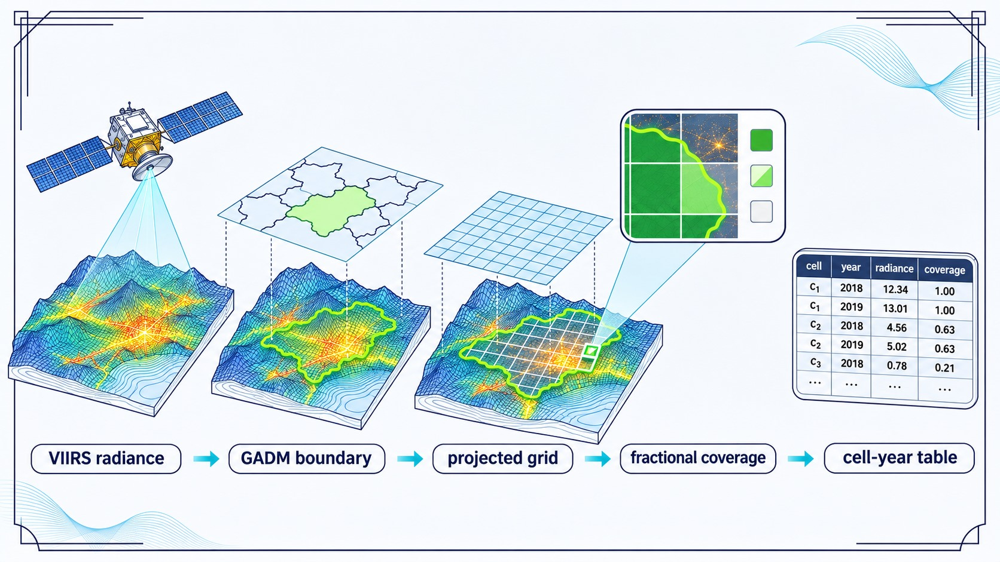
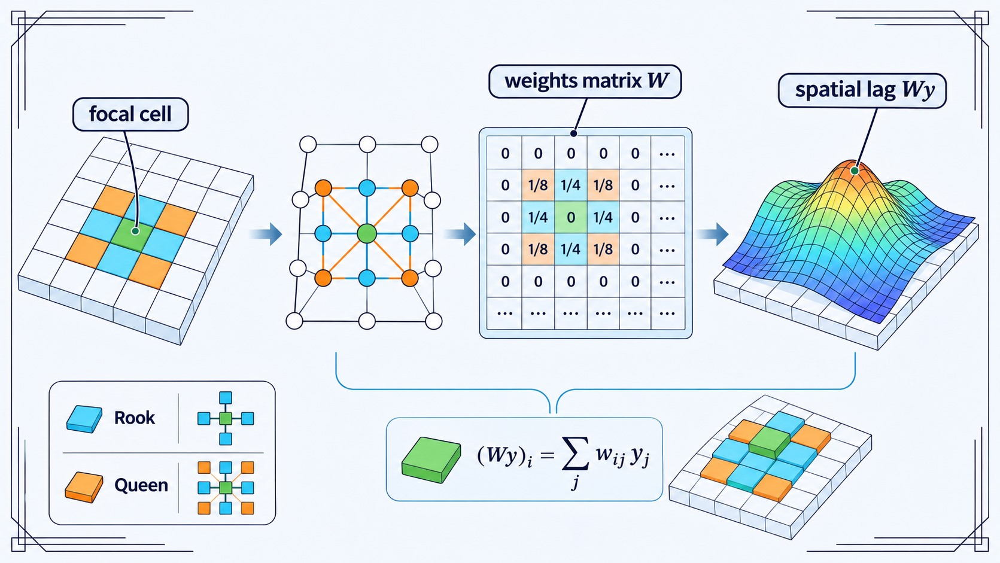
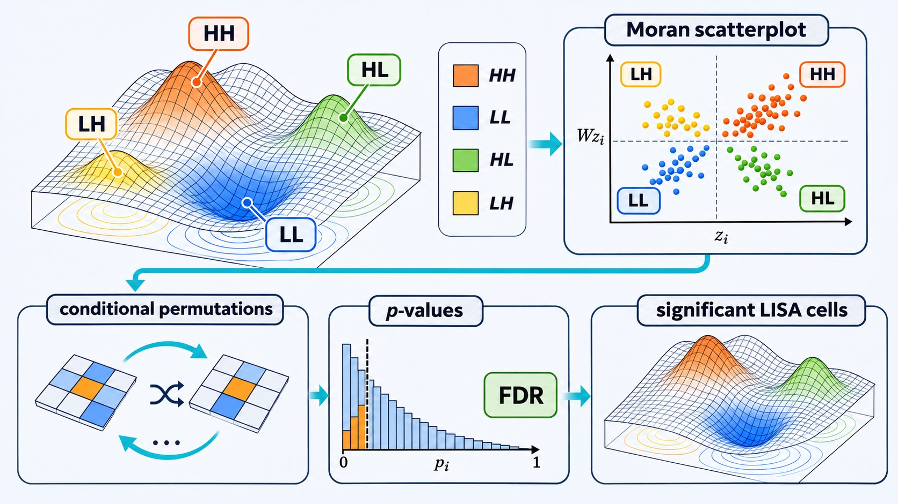
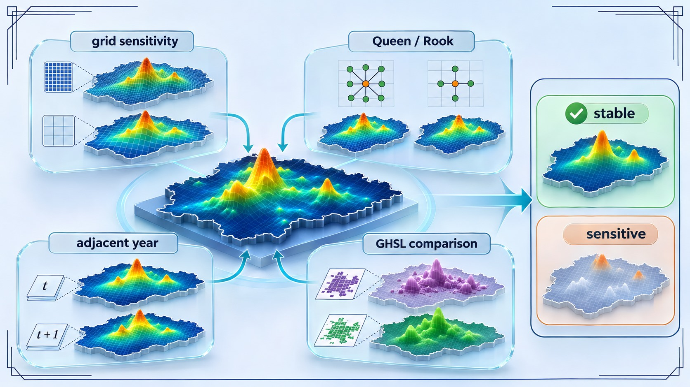

<a id="top"></a>

[Data and GADM guide](docs/README.md) · [Validation status and evidence](validation/README.md)

<div align="center">

# Technical manual and methodological framework

**Nighttime lights (NTL) data extractor & spatial econometrics engine**

[English](README.md) &nbsp;|&nbsp; [Tiếng Việt](README-vi.md) &nbsp;|&nbsp; [Live demo](https://spatial-app.streamlit.app/?)

</div>

---

> [!TIP]
> **TL;DR: got 30 seconds?**
>
> No time for a 10-page academic manual? Here is what this engine does, in plain words.
>
> - **The problem.** Satellite nighttime lights (NTL) are a standard stand-in for GDP in economics. **But** the data is huge. Processing it usually crashes an ordinary computer (RAM runs out), and doing it by hand takes weeks.
> - **What the app does.** You pick a region $\rightarrow$ the app fetches the data from *Google Earth Engine* $\rightarrow$ a C/C++ backend crushes millions of pixels into grid cells $\rightarrow$ **resource guards limit the workload; reliable operation within 1GB still requires a full deployment benchmark.**
> - **What you get.** One click gives you a CSV of ready-to-use economic indicators: where is the true urban core? where are the economic hotspots (LISA)? how unequal is the distribution (Gini)? Download it and drop it straight into your regression models.


This project is a system for **spatial econometrics**. It combines a spatial grid infrastructure with a nighttime lights (NTL) extraction pipeline.

The app covers three stages: it turns irregular administrative boundaries into uniform square grids; it connects directly to Google Earth Engine (GEE) to pull raster data (SNPP-VIIRS); and it automatically computes micro-level spatial statistics (LISA) and exports panel datasets for macroeconomic models.

### Where should you start?

| If you are... | Read |
| :--- | :--- |
| A policymaker or a non-technical reader | [Section 0](#s0), especially the questions the app can answer and the interpretation guardrails |
| An economist who needs variables for regressions | [Section 0](#s0), [Section V](#s5), then [Section III](#s3) to see where the indicators come from |
| A researcher checking the methodology | [Section 0](#s0), [Section II](#s2) and [Section III](#s3) |
| Deploying or operating the system | [Quick start](#quick-start), [Section I](#s1), [Section IV](#s4) and [Section VI](#s6) |

<details>
<summary><b>Quick glossary (click to expand)</b></summary>

<br>

| Term | In plain words |
| :--- | :--- |
| **NTL** (Nighttime Lights) | Light observed from satellites at night. Here, the mean radiance of a grid cell. |
| **VIIRS** | The satellite sensor/dataset that supplies the nighttime imagery used by the system. |
| **GEE** | Google Earth Engine, where the satellite imagery is fetched from. |
| **Vector / Raster** | Vector data are boundary polygons (provinces, districts...). Raster data are images made of pixels. |
| **SOL** (Sum of Lights) | Total light of a cell = mean radiance × cell area. |
| **LISA** | An indicator that tells whether *each grid cell* clusters with its surroundings (a bright cluster, a dim cluster, or an odd one out). |
| **HH / LL / HL / LH** | The four LISA labels: High-High, Low-Low, High-Low, Low-High (see [Section 3.1](#s3)). |
| **MAUP** | Sensitivity of a result to the scale and zoning of spatial units; a regular grid standardizes measurement support but does not remove this problem. |
| **FDR** | A way to keep the number of false discoveries in check when thousands of cells are tested at once. |
| **CBD** | Central Business District, the economic core of a region. |
| **Gini** | A measure of concentration/inequality. Near 0 means evenly spread; near 1 means concentrated in very few cells. |
| **UTM** | A flat coordinate system measured in meters, convenient for areas and distances. |
| **OOM** | Out-Of-Memory: RAM runs out and the operating system forcibly kills the process. |

</details>

---

<a id="s0"></a>

## 0. Spatial econometrics and what this app actually does

### 0.1. What is spatial econometrics?

Ordinary econometrics often starts from the idea that, after conditioning on the explanatory variables, one observation is independent of another. Geographic data rarely fit that assumption. A bright commercial center can affect nearby land, a transport investment can cross an administrative border, and neighboring districts can share infrastructure, labor markets and unobserved shocks.

**Spatial econometrics** extends econometrics so that location and connections between locations enter the analysis explicitly (Anselin, 1988; LeSage & Pace, 2009). It focuses on two recurring features:

1. **Spatial dependence:** the value or disturbance at location $i$ is related to values or disturbances at nearby locations.
2. **Spatial heterogeneity:** relationships, variances or regimes can differ from one place to another.

The central object is a spatial weights matrix $W$. Each element $w_{ij}$ represents whether, or how strongly, location $j$ is connected to location $i$. The spatial lag

$$
(Wy)_i = \sum_j w_{ij}y_j
$$

is therefore a summary of the values around location $i$. On a regular grid, this project mainly uses Queen contiguity, where cells sharing an edge or a corner are neighbors. Robustness checks also use Rook contiguity, where only shared edges count (Anselin, 1988; Rey et al., 2023).

Spatial dependence matters because it changes both the substantive question and the statistical inference. A conventional regression may answer how $X_i$ is associated with $y_i$. A spatial model may additionally ask whether $y_j$ in neighboring places affects $y_i$, whether a shock propagates across space, and whether the remaining errors still cluster geographically (LeSage & Pace, 2009; Elhorst, 2014).

> [!IMPORTANT]
> This application is primarily a **measurement, exploratory spatial data analysis and data-preparation system**. It computes NTL indicators, Global Moran's I, Local Moran's I, diagnostics, robustness summaries and panel-ready exports. It does **not** estimate a complete SAR, SEM or SDM causal model inside the interface. Those models require an outcome, covariates and an identification strategy supplied by the researcher.

### 0.2. From spatial exploration to spatial regression

Spatial statistics and spatial econometrics overlap, but they do not answer the same question. Exploratory spatial data analysis asks **what pattern is present and where**. Spatial econometrics adds an explicit outcome model and asks **which dependence mechanism is consistent with the research design, how parameters should be estimated, and how uncertainty and spillovers should be interpreted** (Anselin, 1988; Rey et al., 2023).

| Stage | Typical question | Tool or model | Relation to this app |
| :--- | :--- | :--- | :--- |
| **Description** | How bright, unequal or concentrated is the locality? | Maps, quantiles, Gini, Lorenz and radial profiles | Computed directly |
| **Global ESDA** | Is there overall spatial autocorrelation? | Global Moran's I | Computed directly |
| **Local ESDA** | Where are clusters and spatial outliers? | Local Moran's I / LISA | Computed directly |
| **Model diagnosis** | Does spatial structure remain after accounting for covariates? | Moran test on fitted residuals and specification tests | Diagnostic inputs are exported; the substantive regression is external |
| **Spatial regression** | Is dependence in the outcome, covariates, disturbances or several channels? | SLX, SAR, SEM, SDM and related models | Not estimated in the interface |
| **Causal design** | What is the effect of an intervention, including interference across locations? | A design-specific estimator with exposure and spillover assumptions | The app supplies measurements, distances, rings and sensitivity evidence, not identification by itself |

The common linear model families are useful as a map of the field:

| Model | Compact form | Main idea |
| :--- | :--- | :--- |
| **OLS baseline** | $y = X\beta + \varepsilon$ | No explicit spatial channel after conditioning on $X$ |
| **SLX** | $y = X\beta + WX\theta + \varepsilon$ | Neighboring covariates may affect the local outcome |
| **SAR / spatial lag** | $y = \rho Wy + X\beta + \varepsilon$ | Outcomes interact simultaneously across connected locations |
| **SEM / spatial error** | $y = X\beta + u$, $u = \lambda Wu + \varepsilon$ | Unobserved shocks are spatially correlated |
| **SDM / Spatial Durbin** | $y = \rho Wy + X\beta + WX\theta + \varepsilon$ | Combines outcome interaction with neighboring covariate effects |

These equations are not interchangeable labels. In a SAR or SDM model, coefficients are not usually the final marginal effects because feedback through $(I-\rho W)^{-1}$ creates direct and indirect impacts. A significant Moran statistic alone does not select a model. Model choice should follow the substantive mechanism, the construction of $W$, residual diagnostics and the identification assumptions (LeSage & Pace, 2009).

### 0.3. From a research question to an app output

| Research question | App output | Why it helps | What it does not prove |
| :--- | :--- | :--- | :--- |
| Where is nighttime light concentrated? | NTL map, SOL, Lorenz curve, Gini, brightest 10% share and rank-size plot | Describes the level and concentration of observed radiance (Henderson et al., 2012; Donaldson & Storeygard, 2016) | Household income, GDP or welfare without an external model |
| Is brightness spatially clustered across the whole locality? | Global Moran's I with a permutation pseudo p-value | Tests whether nearby grid cells are more similar than expected under the permutation reference (Moran, 1950) | The cause of clustering or spatial dependence in regression residuals |
| Which cells form local clusters or spatial outliers? | LISA classes `HH`, `LL`, `HL`, `LH`, `NS`, `DARK` and `EDGE` | Locates local clusters and contrasting cells after significance testing (Anselin, 1995; Caldas de Castro & Singer, 2006) | A causal treatment effect or an official urban boundary |
| Is the result sensitive to analytical choices? | Rook/Queen, threshold, transform, FDR, seed, coarser-grid and adjacent-year checks | Shows whether the High-High pattern survives reasonable alternatives | Universal stability outside the tested specifications |
| How does relative spatial position change between two years? | Space-Time regimes, extensive/intensive margins and conditional Markov matrices | Separates own-cell change from change in the surrounding spatial lag | Absolute economic growth or a multi-period causal panel result |
| Does NTL agree with a separate urban proxy? | GHSL built-up or population Spearman correlation, block-bootstrap interval and AUC | Provides an external agreement check on the same grid (Pesaresi & Politis, 2023; Schiavina et al., 2023) | Validation against GDP, prices or household outcomes |
| What can be taken into another econometric workflow? | Cell CSV, LISA cell CSV, one-row region-year panel CSV, Space-Time CSV and optional GeoJSON | Preserves identifiers, quality fields, methods and derived variables | A ready-made empirical specification that can replace research design |

### 0.4. Complete app tour

The interface follows the same order as a defensible research workflow. Features that take substantial time, such as robustness runs, GHSL validation and the second-year extraction, run only when requested.

| Screen or control | Main functions | Outputs to inspect |
| :--- | :--- | :--- |
| **Place and resolution selector** | Search or browse country, first-level unit and locality; choose a year from 2014 to 2025 and a grid size from 500 to 5,000 m; estimate workload before execution | Boundary area, expected cell count, dynamic UTM CRS and a warning or block for oversized jobs |
| **Extraction pipeline** | Build a globally aligned square grid, create the annual median VIIRS composite, extract area-weighted cell means and record stage performance | Grid geometry, `ntl_mean`, `area_km2`, cell centroid and pipeline provenance |
| **Map tab** | Switch between continuous NTL, global economic classes and within-locality standing; select linear, square-root or logarithmic color scaling; toggle unlit cells, Top 10 outlines, cell borders and the outside mask | Interactive cell tooltips with rank, percentile, SOL share, standardized score, class and coordinates |
| **Data tab: overview** | Report weighted and unweighted summaries, percentiles, dispersion, skewness, Gini, lit share and the brightest cells | Quick findings, descriptive table, Top 10 table and the complete preview table |
| **Data tab: spatial structure** | Compute Global Moran's I with Queen neighbors and permutation inference | Observed $I$, expected $I$, pseudo p-value and average neighbor count |
| **Data tab: distribution** | Compare cell share with light share; draw Lorenz, rank-size and radial distance profiles | Gini, Pareto-tail view and evidence of monocentric or polycentric light patterns |
| **Data quality panel** | Flag missing, negative, zero and low-observation support; optionally compare clipped and unclipped negatives and retrieve valid-month support | `dq_*` fields, automatic warnings and the assumptions used by the NTL composite |
| **External validation panel** | Compare NTL with GHSL built-up surface or population on the preserved native GHSL grid | Spearman $\rho$, spatial block-bootstrap interval, AUC and the GHSL epoch used |
| **LISA and Panel tab** | Set permutations, $\alpha$, FDR, log transform, light threshold, minimum cluster size and minimum neighbors; classify local clusters and derive the urban core | LISA map, area composition, region-year KPIs, cell and panel exports |
| **LISA map modes** | View local clusters, spillover rings or recentered market access; inspect distance to the core and signed distance to the hotspot boundary | Inputs for density-gradient, market-access and spatial-boundary research designs |
| **Diagnostics and robustness** | Check dark share, residual spatial pattern, Pareto tail, seed stability, transform/weight/threshold alternatives, MAUP and adjacent years | Warnings, Jaccard overlap, stable-HH area and downloadable robustness table |
| **Dynamic Space-Time panel** | Re-extract a comparison year, calculate changes in standardized own-cell and neighbor positions, and build spatially conditioned transition matrices | Four relative-change regimes, Shorrocks mobility, extensive/intensive margins and a Space-Time CSV |
| **Performance panel** | Record elapsed time and process memory for extraction, zonal statistics, LISA, GHSL and Space-Time stages when available | Stage-level timing, sampled peak RSS, deployment revision when known and downloadable JSON/CSV |
| **Guide and downloads** | Explain map layers, thresholds, MAUP and fields; export regression-ready CSV or optional GeoJSON | Reusable data plus a data dictionary and method metadata |

### 0.5. A recommended analysis sequence

1. **State the unit and question.** Decide whether the observation is a grid cell or a region-year and whether the task is description, prediction, association or causal inference.
2. **Choose the boundary and year.** Record the GADM identifier and source year rather than relying on the displayed place name alone.
3. **Choose spatial support.** Select an initial grid from the spatial scale of the process, source resolution and computational budget, then repeat the analysis at defensible finer or coarser resolutions. No single cell size is generally optimal.
4. **Inspect measurement support.** Read the `dq_*` fields and the quality panel before interpreting a zero as absence of activity.
5. **Explore levels and concentration.** Use the map, histogram, Lorenz curve, Gini and radial profile before running local tests.
6. **Test global structure.** Global Moran's I answers whether clustering exists at the locality level, not where it occurs.
7. **Locate local patterns.** Run LISA with a declared neighbor rule, permutation count, significance level and FDR choice.
8. **Challenge the result.** Change weights, transforms, thresholds, grid size, random seed and year where substantively justified.
9. **Seek external agreement.** GHSL checks whether rankings agree with built surface or population, while domain-specific outcomes remain the researcher's responsibility.
10. **Export with provenance.** Keep raw NTL, quality flags, parameter fields and identifiers. Do not keep only the final cluster label.

### 0.6. How to interpret results without overclaiming

A result is strongest when four questions have separate answers:

| Layer | Question | Example |
| :--- | :--- | :--- |
| **Measurement** | Was the signal observed and processed as intended? | Valid-month support is adequate and missing cells are flagged |
| **Statistical evidence** | Is the pattern unlikely under the stated reference procedure? | Local pseudo p-values are corrected with BH-FDR |
| **Robustness** | Does the conclusion survive plausible analytical alternatives? | High-High cells overlap under Queen/Rook and coarser grids |
| **External meaning** | Does the measure agree with another relevant construct? | NTL ranks agree with GHSL built-up surface, with uncertainty reported |

Statistical significance is not economic magnitude. A High-High cell is not automatically a central business district, a low-light cell is not automatically poor, and a strong GHSL correlation is not proof that NTL measures GDP. Causal language requires a design that explains treatment assignment, spillovers, confounding and the estimand.

<a id="quick-start"></a>

### 0.7. Quick start

The fastest route is the [live app](https://spatial-app.streamlit.app/?). For a local run:

```bash
python -m venv .venv
python -m pip install -r requirements.txt
streamlit run app.py
```

The extraction buttons require valid Google Earth Engine credentials. The app accepts service-account fields under `ee_credentials` in Streamlit secrets, or credentials already available to `ee.Initialize()` in the local environment. Do not commit private keys. Boundary files are discovered from the repository's `data/` hierarchy.

### 0.8. Suggested learning path

| Level | Read or use | Best for |
| :--- | :--- | :--- |
| **Start visually** | [GeoDa: An Introduction to Spatial Data Science](https://geodacenter.github.io/) and its [learning resources](https://geodacenter.github.io/documentation/) | Weights, Moran scatterplots, local clusters and exploratory spatial reasoning without starting from matrix algebra |
| **Start with Python** | [Geographic Data Science with Python](https://geographicdata.science/book/) by Rey, Arribas-Bel and Wolf | Reproducible geospatial data handling, visualization, weights, ESDA and spatial modeling |
| **Applied work in R** | Bivand, Pebesma and Gómez-Rubio, [*Applied Spatial Data Analysis with R*, 2nd ed.](https://link.springer.com/book/10.1007/978-1-4614-7618-4) | Spatial objects, import/export, visualization and applied areal-data analysis |
| **Foundations** | Anselin, [*Spatial Econometrics: Methods and Models*](https://link.springer.com/book/10.1007/978-94-015-7799-1) | The conceptual foundations of spatial dependence, heterogeneity, specification and inference |
| **Spatial regression and impacts** | LeSage and Pace, [*Introduction to Spatial Econometrics*](https://www.routledge.com/Introduction-to-Spatial-Econometrics/LeSage-Pace/p/book/9781032477749) | SAR/SEM/SDM-type models, estimation and interpretation of direct and indirect effects |
| **Spatial panels** | Elhorst, [*Spatial Econometrics: From Cross-Sectional Data to Spatial Panels*](https://link.springer.com/book/10.1007/978-3-642-40340-8) | Static and dynamic spatial panel specifications after the cross-sectional foundations are clear |

A practical order is: map and weights, Global Moran, Local Moran and multiple testing, regression diagnostics, spatial lag/error/Durbin models, impacts, then spatial panels. Reading advanced panel models before understanding $W$, spatial lags and the difference between exploratory clusters and regression effects usually creates more confusion than progress.

### 0.9. Scientific links between advanced app modules and research design

The advanced modules are most useful when each output is treated as an answer to a specific scientific question, not as an all-purpose index.

#### A. NTL as a measured proxy, not a latent economic truth



<p align="center"><em>Figure 1. The measurement chain moves from VIIRS radiance, administrative boundaries and a projected grid to fractional coverage and a cell-year table.</em></p>

Let $a_i$ denote an unobserved economic construct and $y_i$ the observed radiance. A useful mental model is $y_i = g(a_i, z_i) + u_i$, where $z_i$ contains lighting technology, land use, atmospheric conditions and other factors, while $u_i$ contains remaining measurement error. The app improves the construction and documentation of $y_i$; it does not identify $g(\cdot)$ or recover $a_i$ without external assumptions and outcomes (Henderson et al., 2012; Donaldson & Storeygard, 2016; Gibson et al., 2021).

This is why the Data Quality panel keeps observation support, missingness, measured zeros and clipped negatives separate. A recorded zero, an unobserved pixel and a negative corrected radiance mapped to zero can have the same displayed NTL but different evidential meanings. Researchers should retain the `dq_*` fields and state the zero/negative policy in the methods section.

**From a satellite image to one number in a table.** VIIRS observes radiance directed toward the sensor, not GDP, income or welfare themselves. Monthly images must first be combined into an annual representation, then clipped by the GADM boundary and transferred to the analysis grid. If analysis cell $i$ intersects several source pixels $p$, an area-weighted mean can be understood as

$$
\bar r_i = \frac{\sum_p a_{ip}r_p}{\sum_p a_{ip}},
$$

where $r_p$ is source-pixel radiance and $a_{ip}$ is the area shared by pixel $p$ and cell $i$. This expression explains why a boundary cell should not be treated like a fully covered interior cell: only the area actually inside the study region should contribute. Fractional coverage prevents a source pixel that barely touches a cell from being counted as if it covered the whole cell (Baston, 2023).

**Three layers of uncertainty are worth remembering.** First is sensor and image-processing uncertainty, including clouds, moonlight, temporary light and valid-month support. Second is spatial representation uncertainty from the boundary, projection, grid size and border-cell rule. Third is conceptual uncertainty: even perfectly measured radiance remains a proxy for only part of human activity (Elvidge et al., 2017, 2021; Gibson et al., 2021). Better geometric precision does not automatically close the gap between light and the economic construct of interest.

**How to read this in the app.** Before inspecting clusters or running LISA, check the year, boundary, CRS, grid size, dark-cell share, valid-month support and `dq_*` flags. If a measurement choice materially changes the map, that issue should be resolved or reported before statistical interpretation begins.

> **Memory aid:** NTL in the app is the product of a measurement chain. A cell is not "the economy of the cell"; it is observed radiance that has been aggregated and attached to a particular spatial support.

#### B. The weights matrix is a scientific assumption



<p align="center"><em>Figure 2. A neighbor rule turns the grid into a graph, the graph into <var>W</var>, and <var>W</var> into the spatial lag <var>Wy</var>.</em></p>

$W$ is not merely a software setting. Queen contiguity asks whether immediate edge or corner contact carries relevant interaction; Rook excludes corner-only contact; a distance or network matrix would encode a different mechanism. Row standardization changes a spatial lag from a neighbor sum into a neighbor average, while a binary symmetric matrix preserves a different scale (Anselin, 1988; LeSage & Pace, 2009).

The app exposes Queen/Rook sensitivity and grid-scale sensitivity because conclusions that disappear after a defensible change in $W$ should be presented as specification-dependent. For published work, report the neighbor rule, normalization, treatment of islands, tested cells, average neighbor count and why that $W$ represents the proposed interaction mechanism.

**Graph intuition.** Treat every cell as a node and every neighbor relation as an edge. Row $i$ of $W$ then lists the nodes that cell $i$ is allowed to "see." Under row standardization, $\sum_j w_{ij}=1$ for a cell with neighbors, so

$$
(Wy)_i = \sum_j w_{ij}y_j
$$

is a weighted neighborhood average. If $y_i$ is high and $(Wy)_i$ is also high, the cell sits in a relatively bright environment. If $y_i$ is high but $(Wy)_i$ is low, it resembles a bright spatial outlier. These are relations defined by $W$, not physical distance by itself.

**Why Queen and Rook can disagree.** On a square grid, Rook commonly provides up to four orthogonal neighbors, while Queen can provide eight by including corner contact. Queen smooths over a broader immediate neighborhood and can connect components through corners. Rook imposes a stricter geometric contact rule. Neither is universally correct. The scientific question is which contact pattern plausibly represents transport, labor-market, light-spill, or administrative interaction.

**Borders and islands.** Border cells generally have fewer neighbors. After row standardization, each remaining neighbor therefore receives more weight. A cell with no neighbors has no spatial lag defined in the same way. The app records neighbor counts and eligibility so that a graph-structure problem is not silently converted into a confident statistical label.

> **Memory aid:** $W$ is a small model embedded inside every spatial statistic. Changing $W$ changes what the word "surrounding" means.

#### C. Local inference requires a testing protocol



<p align="center"><em>Figure 3. Exploratory patterns are evaluated with conditional permutations and multiple-testing correction before a cell receives a significant LISA label.</em></p>

LISA runs one local test for each eligible cell. The pseudo p-value depends on the conditional permutation procedure, random seed and number of permutations. Its finest attainable resolution is bounded by the permutation count. Testing thousands of cells also creates a multiple-testing problem, so the app provides Benjamini-Hochberg FDR control and reports when the requested permutation/FDR combination cannot reject any cell (Anselin, 1995; Benjamini & Hochberg, 1995; Caldas de Castro & Singer, 2006).

A defensible LISA result therefore reports the transformation, light threshold, edge mask, minimum neighbors, permutations, seed, $\alpha$, FDR choice and minimum connected-cluster size. The `HH`, `LL`, `HL` and `LH` labels should always be read together with significance and eligibility flags.

**From global to local.** Global Moran's $I$ summarizes the cross-product between standardized values $z_i$ and their lag $\sum_j w_{ij}z_j$ over the full region:

$$
I = \frac{n}{S_0}\frac{\sum_i\sum_j w_{ij}z_i z_j}{\sum_i z_i^2},
\qquad S_0=\sum_i\sum_j w_{ij}.
$$

A positive $I$ commonly indicates that similar values lie near one another under $W$, while a negative $I$ indicates contrast. The observed statistic is meaningful only relative to an appropriate reference distribution (Moran, 1950). Global Moran tells us that the region has structure, not which cells produce it.

Local Moran decomposes this intuition by cell and is commonly proportional to $I_i=z_i\sum_j w_{ij}z_j$. The signs of $z_i$ and its lag divide the Moran scatterplot into four quadrants. `HH` and `LL` cells resemble their surroundings; `HL` and `LH` cells are spatial contrasts. A quadrant label describes position in the scatterplot. It is not yet a statement of statistical significance.

**What permutation answers.** The app holds the focal value fixed and rearranges suitable neighbor values to form a reference distribution. With $R$ permutations, a pseudo p-value commonly follows the plus-one rule

$$
p_i = \frac{1 + \sum_{r=1}^{R} \mathbb{I}\left(|I_i^{(r)}| \ge |I_i^{obs}|\right)}{R+1}
$$

The number of permutations therefore determines p-value resolution. If an FDR-adjusted threshold falls below the smallest attainable p-value, no cell can be rejected even when a map looks visually striking.

**FDR is not a decorative filter.** When thousands of cells are tested, some small p-values arise by chance. Benjamini-Hochberg controls the expected false-discovery proportion among discoveries under its stated conditions and interpretation (Benjamini & Hochberg, 1995; Caldas de Castro & Singer, 2006). Results should distinguish at least three states: ineligible for testing, tested but nonsignificant, and significant under the chosen correction rule.

> **Memory aid:** an `HH` or `LL` color answers "which quadrant describes the pattern"; the p-value and FDR answer "does the evidence exceed the stated reference procedure." Neither answers "why did the pattern arise."

#### D. Robustness challenges a conclusion rather than repeating one calculation



<p align="center"><em>Figure 4. A conclusion is challenged across grid scale, neighbor relation, adjacent year and GHSL comparison; persistent features are separated from sensitive ones.</em></p>

A reproducible result is not necessarily robust. Reproducibility means that the same data, code and parameters reproduce the same result. Robustness asks a harder question: does the conclusion remain when defensible analytical choices change? Write the output conceptually as $R(s)$, where $s$ is a specification containing grid size, $W$, transformation, threshold, seed, FDR rule and year. Robustness studies how $R(s)$ varies across a scientifically defensible specification set, not across every arbitrary combination.

The app challenges four main risk classes:

1. **Spatial-support risk:** change grid size or alignment to see whether MAUP moves the detected pattern (Openshaw, 1984; Fotheringham & Wong, 1991).
2. **Relationship risk:** compare Queen and Rook to see whether corner contact drives the result.
3. **Temporal risk:** compare an adjacent year to separate a persistent feature from a one-year realization.
4. **Construct risk:** compare NTL with GHSL built surface or population to test agreement with another urban construct, not with universal ground truth.

For two `HH` cell sets $A$ and $B$, Jaccard overlap

$$
J(A,B)=\frac{|A\cap B|}{|A\cup B|}
$$

summarizes agreement from 0 to 1. One Jaccard number is not the whole result. Inspect stable area, where removed or added cells occur, how the global statistic changes, and whether disagreement is concentrated around cluster borders or in the core.

**How to interpret it.** "Stable" means the main conclusion persisted across the alternatives actually tested, within the selected place, period and proxy. "Sensitive" does not mean wrong. It means that the conclusion must be conditioned on the specification or supported with more data. If only one configuration yields a striking result, that configuration needs a stronger scientific rationale, not stronger wording.

> **Memory aid:** significance asks whether a result is unusual under a reference procedure. Robustness asks whether it depends too heavily on the analyst's defensible choices. These are different questions.

#### E. Turning clusters into research variables

The app derives several variables from the descriptive light surface:

- **Pareto tail diagnostics** summarize concentration among the brightest cells and should be accompanied by the selected tail fraction, standard error and KS diagnostic (Bluhm & Krause, 2022).
- **Urban density gradients** describe how radiance changes with distance from a detected core. The core is algorithmic, not an official CBD or a causal treatment boundary.
- **Recentered market access** removes the component predicted by centrality so that access is not mechanically treated as random exposure (Borusyak & Hull, 2023).
- **Signed hotspot-boundary distance and spillover rings** prepare running variables and exposure groups for spatial-boundary or interference designs. Identification still requires continuity, no precise sorting and a defensible spillover model (Vazquez-Bare, 2023; Butts, 2024).

These exports are candidate regressors, outcomes, exposure measures or diagnostics. Their correct role depends on the estimand and the timing of the empirical design.

#### F. Two-period dynamics are relative, not absolute growth

The Space-Time module standardizes $ln(1+\mathrm{NTL})$ separately within each year and compares changes in own-cell position with changes in the neighboring spatial lag. Its four directional regimes therefore describe **relative movement within each year's distribution**. They are not equivalent to absolute radiance growth, GDP growth or a causal transition (Rey et al., 2023).

The module separately reports entry from dark to lit, exit from lit to dark and mean log change among cells lit in both periods. This extensive/intensive split should be read alongside the relative regimes. With only two periods, transition tables remain descriptive; multi-period spatial-panel inference requires additional assumptions and diagnostics (Elhorst, 2014; Müller & Watson, 2024).

#### G. External validation measures agreement with a chosen construct

GHSL built-up surface records square metres of built surface per 100 m source cell, while GHS-POP records inhabitants per source cell at five-year epochs. The app preserves the native source grid, aggregates amounts to analysis cells and compares their rankings with NTL using Spearman $\rho$, a spatial block-bootstrap interval and top-quartile AUC (Pesaresi & Politis, 2023; Schiavina et al., 2023).

High agreement supports the statement that NTL is aligned with that particular settlement construct in the selected place and period. It does not validate NTL against every economic outcome. Low agreement may reflect genuine economic structure, temporal mismatch, many tied zeros, proxy error or extraction problems; the reason must be investigated before the proxy is rejected.

#### H. Minimum reporting set for a reproducible application

| Component | Report at minimum |
| :--- | :--- |
| Study support | GADM identifier, year, grid size, CRS, cell count and border-cell rule |
| NTL construction | Dataset, monthly-to-annual aggregation, cloud/observation support, negative and missing-value policy |
| Spatial relation | $W$ rule, normalization, islands, average neighbors and scientific rationale |
| Global inference | Moran's $I$, expected value, permutations, pseudo p-value and analyzed sample |
| Local inference | Transformation, threshold, edge mask, permutations, seed, $\alpha$, FDR and minimum cluster size |
| Robustness | Alternative weights, transformations, thresholds, grid sizes, years and overlap measure |
| External validation | GHSL variable and epoch, usable cells, $\rho$, block-bootstrap interval, AUC and tied-zero share |
| Dynamics | Both years, standardization rule, extensive/intensive statistics and the descriptive nature of regimes |
| Reproducibility | Source revision, exported parameter/provenance fields and the exact cell/panel file used |

### 0.10. Scientific specification sheet

The table below records the **current operational defaults implemented in the source code**. It is not a claim that one parameter set is optimal for every study. Defaults provide a reproducible starting point; the researcher must still explain why the grid, neighbor relation, threshold and inferential procedure fit the substantive question. This matters especially for spatial data because changing the analytical unit or weights matrix can change a result even when the source observations remain fixed (Openshaw, 1984; Fotheringham & Wong, 1991; Anselin, 1988).

| Component | Current specification | Scientific meaning and reporting requirement |
| :--- | :--- | :--- |
| **Observation unit** | One grid cell within one place and year; the panel key is `iso3`, `region_id`, `year`, `cell_size_m` | A cell is measurement support, not automatically a neighborhood, market or behavioral unit. Changing cell size changes the empirical question. |
| **Time** | Years 2014–2025; an annual image is the median of monthly images with `cf_cvg > 0` | The median limits the influence of extreme monthly observations, but does not turn monthly imagery into an error-free annual economic measure. Record the year, valid-month support and VIIRS source version (Elvidge et al., 2017, 2021). |
| **Measured quantity** | `avg_rad` in nW/cm²/sr; `ntl_mean` is the fractional-coverage mean and `ntl_sol = ntl_mean × area_km2` | `ntl_mean` represents average intensity; `ntl_sol` combines intensity with area. They answer different questions and should not be substituted without explanation (Henderson et al., 2012; Gibson et al., 2021). |
| **Geometry** | Dynamic UTM grid, 500–5,000 m cell side, 500 m default; cells below 99% of full-cell area are flagged as borders | UTM supports metre-based distance and area. The 99% rule defines the core sample but does not remove MAUP; test at least one alternative grid size when cluster location matters. |
| **Raster extraction** | Mean weighted by the intersected area between source pixels and analysis cells | Fractional coverage prevents a pixel that barely touches a cell from receiving full-cell weight. Report the extraction rule and NoData policy with the result (Baston, 2023). |
| **Spatial relation** | Queen by default; Rook for sensitivity analysis; row-standardized LISA weights | Queen and Rook encode different definitions of “nearby.” Report the rule, normalization, average neighbors and island handling (Anselin, 1988; LeSage & Pace, 2009). |
| **Global Moran** | 199 permutations in the overview interface | This is a region-wide test of global spatial structure. Its pseudo p-value has finite resolution and does not locate the cells producing the pattern (Moran, 1950). |
| **Local Moran / LISA** | Defaults: 499 permutations, seed 42, $\alpha=0.05$, BH-FDR on, raw scale, light threshold 0, at least 1 neighbor and a 4-cell minimum cluster | If 499 permutations and the number of tests make rejection under BH-FDR impossible, the interface raises the count to 999. Report quadrant membership separately from statistical significance (Anselin, 1995; Benjamini & Hochberg, 1995; Caldas de Castro & Singer, 2006). |
| **Missing and negative values** | Missing or negative zonal results enter the operational surface as 0; quality flags retain the origin of the conversion | A measured zero, no observation and a negative corrected radiance are not equivalent evidence. Preserve the `dq_*` fields so that data treatment does not become a hidden assumption (Gibson et al., 2021). |
| **Computational limits** | At most 150,000 analysis cells; at most 30,000 cells rendered on the map | These are operational limits, not statistical standards. If a coarser grid is required to complete a run, report the change in spatial support. |
| **Outputs** | Cell CSV, LISA CSV, region-year CSV, Space-Time CSV and optional GeoJSON | Exports retain measurements, eligibility flags, parameters and inferential labels. Do not preserve only a map or the final classification column. |

> [!IMPORTANT]
> **For a first-time reader:** “default” only means that the app begins with this setting. It does not mean that 500 m, Queen or $\alpha=0.05$ is always correct. A defensible specification links each technical choice to the proposed mechanism, then shows how the conclusion changes under other reasonable choices.

### 0.11. A worked reading of one result across five evidence layers

Suppose the map shows a `High-High` cluster near the center of a place. The sequence below illustrates **how to reason about a result**; it is not an empirical finding for any particular location.

1. **Measurement layer:** confirm that the cluster has adequate monthly support, is not concentrated in border cells, and is not created only by clipping negative values or replacing NoData with 0. If measurement support fails, economic interpretation should stop here.
2. **Descriptive layer:** report the cluster's radiance, area, SOL share and location. The warranted statement is “observed radiance is concentrated here,” not “this is the richest area.” NTL is informative as a proxy, but its relationship with economic activity varies by place and target construct (Henderson et al., 2012; Donaldson & Storeygard, 2016; Gibson et al., 2021).
3. **Inferential layer:** read the `HH` label together with its pseudo p-value, BH-FDR rule, permutation count and tested-cell count. LISA was designed to identify local pockets of association and spatial outliers; it does not supply a causal mechanism (Anselin, 1995).
4. **Robustness layer:** compare Queen with Rook and vary grid size, year, seed, transformation and threshold. If the core persists while the border moves, describe a stable core and a sensitive boundary instead of calling the entire object “robust.”
5. **External-validity layer:** compare with GHSL built surface or population and report uncertainty. Agreement supports interpretation relative to that settlement construct; it does not make GHSL ground truth or NTL equivalent to GDP (Pesaresi & Politis, 2023; Schiavina et al., 2023).

A bounded academic conclusion could therefore read: *“Under the reported specification, the central area contains a High-High radiance cluster that remains significant after multiple-testing correction. Its core persists under Queen/Rook and alternative-grid checks, while NTL ranks agree with GHSL built surface. The result supports an interpretation of spatial concentration in observed light-emitting activity, but does not by itself identify GDP, welfare or a causal effect.”*

> [!NOTE]
> **A simple stopping rule:** if the evidence reaches only the descriptive layer, stop with descriptive language. Use “significant” only after reporting the inferential procedure; use “robust” only after listing the alternatives tested; and use causal language only when the research design identifies an effect.

<sub>[↑ Back to top](#top)</sub>

---

<a id="s1"></a>

## I. System architecture overview and resource management

The system is more than a remote sensing data extractor. It is a web-based spatial processing engine that links geographic preprocessing (GIS) workflows directly to spatial econometric models.

### 1.1. Four-tier architecture

The job mixes three very different kinds of data: **vector** (administrative boundaries), **raster** (VIIRS satellite imagery) and **spatial inferential statistics**. To keep this manageable, the workflow is split into 4 independent tiers:

| Tier | What it does | Key techniques / tools |
| :--- | :--- | :--- |
| **Tier 1**<br>Data discovery | Recursively scans the local GADM directory structure, infers ISO3 identifiers, standardizes administrative names and loads them into the user interface (UI), without relying on a static database. | Pattern recognition, Unicode normalization (NFC/NFD), the `pycountry` library |
| **Tier 2**<br>Geometry | Handles polygon geometry: projects all vector data into a dynamic flat UTM (Universal Transverse Mercator) coordinate system chosen from the centroid longitude and latitude of the bounding box, then builds a regular spatial grid. | Vectorization with `numpy.meshgrid` and `shapely.box` |
| **Tier 3**<br>Raster | Sends a spatial query to the Google Earth Engine (GEE) API to filter clouds, compute the annual median composite and clip the raster image to the analysis boundary. The GeoTIFF byte stream is loaded into temporary memory so the **C/C++ engine** can compute area-weighted fractional zonal statistics between the vector grid and the raster. | GEE API, the **C/C++ engine** `exactextract` |
| **Tier 4**<br>Econometrics & rendering | Runs the spatial econometrics core (Global Moran's I, Local Moran's I / LISA, connected hotspot cluster detection, distance to the economic core, Gini inequality coefficient) and renders the multi-layer interactive map. Output is packaged through the data bridge as cell-level and region–year panel CSV files. | Folium/Leaflet |

> [!NOTE]
> Country classification and GADM source rules are in the [data and validation guide](docs/README.md).

### 1.2. Hardware constraints and out-of-memory (OOM) safeguards on Cloud

The target deployment environment is Streamlit Community Cloud (or low-cost docker containers), where resources are strictly limited to **~1GB RAM** and **1 CPU Core**.

The memory footprint of spatial geometry processing grows rapidly with grid resolution.

> [!WARNING]
> **A typical way to crash the server.** When executing `geopandas.clip()` on a 500m grid for an administrative unit covering $38,000 \, \mathrm{km}^2$, the number of clipped polygons ($N_{\mathrm{clip}} > 152,000$) exceeds the $150,000$ cap (while the pre-clip bounding-box grid $N_{\mathrm{bbox}}$ can exceed $250,000$ polygons). Holding the topology of that many polygons in RAM at once triggers the Linux OOM Killer and takes down the server process.

Three layers of defense prevent this:

| # | Safeguard | How it works |
| :---: | :--- | :--- |
| 1 | **In-memory zip streaming & ephemeral cleanup** | Raster imagery from GEE is downloaded as a compressed byte stream, extracted directly in RAM and written to a temporary file (`tempfile`). As soon as `exactextract` finishes reading the raster inside the `try...finally` block, the temporary file is forcibly removed from disk, releasing resources immediately. |
| 2 | **Pre-computation grid size fuse** | Estimates the number of grid cells from boundary area and perimeter *before* any geometry is created, so queries that exceed the memory cap are blocked (details in [Section 4.1](#s4)). |
| 3 | **FIFO session cache** | The LISA computation cache (`_lisa_cache`) holds at most the 5 most recent parameter configurations, evicted first-in, first-out (FIFO). Users can switch between parameter sets instantly, with no memory leak. |

### 1.3. Stateless mechanism of web browsers

Streamlit runs on a **stateless** model: every time a user touches any UI control, Python re-executes the script from top to bottom. The system keeps its state through two mechanisms:

| Mechanism | What it is used for |
| :--- | :--- |
| **Memoization**<br>(`@st.cache_data`, `@st.cache_resource`) | GEE authentication initialization, GADM directory scanning, boundary geometry statistics and satellite raster downloads. Results are hashed by their input parameters and reused straight from cache. |
| **Session state injection** | The heavy extraction workflow is isolated inside `run_pipeline()` and its output is stored in `st.session_state["result"]`. Later changes to colormaps, scaling modes or map filters read directly from `st.session_state`, so the presentation layer (UI) is fully decoupled from the computation backend. |

<sub>[↑ Back to top](#top)</sub>

---

<a id="s2"></a>

## II. Spatial geoprocessing methodology

### 2.1. Making spatial support explicit under MAUP

Results calculated from areal data can change when the scale or zoning of the analytical units changes. This sensitivity is the **modifiable areal unit problem (MAUP)** (Openshaw, 1984; Fotheringham & Wong, 1991). Administrative units make spatial support especially heterogeneous because their areas and shapes differ, but replacing them with a regular grid does not eliminate MAUP. The application makes support explicit and comparable by using a projected square grid; defensible analysis still requires reporting the grid definition and testing reasonable alternative sizes or alignments.

> **In plain words:** equal squares make the measurement units easier to compare, but the chosen square size and origin can still change the pattern. A grid is a documented analytical choice, not a complete solution to MAUP.

#### Dynamic coordinate projection algorithm

The Phase 1 prototype hardcoded a local EPSG code (`EPSG:32648`). The current version instead works out the optimal **UTM (Universal Transverse Mercator)** zone from the centroid longitude and latitude $(\lambda_{\mathrm{center}}, \phi_{\mathrm{center}})$ of the study area's bounding box.

**Step 1: find the zone.**

$$
\mathrm{Zone} = \min\left(60, \max\left(1, \left\lfloor \frac{\lambda_{\mathrm{center}} + 180}{6} \right\rfloor + 1\right)\right)
$$

**Step 2: assign the EPSG code** (in meters), automatically for both the Northern and Southern hemispheres:

$$
\mathrm{EPSG} = \begin{cases} 32600 + \mathrm{Zone} & \text{if } \phi_{\mathrm{center}} \ge 0 \text{ (Northern hemisphere)} \\ 32700 + \mathrm{Zone} & \text{if } \phi_{\mathrm{center}} < 0 \text{ (Southern hemisphere)} \end{cases}
$$

> **Quick example:** a study area centered at longitude $105^\circ\mathrm{E}$ in the Northern hemisphere gives $\mathrm{Zone} = \lfloor 285 / 6 \rfloor + 1 = 48$ and $\mathrm{EPSG} = 32648$, which is exactly the code the Phase 1 prototype hardcoded.

**Grid alignment.** Grid origin coordinates $(x_0, y_0)$ are snapped to integer multiples of the cell side length $\mathrm{size}$ in the selected UTM CRS. This makes grid lines repeatable for runs that use the same CRS, size and origin rule. It does not guarantee one seamless lattice across localities assigned to different UTM zones; cross-location analysis must first define a common grid and projection.

### 2.2. Cloud masking on GEE and zonal statistics extraction via fractional coverage

#### Step 1: mask clouds before taking the median

| Item | Value |
| :--- | :--- |
| Data source | Monthly composites from `NOAA/VIIRS/DNB/MONTHLY_V1/VCMSLCFG` |
| Native resolution | $\approx 15\text{ arc-seconds} \approx 463.83\text{ m}$ at the equator |
| Cloud-free mask | `cf_cvg` $> 0$, applied to each monthly image |
| Compositing | **Annual median composite** (Elvidge et al., 2017, 2021) |

Why the mask is needed: `cf_cvg` $= 0$ means that the monthly pixel has no cloud-free observation support. Treating that value as observed darkness would conflate missing support with measured radiance, so the application excludes it before the annual median. If all months are excluded, the annual value is missing and the legacy operational surface later fills it with zero while the `dq_*` fields retain the distinction. The Version 1 monthly series can still contain aurora, fires, boats and other temporary lights; this mask is not a complete contamination filter.

#### Step 2: zonal statistics via fractional coverage

A center-of-pixel rule assigns a source pixel wholly according to its center and therefore ignores partial overlap at polygon boundaries. The resulting difference depends on the geometry and resolution; this repository does not claim one universal error magnitude. The system instead uses `exactextract` (Baston, 2023). The mean radiance $\mathrm{NTL}_{i}$ of grid cell $i$ is a weighted average, with weights given by the fractional pixel area $w_{ip} \in [0, 1]$ that actually falls inside polygon cell $i$:

$$
\mathrm{NTL}_i = \frac{\sum_{p \in i} x_p \cdot w_{ip}}{\sum_{p \in i} w_{ip}}
$$

> **In plain words:** each pixel counts only for the part that lies inside the cell. A pixel with 60% of its area inside the cell carries a weight of $0.6$; a pixel that merely clips the edge barely matters.

Missing or negative values arising from sensor stray-light correction are clamped to $0.0$. The sum of lights (SOL) of each cell is the product of mean radiance and true clipped area:

$$
\mathrm{SOL}_i = \mathrm{NTL}_i \times A_i
$$

<sub>[↑ Back to top](#top)</sub>

---

<a id="s3"></a>

## III. Spatial econometrics core (LISA core algorithm)

The `ntl/lisa_core.py` module is built entirely with array algebra on `numpy` and `pandas`. It needs no heavy GIS packages such as `libpysal` or `esda`, and it brings the complexity of contiguity graph construction down to $\mathcal{O}(N \log N)$.

> **LISA in one sentence:** instead of a single number for the whole region, LISA gives *each grid cell* a label saying whether that cell and its surroundings are bright together, dim together, or at odds with each other.

### 3.1. Handling zero-inflated data and border cells

Natural nighttime radiance data contain a high proportion of zeros (forests, water bodies, agricultural land). They also contain sliver polygons clipped along administrative boundaries. The system tackles both problems in 3 steps.

#### Step 1. Border cell masking

A grid cell $i$ is flagged as a border cell (`is_border_cell = 1` and `is_edge_masked = 1`) and excluded from the contiguity graph if its true clipped area $A_i$ is less than $99\%$ of a full standard cell area:

$$
A_i < 0.99 \times \left(\frac{\mathrm{size}}{1000}\right)^2 \quad (\mathrm{km}^2)
$$

#### Step 2. Z-score standardization on the core reference set $S$

Let $S$ denote the set of core cells (non-border cells, meaning $A_i \ge 0.99 \times (\mathrm{size}/1000)^2$) eligible for testing. Depending on the mode, $S$ consists of:

| Mode | $S$ consists of |
| :--- | :--- |
| Default (`include_zeros = False`) | Core cells with radiance above the threshold ($\mathrm{NTL}_i > \mathrm{threshold}$) |
| Extended (`include_zeros = True`) | All core cells |

The standardized score $z_i$ uses the Bessel-corrected sample standard deviation ($\mathrm{ddof} = 1$):

$$
\mu_S = \frac{1}{\lvert S \rvert} \sum_{i \in S} v_i, \quad \sigma_S = \sqrt{\frac{1}{\lvert S \rvert - 1} \sum_{i \in S} (v_i - \mu_S)^2}, \quad z_i = \frac{v_i - \mu_S}{\sigma_S} \quad \forall i \in S
$$

Here $v_i$ depends on whether the log transformation is enabled (it compresses the right-skewed tail):

| Option | Value of $v_i$ |
| :--- | :--- |
| Log transformation on | $v_i = \ln(\mathrm{NTL}_i)$ |
| Log transformation on, zeros included | $\ln(1 + \mathrm{NTL}_i)$ |
| Raw radiance scale | $v_i = \mathrm{NTL}_i$ |

#### Step 3. Methodological implications of the lit-only testing mode (`lit_only`)

When unlit cells ($\mathrm{NTL}_i \le \mathrm{threshold}$, labeled `DARK`) are excluded from the spatial weight matrix $W$, the mean $\mu_S$ represents the **internal average brightness of illuminated areas**. The LISA labels then read as follows:

| Label | Meaning in `lit_only` mode |
| :--- | :--- |
| **High-High (HH)** | Contiguous urban and commercial cores with exceptionally high radiance. |
| **Low-Low (LL)** | Contiguous areas of low-intensity illumination (below the lit-area mean, such as peri-urban fringes or sparse settlements). Completely unlit areas are separated into the `DARK` state. |
| **High-Low (HL)** and  **Low-High (LH)** | Spatial outliers within the illuminated urban structure. |

### 3.2. Queen contiguity graph

The spatial weight matrix $W$ is built with **Queen** contiguity on the regular grid, for cells in $S$. Queen counts 8 surrounding directions: 4 edges and 4 corners.

```text
┌───┬───┬───┐
│ NW │ N  │ NE │
├───┼───┼───┤
│ W  │ ■  │ E  │      ■ = the cell being examined; the 8 cells around it are its neighbors
├───┼───┼───┤
│ SW │ S  │ SE │
└───┴───┴───┘
```

From the centroid coordinates $(c_{x,i}, c_{y,i})$ in UTM meters, the algorithm maps each cell to integer grid indices $(ix_i, iy_i)$ and computes a unique 1D hash key:

$$
ix_i = \left\lfloor \frac{c_{x,i} + \epsilon}{\mathrm{size}} \right\rfloor, \quad iy_i = \left\lfloor \frac{c_{y,i} + \epsilon}{\mathrm{size}} \right\rfloor, \quad \mathrm{Key}_i = ix_i \cdot H + iy_i
$$

Here $\epsilon = 10^{-6}\text{ m}$ compensates for IEEE-754 floating-point rounding near cell boundaries, and $H = \max(iy) - \min(iy) + 4$.

> **In plain words:** every cell gets a unique "house number". The algorithm sorts the house numbers, then uses vectorized binary search via `numpy.searchsorted` to look up all 8 neighbors $(dx, dy) \in \{-1, 0, 1\}^2 \setminus \{(0,0)\}$ of every cell at once, instead of comparing cells pair by pair. That is why the complexity stays at $\mathcal{O}(N \log N)$.

Spatial weights $w_{ij}$ are row-standardized:

$$
w_{ij} = \begin{cases} \frac{1}{k_i} & \text{if } j \in N(i) \cap S \\ 0 & \text{otherwise} \end{cases}
$$

where $k_i = \lvert N(i) \cap S \rvert$ is the number of valid neighbors of cell $i$. Only cells $i \in S$ with $k_i \ge k_{\min}$ (default $k_{\min} = 1$) enter the tested set $\mathrm{Focal}$.

> Method update (11 November 2026): Local I now uses ESDA normalization and conditional sampling without replacement. Recompute earlier LISA or panel exports before comparing them with current results; see the [validation guide](validation/README.md).

### 3.3. Local Moran's I (LISA) test and conditional permutation

The Local Moran's I statistic (Anselin, 1995) and the standardized spatial lag ($\mathrm{Spatial\ Lag}\ z$) for each cell $i \in \mathrm{Focal}$ are defined as:

$$
I_i = \frac{z_i}{m_2} \sum_{j \in N(i) \cap S} w_{ij} z_j, \quad \mathrm{Lag}(z_i) = \sum_{j \in N(i) \cap S} w_{ij} z_j, \quad m_2 = \frac{1}{\lvert S \rvert - 1} \sum_{r \in S} z_r^2
$$

> **In plain words:** the spatial lag $\mathrm{Lag}(z_i)$ is the "average" brightness of the neighboring cells. A large positive $I_i$ means the cell and its neighbors move together (both bright or both dim). A negative $I_i$ means they pull in opposite directions.

#### Vectorized conditional permutation

Nighttime light radiance does not follow a normal distribution, so the statistical significance of $I_i$ is evaluated by Monte Carlo simulation with $R$ conditional permutations:

| Parameter | Value |
| :--- | :--- |
| Number of permutations $R$ | Default $R = 499$, up to $R = 999$ |
| Tie tolerance | $10^{-12}$ |

In each permutation $r \in \{1, \dots, R\}$, the focal value $z_i$ is held fixed while $k_i$ neighbor values are drawn uniformly **without replacement within each replicate**, using sequential rejection sampling from the pool $S \setminus \{i\}$. This produces the simulated statistic $I_i^{(r)}$.

Let $M_i$ denote the number of simulations falling into the nearer extreme tail (numerical ties are handled within $10^{-12}$):

$$
M_i = \min\left( \sum_{r=1}^R \mathbb{I}\left(I_i^{(r)} \ge I_i - 10^{-12}\right); \sum_{r=1}^R \mathbb{I}\left(I_i^{(r)} \le I_i + 10^{-12}\right) \right)
$$

The app retains its doubled smaller-tail pseudo p-value with inclusive ties and a +1 correction (distinct from ESDA's raw one-tail `p_sim`):

$$
p_i = \min\left(1.0; 2 \times \frac{M_i + 1}{R + 1}\right)
$$

### 3.4. Controlling the false discovery rate (FDR – Benjamini-Hochberg)

At 500m resolution, one run can test $m = \lvert \mathrm{Focal} \rvert$ grid cells, often tens of thousands of them. Applying an unadjusted threshold $\alpha = 0.05$ to each cell inflates Type I errors (the multiple testing problem) (Caldas de Castro & Singer, 2006).

> **In plain words:** test 10,000 cells at a 5% threshold and, even if the region has no real clusters at all, you would still expect about 500 cells to be flagged as "significant" by pure chance.

The system implements the false discovery rate (FDR) procedure of Benjamini & Hochberg (1995):

1. Sort the $p_i$ values of the $m$ tested cells in ascending order: $p_{(1)} \le p_{(2)} \le \dots \le p_{(m)}$.

2. Find the largest index $k \in \{1, \dots, m\}$ satisfying:

$$
p_{(k)} \le \frac{k}{m} \alpha
$$

3. If such $k$ exists, reject the null hypothesis $H_0$ (declare statistically significant spatial clustering) for all cells with $p_i \le p_{(k)}$.

#### The minimum requirement for catching any cluster at all

The minimum attainable two-sided pseudo p-value is $p_{\mathrm{floor}} = \frac{2}{R + 1}$. So for the Benjamini–Hochberg procedure to reject even one hypothesis, the number of cells reaching $p_{\mathrm{floor}}$ must satisfy this mathematically necessary condition:

$$
k_{\mathrm{hit}} \ge \left\lceil \frac{p_{\mathrm{floor}} \cdot m}{\alpha} \right\rceil = \left\lceil \frac{2m}{(R + 1)\alpha} \right\rceil
$$

The system computes $k_{\mathrm{hit}}$ (`fdr_min_hits_needed`) automatically and warns the user to raise $R$ to $999$ when $m$ is large.

> **Worked example:** with $m = 10{,}000$ cells and $\alpha = 0.05$, at least 800 cells must hit the floor if $R = 499$, but only 400 if $R = 999$. More permutations lower the p-value floor, which makes the condition easier to meet.

### 3.5. Connected hotspot clustering and robust economic core (CBD) identification

Urban economics models often study density gradients with respect to distance from the urban center. To support them, the system extracts connected components of `High-High` cells on the Queen graph using a pointer-jumping label propagation algorithm.

Getting from clusters to a core takes three steps:

1. **Recognize hotspots.** A connected `High-High` component $c$ counts as an **urban growth pole / hotspot cluster** if its cell count meets the minimum threshold $n_c \ge n_{\min}$ (default $n_{\min} = 4$ cells).

2. **Pick the economic core (CBD).** The core centroid $(\mathrm{CBD}_x, \mathrm{CBD}_y)$ is the **sum-of-lights-weighted centroid (SOL-weighted centroid) of the largest High-High cluster** ($C^{\star}$):

$$
\mathrm{CBD}_x = \frac{\sum_{i \in C^{\star}} c_{x,i} \cdot (\mathrm{NTL}_i \cdot A_i)}{\sum_{i \in C^{\star}} (\mathrm{NTL}_i \cdot A_i)}, \quad \mathrm{CBD}_y = \frac{\sum_{i \in C^{\star}} c_{y,i} \cdot (\mathrm{NTL}_i \cdot A_i)}{\sum_{i \in C^{\star}} (\mathrm{NTL}_i \cdot A_i)}
$$

3. **Fallback.** If a locality has no `High-High` cluster reaching $n_{\min}$, the system falls back to a robust alternative: it selects the non-border core cell with the highest spatial moving average score $0.5 \cdot \mathrm{NTL}_i + 0.5 \cdot \mathrm{Lag}(\mathrm{NTL}_i)$.

> [!NOTE]
> **Why not simply take the brightest cell** $\arg\max_i(\mathrm{NTL}_i)$**?** The brightest cell is easily an industrial flare, a port or an airport near the boundary, and it would drag the core away from the true center. The centroid of a whole cluster is far more stable.

From the core, the Euclidean distance from every cell $i$ to the economic core (in km) is exported as `dist_to_core_km`:

$$
d_{\mathrm{core}, i} = \frac{1}{1000}\sqrt{(c_{x,i} - \mathrm{CBD}_x)^2 + (c_{y,i} - \mathrm{CBD}_y)^2}
$$

### 3.6. Additional spatial diagnostic modules

`ntl/lisa_core.py` goes beyond static exploratory spatial data analysis (ESDA) by computing five additional diagnostic modules. They can reveal spatial structure, sensitivity and possible channels that a later research design may need to address; they do not by themselves identify a causal or structural parameter:

| # | Module | Question it answers | Output variable |
| :---: | :--- | :--- | :--- |
| 1 | Top-lights Pareto tail exponent | How strongly are the brightest cells concentrated? | Not applicable |
| 2 | Urban density decay gradient | How fast does light fall off away from the core? | `urban_gradient_decay`, `monocentric_r2` |
| 3 | Recentered market access | What remains of the implemented market-access index after subtracting its fitted relationship with distance to the detected core? | `recentered_market_access` |
| 4 | Spillover rings & signed boundary distance | Where is the hotspot boundary, and how far do spillovers reach? | `signed_dist_hh_km` |
| 5 | Spatial unit-root diagnostics & Spatial Markov | How persistent is the spatial structure, and how does it change between two periods? | `spatial_ar1_persistence` |

Details of each module:

**1. Top-lights Pareto tail exponent** ($\hat{\zeta}_{\mathrm{Hill}}$, Bluhm & Krause, 2022; Bluhm et al., 2025)

Applies the Hill extreme-value estimator to the brightest $k = \lfloor 0.10 \lvert S_{\mathrm{lit}} \rvert \rfloor$ core cells to quantify upper-tail agglomeration intensity:

$$
\hat{\zeta}_{\mathrm{Hill}} = \left[ \frac{1}{k} \sum_{j=1}^{k} \ln\left(\frac{\mathrm{NTL}_{(j)}}{\mathrm{NTL}_{(k+1)}}\right) \right]^{-1}
$$

**2. Endogenous urban density decay gradient** ($\hat{\gamma}$, Duranton & Puga, 2023)

Estimates the structural spatial decay equation by area-weighted WLS across core cells:

$$
\ln(1 + \mathrm{NTL}_{i}) = \alpha_{0} - \gamma \cdot d_{\mathrm{core}, i} + u_{i}
$$

It exports both the decay rate $\hat{\gamma}$ (`urban_gradient_decay`) and the monocentricity goodness-of-fit $R^2_{\mathrm{gradient}}$ (`monocentric_r2`).

**3. Recentered market access** ($\widetilde{\mathrm{MA}}_i$, Borusyak & Hull, 2023)

Computes the gravity-weighted market potential $\mathrm{MA}_{i} = \sum_{j \ne i} \mathrm{SOL}_{j} \exp(-\tau d_{ij})$ over a symmetric UTM grid stencil, then subtracts its exact analytical expectation under spatial permutation $\mathbb{E}_{\pi}[\mathrm{MA}_{i}] = \overline{\mathrm{SOL}}_{\mathrm{Core}} \sum_{j \ne i} \exp(-\tau d_{ij})$ to purge geographic centrality bias (`recentered_market_access`).

**4. Concentric spillover rings and signed boundary distance for Spatial RDD** (Vazquez-Bare, 2023; Butts, 2024)

Computes the signed Euclidean distance to the nearest hotspot boundary, `signed_dist_hh_km` ($d < 0$ inside the core, $d > 0$ outside the core). It serves as the running variable for Spatial Regression Discontinuity Designs (Spatial RDD). The locality is also partitioned into 5 concentric exposure rings, from `0_Treated_HH` through `4_Pure_Control_gt10km`, to isolate uncontaminated control units.

**5. Spatial unit-root diagnostics and two-period Spatial Markov dynamics** (Müller & Watson, 2022, 2024; Rey, Arribas-Bel, & Wolf, 2023; Borusyak, Jaravel, & Spiess, 2024)

Diagnoses first-order spatial autoregression persistence (`spatial_ar1_persistence`) and enables two-period ($t_0 \rightarrow t_1$) directional LISA analysis, to quantify *Agglomeration Shadow* effects and conditional Spatial Markov transition matrices.

<sub>[↑ Back to top](#top)</sub>

---

<a id="s4"></a>

## Data quality, robustness and external validation

Three additions that report how much the result depends on pipeline and analytic choices. None of them changes NTL values.

- **Data-quality report** (Data tab): share of NaN and negative pixels, cells with no extracted value, share of zero cells, and (on demand) the number of cloud-free months per pixel. The same figures and the pipeline provenance (`ntl_composite`, `ntl_negative_handling`, `ntl_nodata_handling`) are written to the panel CSV as `dq_*` columns. An on-demand button re-extracts cell means without clipping negatives and compares them with the clipped version.
- **Robustness checks** (LISA tab): re-runs LISA under Rook weights, higher lit thresholds, P99 / asinh / ln transforms, other α, with and without FDR, a 2×2 coarser grid (MAUP) and adjacent years, then reports the Jaccard overlap of the High-High set with the baseline and the area that is HH in at least 80% of runs. Output columns: `rob_*`. The verdict cut-offs (median Jaccard 0.70 and 0.50) are rules of thumb, not statistical thresholds.
- **External validation** (Data tab): Spearman ρ with a spatial block-bootstrap CI and AUC between NTL and GHSL built-up surface or population on the same cells. GHSL epochs are 5-yearly, so the epoch used can differ from the NTL year. Output columns: `val_*`.

**Observation support (A02).** The annual VIIRS image has the legacy radiance band and five quality bands: observed, negative and measured-zero fractions, mean valid-month count, and low-month fraction. Cell exports also carry `dq_status` (`observed`, `partial_observation`, `no_observation` or `unknown`), `dq_stat_missing` and `dq_ntl_policy=legacy_zero_fill`. A measured zero and a missing observation can still share the legacy NTL value 0; the support fields distinguish them when the raster schema is verified. The Bao'an observed case has 7,148/7,148 populated cells. A real missing/low-support case remains untested.

**GHSL quantities.** Built surface and population are amounts per native source pixel. The application now preserves the GHSL source grid and projects cell polygons to it before area-fraction sums. The completed independent Shanghai package, indexed in the recovered evidence manifest, reproduces the deployed Spearman, block-bootstrap interval and AUC at UI rounding precision. Both intervals contain zero, so the verified result is inconclusive for association and does not generalize to Qimen or Bao'an.

**Evidence and runtime.** The completed V11 NTL/LISA validation for Shanghai, Bao'an and Qimen is summarized in the [validation guide](validation/README.md), with archived inputs and outputs indexed by the recovered manifest. Not every binary is expanded in the current checkout, but the scientific check is not pending. The performance JSON records stage times, process RSS, the deployed commit when available and A02 substep timings. One Bao'an run after the multiband change did not show an A02 speedup. Repeated comparable runs and a complete service-to-CSV check remain open.

Code: `ntl/data_quality.py`, `ntl/semantics.py`, `ntl/robustness.py`, `ntl/validation.py`, `ntl/zonal.py`, `ntl/ee_extra.py`, `ntl/ghsl_native.py`, `ntl/performance.py`. The [validation guide](validation/README.md) distinguishes synthetic tests, recorded field checks and remaining work.

## IV. Memory safeguard algorithms

### 4.1. Grid size estimation fuse

Before `geopandas.clip()` is allowed to run, a pre-computation fuse estimates the number of clipped grid cells ($N_{\mathrm{clip}}$) and bounding-box cells ($N_{\mathrm{bbox}}$) directly from the administrative boundary's area ($\mathrm{Area}$, $\mathrm{km}^2$) and perimeter ($\mathrm{Perimeter}$, $\mathrm{km}$):

$$
N_{\mathrm{clip}} \approx \frac{\mathrm{Area}}{(\mathrm{size}/1000)^2} + \beta \frac{\mathrm{Perimeter}}{\mathrm{size}/1000}
$$

Here $\beta = 0.65$ adjusts for clipped border cells.

> **In plain words:** the number of cells is roughly the region's area divided by the area of one cell, plus an allowance for the cells that get cut along the outline (the longer the perimeter, the bigger the allowance).

| Condition (either one is enough) | Action |
| :--- | :--- |
| $N_{\mathrm{clip}} \ge N_{\max} = 150,000$ (`MAX_CELLS`) | The execution button is locked and the next safe grid resolution is suggested |
| $N_{\mathrm{bbox}} > 4 \times N_{\max}$ | Same |

### 4.2. Dynamic winsorization and browser rendering cap

#### Dynamic winsorization for heatmap colormaps

Ports, heavy industry and gas flares can be bright enough to wash out the contrast of residential urban areas on the map. To prevent that, the display ceiling $v_{\max}$ is set dynamically at the 99th percentile of lit cells $\mathrm{NTL}_{\mathrm{lit}} = \{\mathrm{NTL}_i \mid \mathrm{NTL}_i > 0\}$:

$$
v_{\mathrm{raw}} = \begin{cases} P_{99}(\mathrm{NTL}_{\mathrm{lit}}) & \text{if } \lvert \mathrm{NTL}_{\mathrm{lit}} \rvert > 10 \\ \max_i(\mathrm{NTL}_i) & \text{if } \lvert \mathrm{NTL}_{\mathrm{lit}} \rvert \le 10 \end{cases}, \quad v_{\max} = \begin{cases} v_{\mathrm{raw}} & \text{if } v_{\mathrm{raw}} > 0.1 \\ 1.0 & \text{if } v_{\mathrm{raw}} \le 0.1 \end{cases}
$$

#### Browser DOM rendering cap (`RENDER_CAP = 30,000`)

When the grid exceeds $30,000$ cells, rendering the full Leaflet SVG/Canvas DOM tree can freeze the client browser. The system handles it like this:

- It retains the brightest cells for this overview map display.
- It rounds geometry coordinates to $10^{-6}$ degrees (`shapely.set_precision`) to shrink the GeoJSON payload.

> [!IMPORTANT]
> Only the overview map is trimmed. **CSV exports retain every cell produced by the clipped analysis grid.**

<sub>[↑ Back to top](#top)</sub>

---

<a id="s5"></a>

## V. Panel data structure and econometric data bridge

The primary goal of the system is to provide quantitative variables ready for statistical packages (Python, R, Stata) at two levels of analysis:

| Level | Type of regression | Data file |
| :--- | :--- | :--- |
| **Micro** | Cell-level regressions (cross-sectional / spatial panel) | Cell-level CSV |
| **Macro** | Region–year panel regressions | `ntl_lisa_panel.csv` |

### 5.1. Cell-level micro data

The cell-level CSV exports every cell produced by the application's clipped grid, including unlit `DARK` cells and clipped `EDGE` cells. Keeping these rows alongside indicator flags (`is_border_cell`, `is_edge_masked`, `is_dark`) makes later inclusion and exclusion rules observable and auditable. It does not by itself identify or correct sample-selection bias; that requires a study-specific sampling model and assumptions about the selection process (Heckman, 1979).

**Core micro variable groups:**

| Group | Variables | What they are for |
| :--- | :--- | :--- |
| **Radiance intensity and light volume** | `ntl_mean`, `ntl_sol`, `ntl_log` | Measure how bright a cell is and how much light it emits in total, on both the raw and the log scale. |
| **Spatial lag and relative location** | `ntl_raw_lag`, `ntl_z_lit`, `lisa_lag_z`, `dist_to_core_km` | Directly provide the spatial lag of raw radiance ($\mathrm{Lag}(\mathrm{NTL}_i)$), the spatial lag of standardized scores ($\mathrm{Lag}(z_i)$) and the distance to the economic core, for estimating spatial spillovers and urban density decay gradients. |
| **LISA cluster classification** | `lisa_I`, `lisa_p_sim`, `lisa_class`, `lisa_significant`, `hh_cluster_id` | Build categorical dummy variables, or analyze urban boundary effects with spatial regression discontinuity designs (Spatial RDD). |

> [!NOTE]
> **Why export both a log version and a levels version?** The variable `ntl_log` is defined as $\ln(1 + \mathrm{NTL}_i)$. It compresses right skewness and dampens extreme outliers in OLS/WLS regressions. However, as shown theoretically by Chen & Roth (2024), transformations of the form $\ln(1 + Y)$ are sensitive to the scaling unit of $Y$ when zeros are prevalent, because the estimate conflates the *extensive margin* and the *intensive margin*. The system therefore also exports `ntl_mean` and `ntl_sol` in levels, so researchers can estimate **Poisson Pseudo-Maximum Likelihood (PPML)** models as a robustness check.

### 5.2. Region–year panel data structure

For macroeconomic studies tracking district or provincial development across years, the system aggregates micro-level data into **a single observation row** per `(iso3, region_id, year, cell_size_m)` tuple. These aggregate indicators capture the **spatial structure of development**.

#### 1. Light inequality Gini coefficients

Building on the Night Light Development Index (NLDI) of Elvidge et al. (2012) and the satellite-based spatial inequality studies of Lessmann & Seidel (2017) and Mirza et al. (2021), the Gini coefficient measures how concentrated economic activity is:

$$
G = \frac{2 \sum_{i=1}^n i \cdot x_{(i)}}{n \sum_{i=1}^n x_{(i)}} - \frac{n + 1}{n}
$$

(where $x_{(1)} \le x_{(2)} \le \dots \le x_{(n)}$ are values sorted in non-decreasing order). Three variants are exported:

| Variable | Computed over | Measures |
| :--- | :--- | :--- |
| `gini_ntl_core_all` | All non-border core cells, dark cells included (so every cell has an identical area) | Overall spatial inequality |
| `gini_ntl_core_lit` | Lit core cells only | Inequality within illuminated areas |
| `gini_sol_all` | The cell sum of lights $\mathrm{SOL}_i$ across all cells | Concentration of total light |

#### 2. Hotspot area share and urban polycentricity

The variables `hh_area_share` and `hh_cluster_area_share` measure the share of regional land area falling inside:

- statistically significant `High-High` cells (`hh_area_share`), or
- contiguous `High-High` clusters meeting the minimum size threshold (`hh_cluster_area_share`).

$$
\mathrm{HH}_{\mathrm{share}} = \frac{\sum_{i \in \mathrm{HH}} A_i}{\sum_{i=1}^N A_i}
$$

This serves as a proxy for **de facto urbanization**, overcoming the limitations of administrative urban classifications. Combined with the number of independent hotspot clusters (`n_hh_clusters`) and the area of the largest cluster (`largest_hh_cluster_km2`), researchers can quantify transitions from monocentric to polycentric urban forms.

#### 3. Global spatial autocorrelation: Global Moran's I

This indicator is displayed in the Data tab of `app.py`. It is computed across all $N$ grid cells (including $\mathrm{NTL} = 0$ cells) using symmetric binary Queen contiguity weights (Moran, 1950):

$$
I_{\mathrm{global}} = \frac{N}{\sum_{i=1}^N \sum_{j=1}^N w_{ij}} \frac{\sum_{i=1}^N \sum_{j=1}^N w_{ij}(x_i - \bar{x})(x_j - \bar{x})}{\sum_{i=1}^N (x_i - \bar{x})^2}
$$

> [!WARNING]
> Significant spatial autocorrelation in NTL is a reason to check the residuals of a fitted model; it does not by itself prove that OLS residuals are spatially correlated. If residual dependence remains, consider an appropriate spatial specification such as SAR, SEM or SDM (LeSage & Pace, 2009), or spatially robust inference (Conley, 1999), according to the research design.

#### 4. Internal clustering of illuminated areas: `moran_I_lit`

This indicator is exported in the panel CSV from `ntl/lisa_core.py`. It is the mean of Local Moran's I across tested lit cells:

$$
\bar{I}_{\mathrm{lit}} = \frac{1}{\lvert \mathrm{Focal} \rvert} \sum_{i \in \mathrm{Focal}} I_i
$$

It measures the intensity of spatial clustering within the electrified and urbanized footprint of the locality over time.

### 5.3. Region–year panel data dictionary

The tables below define all variables in the exported `ntl_lisa_panel.csv` file, grouped for easier lookup.

** Identifiers and scale**

| Variable name (Column) | Technical & econometric meaning |
| :--- | :--- |
| `iso3`, `region_id`, `region_label`, `year` | Administrative unit and time identifiers for the panel dataset. |
| `cell_size_m` | Square grid cell side length (meters): spatial scale control variable (MAUP). |
| `n_cells`, `n_cells_edge_masked` | Total grid cells in the locality and number of clipped border cells ($A_i < 0.99 \times (\mathrm{size}/1000)^2 \, \mathrm{km}^2$). |
| `n_cells_lit`, `n_cells_tested` | Number of lit cells ($\mathrm{NTL} > \mathrm{threshold}$) and core cells with sufficient neighbors tested in LISA. |
| `area_total_km2` | Total area of the locality summed across clipped grid cells ($\mathrm{km}^2$). |

** Light coverage and hotspots**

| Variable name (Column) | Technical & econometric meaning |
| :--- | :--- |
| `lit_area_share` | Share of territory with nighttime light signal ($\in [0, 1]$): proxy for electrification and infrastructure coverage. |
| `hh_area_share` | Share of total area falling inside statistically significant `High-High` hotspot cells. |
| `hh_area_share_of_tested` | Share of `High-High` area relative to the total area of tested core cells. |
| `hh_cluster_area_share` | Share of total area falling inside contiguous `High-High` clusters meeting `min_cluster_cells`. |
| `ll_area_share`, `hl_area_share`, `lh_area_share` | Share of total area classified as `Low-Low`, `High-Low`, and `Low-High`. |
| `n_hh_clusters` | Number of independent contiguous `High-High` clusters, a proxy for urban polycentricity. |
| `largest_hh_cluster_km2` | Area ($\mathrm{km}^2$) of the largest contiguous `High-High` cluster (primary urban core). |
| `hotspot_dummy` | Binary indicator (`1/0`): equals `1` if `n_hh_clusters > 0`. Ready for Difference-in-Differences (DiD) designs. |

** Inequality and autocorrelation**

| Variable name (Column) | Technical & econometric meaning |
| :--- | :--- |
| `gini_ntl_core_all` | Radiance Gini coefficient across all non-border core cells (including dark cells), measuring overall spatial inequality. |
| `gini_ntl_core_lit` | Radiance Gini coefficient across lit core cells only, measuring internal inequality within illuminated areas. |
| `gini_sol_all` | Gini coefficient of cell sum of lights ($\mathrm{SOL}_i = \mathrm{NTL}_i \times A_i$) across all grid cells. |
| `moran_I_lit` | Mean Local Moran's I across tested lit cells, measuring urban spatial clustering. |

** Hyperparameters (reproducibility)**

| Variable name (Column) | Technical & econometric meaning |
| :--- | :--- |
| `p_cfg_*`, `p_floor`, `fdr_min_hits_needed` | Hyperparameter metadata recording the test configuration (`perms`, `alpha`, `fdr`, `log`, `lit_thr`, `edge_tol`, `min_nbr`, `min_cluster`) for scientific reproducibility. |

<sub>[↑ Back to top](#top)</sub>

---

<a id="s6"></a>

## VI. System limitations and future extensions

### 6.1. Input data limitations

| # | Limitation | Cause and consequence |
| :---: | :--- | :--- |
| 1 | **Light spillover and reflection** | Because of the optical properties of the VIIRS DNB sensor and atmospheric scattering, light from high-intensity sources (seaports, industrial complexes, major bridges) tends to spill over into adjacent pixels or reflect off water surfaces (Elvidge et al., 2017; Gibson et al., 2021). This can slightly expand the boundaries of `High-High` clusters along coastlines and rivers. |
| 2 | **Clamping negatives to $0$** | The source product permits negative corrected radiance. This application clamps negatives for its legacy operational surface, but the literature does not establish one universally correct threshold. The quality panel therefore reports negative support and can compare unclipped extraction; sensitivity should be reported where dark-area conclusions matter. |
| 3 | **Shared source support on fine grids** | The native resolution of monthly VIIRS composites is approximately $463.83\text{ m}$, so a $500 \times 500\text{ m}$ grid cell covers roughly $1.16$ native pixels by nominal area. Adjacent analysis cells can receive fractions of the same source pixel, creating measurement dependence that should not be mistaken for independent cell-level information. |

> [!TIP]
> **Resolution sensitivity:** a 1,000 m grid is a practical alternative, not a scientifically privileged threshold. Select spatial support from the research question and source resolution, then report results across defensible alternative cell sizes. A causal interpretation still requires a separate identification design.

### 6.2. Hardware constraints

Deployment on free cloud infrastructure (~1GB RAM) caps simultaneous polygon processing at `MAX_CELLS` $= 150,000$ cells. This shapes the scale of analysis you can choose:

| Region scale | What works |
| :--- | :--- |
| Districts, counties, or small-to-medium provinces | Fine for ultra-fine resolution ($500\text{ m}$) |
| Large regions or national-scale analysis | Increase the grid resolution to $2000\text{ m} - 5000\text{ m}$, or run the engine on a local workstation |

### 6.3. Future extensions

1. **Multi-year calibrated VIIRS annual composites (Annual VNL V2).** Add the background-zeroed and gas-flare-filtered annual composites from the Earth Observation Group (`NOAA/VIIRS/DNB/ANNUAL_V21` / `V22`) (Elvidge et al., 2021) alongside the current monthly median composite pipeline, combined with year fixed effects for long-horizon panel regressions.

2. **Multi-period spatial Markov chains and space-time cointegration.** Extend the current two-period ($t_0 \rightarrow t_1$) dynamic module into a continuous multi-period panel time-series model (2014–2025) that incorporates spatial unit root tests.

<sub>[↑ Back to top](#top)</sub>

---

<a id="refs"></a>

## References

1. Anselin, L. (1995). Local Indicators of Spatial Association: LISA. *Geographical Analysis*, 27(2), 93–115. https://doi.org/10.1111/j.1538-4632.1995.tb00338.x

2. Baston, D. (2023). *exactextract: Fast and accurate raster/polygon zonal statistics* [Computer software]. Zenodo. https://doi.org/10.5281/zenodo.11396419

3. Benjamini, Y., & Hochberg, Y. (1995). Controlling the False Discovery Rate: A Practical and Powerful Approach to Multiple Testing. *Journal of the Royal Statistical Society: Series B (Methodological)*, 57(1), 289–300. https://doi.org/10.1111/j.2517-6161.1995.tb02031.x

4. Bluhm, R., & Krause, M. (2022). Top lights: Bright cities and their contribution to economic development. *Journal of Development Economics*, 157, 102880. https://doi.org/10.1016/j.jdeveco.2022.102880

5. Bluhm, R., Dreher, A., Fuchs, A., Parks, B. C., Strange, A. M., & Tierney, M. J. (2025). Connective financing: Chinese infrastructure projects and the diffusion of economic activity in developing countries. *Journal of Urban Economics*, 145, 103730. https://doi.org/10.1016/j.jue.2024.103730

6. Borusyak, K., & Hull, P. (2023). Nonrandom Exposure to Exogenous Shocks. *Econometrica*, 91(6), 2155–2185. https://doi.org/10.3982/ECTA19367

7. Borusyak, K., Jaravel, X., & Spiess, J. (2024). Revisiting Event-Study Designs: Robust and Efficient Estimation. *The Review of Economic Studies*, 91(6), 3253–3285. https://doi.org/10.1093/restud/rdae007

8. Butts, K. (2024). Difference-in-Differences with Spatial Spillovers. *Working Paper / arXiv*. https://doi.org/10.48550/arXiv.2105.03737

9. Caldas de Castro, M., & Singer, B. H. (2006). Controlling the False Discovery Rate: A New Application to Account for Multiple and Dependent Tests in Local Statistics of Spatial Association. *Geographical Analysis*, 38(2), 180–208. https://doi.org/10.1111/j.0016-7363.2006.00682.x

10. Chen, J., & Roth, J. (2024). Logs with Zeros? Some Problems and Solutions. *The Quarterly Journal of Economics*, 139(2), 891–936. https://doi.org/10.1093/qje/qjad054

11. Conley, T. G. (1999). GMM estimation with cross sectional dependence. *Journal of Econometrics*, 92(1), 1–45. https://doi.org/10.1016/S0304-4076(98)00084-0

12. Donaldson, D., & Storeygard, A. (2016). The View from Above: Applications of Satellite Data in Economics. *Journal of Economic Perspectives*, 30(4), 171–198. https://doi.org/10.1257/jep.30.4.171

13. Duranton, G., & Puga, D. (2023). Urban Growth and Its Aggregate Implications. *Econometrica*, 91(6), 2219–2259. https://doi.org/10.3982/ECTA17936

14. Elvidge, C. D., Baugh, K. E., Anderson, S. J., Sutton, P. C., & Ghosh, T. (2012). The Night Light Development Index (NLDI): a spatially explicit measure of human development from satellite data. *Social Geography*, 7(1), 23–35. https://doi.org/10.5194/sg-7-23-2012

15. Elvidge, C. D., Baugh, K., Zhizhin, M., Hsu, F. C., & Ghosh, T. (2017). VIIRS night-time lights. *International Journal of Remote Sensing*, 38(21), 5860–5879. https://doi.org/10.1080/01431161.2017.1342050

16. Elvidge, C. D., Zhizhin, M., Ghosh, T., Hsu, F. C., & Taneja, J. (2021). Annual Time Series of Global VIIRS Nighttime Lights Derived from Monthly Averages: 2012 to 2019. *Remote Sensing*, 13(5), 922. https://doi.org/10.3390/rs13050922

17. Fotheringham, A. S., & Wong, D. W. S. (1991). The modifiable areal unit problem in multivariate statistical analysis. *Environment and Planning A: Economy and Space*, 23(7), 1025–1044. https://doi.org/10.1068/a231025

18. Gibson, J., Olivia, S., Boe-Gibson, G., & Li, C. (2021). Which night lights data should we use in economics, and where? *Journal of Development Economics*, 149, 102602. https://doi.org/10.1016/j.jdeveco.2020.102602

19. Heckman, J. J. (1979). Sample selection bias as a specification error. *Econometrica*, 47(1), 153–161. https://doi.org/10.2307/1912352

20. Henderson, J. V., Storeygard, A., & Weil, D. N. (2012). Measuring Economic Growth from Outer Space. *American Economic Review*, 102(2), 994–1028. https://doi.org/10.1257/aer.102.2.994

21. LeSage, J., & Pace, R. K. (2009). *Introduction to Spatial Econometrics*. Chapman and Hall/CRC. https://doi.org/10.1201/9781420064254

22. Lessmann, C., & Seidel, A. (2017). Regional inequality, convergence, and its determinants – A view from outer space. *European Economic Review*, 92, 110–132. https://doi.org/10.1016/j.euroecorev.2016.11.009

23. Mirza, M. U., Xu, C., van Bavel, B., van Nes, E. H., & Scheffer, M. (2021). Global inequality remotely sensed. *Proceedings of the National Academy of Sciences*, 118(18), e1919913118. https://doi.org/10.1073/pnas.1919913118

24. Moran, P. A. P. (1950). Notes on Continuous Stochastic Phenomena. *Biometrika*, 37(1/2), 17–23. https://doi.org/10.1093/biomet/37.1-2.17

25. Müller, U. K., & Watson, M. W. (2022). Spatial Correlation Robust Inference. *Econometrica*, 90(6), 2901–2935. https://doi.org/10.3982/ECTA19465

26. Müller, U. K., & Watson, M. W. (2024). Spatial Unit Roots and Spurious Regression. *Econometrica*, 92(5), 1661–1695. https://doi.org/10.3982/ECTA21654

27. Openshaw, S. (1984). *The Modifiable Areal Unit Problem*. Concepts and Techniques in Modern Geography (CATMOG), No. 38. Geo Books.

28. Rey, S. J., & Anselin, L. (2007). PySAL: A Python Library of Spatial Analytical Methods. *The Review of Regional Studies*, 37(1), 5–27. https://doi.org/10.52324/001c.8285

29. Rey, S. J., Arribas-Bel, D., & Wolf, L. J. (2023). *Geographic Data Science with Python*. Chapman and Hall/CRC. https://doi.org/10.1201/9780429292507

30. Vazquez-Bare, G. (2023). Identification and estimation of spillover effects in randomized experiments. *Journal of Econometrics*, 237(1), 105237. https://doi.org/10.1016/j.jeconom.2021.10.014

31. Anselin, L. (1988). *Spatial Econometrics: Methods and Models*. Springer. https://doi.org/10.1007/978-94-015-7799-1

32. Bivand, R. S., Pebesma, E., & Gómez-Rubio, V. (2013). *Applied Spatial Data Analysis with R* (2nd ed.). Springer. https://doi.org/10.1007/978-1-4614-7618-4

33. Elhorst, J. P. (2014). *Spatial Econometrics: From Cross-Sectional Data to Spatial Panels*. Springer. https://doi.org/10.1007/978-3-642-40340-8

34. Pesaresi, M., & Politis, P. (2023). *GHS-BUILT-S R2023A: GHS built-up surface grid, derived from Sentinel-2 composite and Landsat, multitemporal (1975-2030)*. European Commission, Joint Research Centre. https://doi.org/10.2905/9F06F36F-4B11-47EC-ABB0-4F8B7B1D72EA

35. Schiavina, M., Freire, S., Carioli, A., & MacManus, K. (2023). *GHS-POP R2023A: GHS population grid multitemporal (1975-2030)*. European Commission, Joint Research Centre. https://doi.org/10.2905/2FF68A52-5B5B-4A22-8F40-C41DA8332CFE
