

# Validation status

[English](README.md) · [Tiếng Việt](README-vi.md) · [Application manual](../README.md) · [Evidence guide](evidence/README.md)

A result applies only to the stated location, year, input and precision. The table separates results supported by deposited evidence from work that still needs additional data.

## How to interpret a scientific audit

An interpretable audit states six things: **source and unit of observation; quantity estimated; comparison reference; rationale for the test; error/sensitivity rule; and the strongest permitted conclusion**. Formula checks, implementation tests, independent processing of the same satellite product, simulations with known truth, and independent field construct validation are **not interchangeable levels of evidence**.

- **Numerical oracle:** small inputs with known answers establish formula behavior, not field truth.
- **Implementation contract:** checks file schemas, grid geometry, masks, and application pathways on specified cases.
- **Source-level cross-check:** recalculates per-cell outputs from rasters or comparison products. State whether data and processing are genuinely independent.
- **Known-truth simulation:** exposes sensitivity or test error under specified synthetic assumptions, not general field performance.
- **Economic construct / inferential validation:** requires an independent economic comparator, identified design, or an appropriate calibrated null. Rank correlations alone do not supply these.

### G01-G18: test, calculation, rationale, and claim boundary

This matrix documents **existing checks**, not algorithm changes. The authoritative dispositions remain in the [G01-G18 register](scientific_closure_register.json); detailed numerical evidence and programs appear below and in the [evidence guide](evidence/README.md).

| ID | What is calculated or tested | Why this test is used | Interpretation and upper limit |
| --- | --- | --- | --- |
| G01 | Assign distance rings (0-2, 2-5, 5-10 km, etc.) using Euclidean distance between **cell centers** and High-High (HH) cells. | Preserve a reproducible proximity descriptor without presuming an exogenous intervention. | A distance association, **not causal spillover or regression discontinuity**; those need an independent intervention/boundary and identification checks. |
| G02 | Standardize NTL to `z`, obtain neighbor lag `Wz`, and report same-period `Corr(z, Wz)`. | Separate simultaneous spatial association from time-series dynamics. | Not an estimated spatial AR(1) coefficient or unit-root test. |
| G03 | Apply fixed radiance cutoffs 5/15/40 and check resulting labels. | Class membership is reproducible without economic ground-truth labels. | Radiance bands are descriptive, not verified employment, CBD or economic-development classes. |
| G04 | Form `SOL_j = NTL_j × area_j`; sum `SOL_j × exp(-tau × distance_ij)` within a chosen radius, then compare ranks/top-decile Jaccard across radii, `tau` and spatial reassignments. | Stress-test distance kernels and brightness-location dependence; synthetic known jobs illustrate construct sensitivity. | **Light potential**, not observed travel cost or economic market access. Subtracting permutation expectations does not establish exogeneity. |
| G05 | Select an NTL-based center from the largest significant HH component using SOL weights; fit area-weighted WLS of `log1p(NTL)` on center distance; compare slopes and R² with known simulated and alternative centers. | Detect sensitivity from using NTL to select both the explanatory reference point and the dependent variable. | Higher in-sample R² does **not** validate an economic CBD. Only simulations have a known true center; Bao'an lacks an independent employment center. |
| G06 | Estimate Hill/KS for the top 5/10/15/20% positive tails; perform 399 Pareto bootstrap draws **refitting alpha but fixing u and k**; compare conditional Pareto, exponential, truncated-lognormal AICc at the same cutoff. | Distinguish an asymptotic KS approximation, conditional fit, and rival tail descriptions. | A nonsignificant KS or best AICc does **not prove a spatial Pareto law**: resampling assumes iid and does not reselect cutoff. |
| G07 | Calculate `signed_dist_hh_km` from cell center to HH cell center under the implementation rule. | Expose the geometric estimand rather than labeling a centroid distance as a boundary distance. | Not distance to the actual outline of HH polygons without an independent geometry calculation. |
| G08 | Enforce `year_t0 < year_t1`, rejecting identical or reversed time endpoints. | Establish temporal ordering for a two-date comparison. | A chronology invariant, not causal identification or knowledge of intervening annual trends. |
| G09 | Construct quartile transition probabilities; compute Shorrocks `(4 - trace(P))/3` **only with valid source probability rows**; return NaN on empty source quartiles. | Avoid treating all-zero rows as distributions, which could produce spurious mobility with no transitions. | A two-date transition description, not validated stationary or long-run Markov dynamics. |
| G10 | Distinguish `dq_mean_valid_months` (months) from summed `cf_cvg_total` (observation counts), and compare masks and `dq_observed_fraction` on matching `grid_id`. | A valid month can contain multiple cloud-free observations; count, temporal completeness and observed area are different quantities. | All-supported Bao'an/Qimen cells do not test a **genuinely unobserved cell**; neither do these checks establish an optimal observation-count weighting scheme. |
| G11 | Screen polar latitudes, dateline crossing and applicability of a single UTM zone; use geodesic/equal-area controls where required. | Planar area and distance can be distorted across extreme or multizone geographies. | A scope warning is not global geometric accuracy certification. |
| G12 | Separate descriptive residual Moran I from an inferential statistic backed by permutations or another justified reference; do not treat `I > 0.3` as a p-value. | The magnitude of an autocorrelation statistic does not itself provide its null distribution. | Describe association only when an appropriate inference test is unavailable. |
| G13 | Record the GHSL epoch actually used and its year difference from VIIRS. | Five-year GHSL epochs can make a supposedly cross-sectional comparison temporally mismatched. | Not same-year evidence until timestamps are matched or temporal sensitivity is assessed. |
| G14 | Compare HH-set Jaccard, seed-to-seed variation, center movement and threshold sensitivity on consistent cells/settings. | Equal HH counts do not establish **spatial overlap** or hotspot location stability. | These cutoffs are heuristic descriptors, not validated universal statistical tests. |
| G15 | Verify that `moran_I_lit` means the mean of Local Moran I rather than Global Moran I. | Local and global statistics use different domains and normalizations. | Never relabel an average local statistic as a global coefficient. |
| G16 | Match NOAA product ID `VCMSLCFG` in documentation, Earth Engine code, and provenance tests. | Product substitutions can alter stray-light processing, masking and comparability. | This establishes **source identity**, not physical sensor accuracy. |
| G17 | On a 64-cell synthetic grid, run valid-null Gaussian p-value experiments with known truth (400 replications per setting) and separate LISA simulations (24 per setting, 999 permutations); compare raw, BH and BY using `FDP = V/max(R,1)`. | Simulated FDR requires known true nulls; alternate spatial dependence exposes assumptions. | Mean FDR from **valid Gaussian p-values** does not validate field Local Moran permutation p-values or PRDS conditions. |
| G18 | Generate 144 synthetic cells: 106 positive, 28 observed zero, 10 unobserved; compare positive-only, supported-zero and naive missing-as-zero LISA, with and without BH. | Isolate how misclassifying missingness changes analysis population, adjacency, normalization and test family. | HH/LL differences are **synthetic policy sensitivity**, not quantified real-world bias; a genuinely missing field case and independent observation source remain necessary. |

### Computation, tolerance choice and interpretation rules

- **Cellwise VIIRS verification:** compare `NTL_app` with pixel-area-overlap means on the same `grid_id` polygons, and retain each absolute deviation. Four-decimal CSV output implies `0.00005` rounding tolerance, **not an instrument accuracy bound**. Spearman near 1 checks ranks, **not exact numerical agreement**.
- **GHSL aggregation:** source pixels encode quantities; sum `pixel_quantity × intersection_area/pixel_area` in a suitable area CRS to avoid creating or losing totals through resampling, then normalize by cell area for density. Compare rho, AUC and spatial-block ranges. A rho interval including zero does not justify a claim of a nonzero monotonic relationship.
- **Permutation inference and multiplicity:** fixed RNG seeds aid reproduction under **the same algorithm**, not exact p-value equivalence between independent codebases. BH tests sorted p-values against `i × alpha/m`; BY further divides by the harmonic sum. Changing analyzed cells also changes the tested family.
- **Spatial dependence:** neighboring cells are not automatically iid. Spearman describes monotonic association; block resampling explores **sensitivity to sampling units**, not automatically calibrated confidence intervals, causal effects or FDR guarantees.
- **Provenance and independence:** SHA-256 establishes byte identity, not scientific correctness. Reprocessing the same VIIRS product is an implementation cross-check rather than an independent sensor validation. When raw inputs are owner-held instead of committed, label the limitation explicitly rather than substituting synthetic data.

## Results

| Topic | Result | Limit |
| --- | --- | --- |
| GADM China | 2,420 curated units matched the full-resolution GADM 4.1 source at the documented precision. | This does not verify current official boundaries or every country. |
| Yanqing VIIRS and LISA | The deposited 2020 polygon table has 8,332/8,333 cells within 0.00005; the single exceedance is a border cell at 0.0000643242. The independent LISA table matches 8,154/8,333 final classes and records all 179 differences. | LISA uses rounded exported NTL and an independent permutation seed, so label differences must be reported rather than treated as exact arithmetic failures. Two dates do not establish an annual trend. |
| Shanghai, Bao'an and Qimen | The completed V11 validation found 15,330/15,330 full cells within the four-decimal CSV bound; 1,846/1,847 clipped cells were within 0.00005 and all were within 0.0000501. The recovered manifest inventories the source rasters, application CSVs and edge-cell outputs used. | The current checkout preserves the report, inventory and hashes rather than every expanded binary input, so this completed result should not be confused with a fresh rerun from the checkout alone. |
| A02 observation metadata | The 7,148-cell Bao'an CSV has observed status and five finite quality fields in every row. Across the earlier and later exports, all values in the 32 shared columns match; the later file adds LISA columns. | No genuinely unobserved field cell has been checked. |
| Qimen 2016: negative radiance and observed zero | 1,079 of 12,202 valid source pixels have negative annual median and clip to zero; the app has 49 genuinely zero cells, with 47/47 source-covered zeros agreeing after alignment. See the [methods, errors and provenance](evidence/README.md#g10g18-qimen-2016-observed-zeros-and-negative-radiance). | The 2020 reference grid is an indirect lattice proxy; 23 cropped boundary cells lack source coverage; no real `no_observation` cell or original 2016 app raster verifies its exact geotransform. |
| GHSL Shanghai | The completed independent validation inventories native-grid and application-style rasters, a cell-validation JSON, hashes, script and report. The native-grid calculation reproduced the displayed rho, bootstrap interval and AUC rounding on 715 eligible cells. | Both rho intervals include zero, so the verified result is an inconclusive association for this sample, not proof of general GHSL agreement or economic validity. |
| A02 performance | The later Bao'an run records 37.6479 s for the pipeline and 26.4623 s for A02, compared with 46.6687 s and 25.0028 s in the earlier run. | The total run was shorter, but A02 itself was not faster. Repeated comparable runs are needed. |

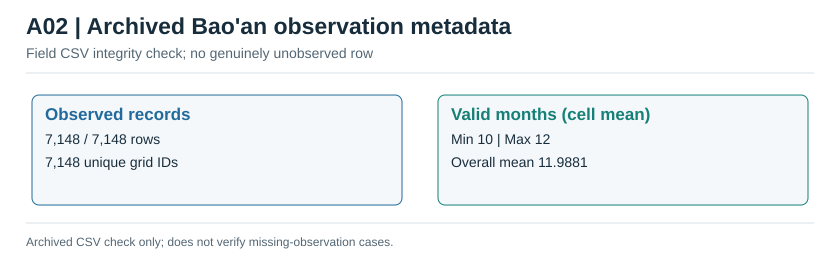

*Figure A02.1. Archived Bao'an CSV observation-support metadata. All rows are observed; no genuine missing observation is tested. [Source evidence](evidence/audit-2026-11-15/verified_summary.json).*

File locations, hashes and runnable checks are listed in the [evidence guide](evidence/README.md).

The evidence guide's [scientific claim audit](evidence/README.md#scientific-claim-audit) distinguishes literature support, implementation tests and field comparisons. A citation can justify a method or interpretation, but it does not establish that this application's output passed a field check.

## Audit coverage register

The original source review used identifiers A01 to A12. Their current status is summarized here; the [complete audit question matrix](evidence/README.md#complete-audit-question-matrix) records the question, reason, evidence file, method, quantitative result or acceptance rule, tolerance and limit for each item.

| IDs | Current status |
| --- | --- |
| A01 | CI discovery gap closed. Current workflow runs the full maintained test tree across two jobs. |
| A02 | Observation fields verified for all-supported Bao'an; synthetic missingness sensitivity quantified. Qimen 2016 adds observed negative-to-zero evidence; a truly unobserved field cell remains unavailable. |
| A03 | Independent numerical oracles and Yanqing field comparisons are recorded; broader morphologies and continuous annual data remain open. |
| A04 | Closed. One Gini implementation returns 0.000000 for `[5,5,5,5]`, 0.500000 for `[0,0,10,10]`, 0.250000 for `[1,2,3,4]` and 0 for empty/all-zero samples, matching the independent pairwise formula within $10^{-12}$. Negative, NaN and infinite cases all raise an error instead of changing the sample. |
| A05 | Test versions are partly pinned, but production dependencies and a full reproducible lock remain incomplete. |
| A06 | Integration coverage and modular statistical code reduce risk; application orchestration remains coupled. |
| A07 | Block-aggregation MAUP is tested as implemented; equivalence to direct coarse-grid raster extraction is not established. |
| A08 | Native-grid GHSL conservation and CRS handling are fixed and tested; the independent Shanghai field validation is complete, with its inputs, cell-validation result, script and hashes recorded in the recovered evidence manifest. |
| A09 | Rho labels are descriptive conventions. Shanghai confidence intervals include zero and do not establish a nonzero association. |
| A10 | In-session caches are bounded and two field profiler files are deposited; concurrent Cloud capacity is untested. |
| A11 | Synthetic integration and one stored Bao'an execution cover many stages; a repeatable authenticated live-service end-to-end test is still absent. |
| A12 | Six maintained bilingual guide pairs and automated link/math checks are in place; semantic and scientific review remains manual. |

## What can be reproduced from this repository

| Check | Command or material | Scope |
| --- | --- | --- |
| Bao'an evidence | `node validation/audit_public_evidence.mjs --check-result` | Checks rows, IDs, A02 fields, stored summary and file inventories. |
| Documentation | `node validation/check_docs.mjs` | Checks the maintained English/Vietnamese guides, links and math delimiters. |
| Application contracts | `python -m pytest -q tests` | Checks numerical, schema, masking and interface behavior with deposited or synthetic inputs. |
| Three-location raster comparison | [Cross-location workflow](cross_location/README.md) and recovered audit manifest | Records the completed V11 method, inputs, edge-cell artifacts, tolerances and results. The current checkout is not a newly expanded binary rerun bundle. |

**Figure reproducibility.** Generate the SVG illustrations from retained evidence with `node validation/generate_validation_figures.mjs`; use `node validation/generate_validation_figures.mjs --verify` to compare every generated figure with its committed counterpart. Both language guides use the same figures with localized captions. No illustration is additional field evidence.

## Method boundaries

- NTL per cell is the fractional-coverage mean of valid VIIRS radiance. Negative valid radiance is clipped to zero for the legacy output; observation-support fields remain separate.
- Local Moran uses eligible core or lit cells and row-standardized weights. Global Moran uses all cells and binary Queen weights; the two statistics are not interchangeable.
- GHSL source-pixel quantities are summed by polygon intersection fraction on the native grid, then divided by cell area for density.
- Automated tests, stored numeric comparisons and live service checks answer different questions. Each published result should state its input, revision, location, year, grid and tolerance.

## Remaining scientific gaps: G01-G18

This register follows the completed A01-A12, V11, Yanqing, Bao'an and Shanghai GHSL records above. A corrected label is **not** a new external validation. Existing numerical evidence, archival manifests, data and historic CSV schemas remain authoritative within their recorded scope. Codes such as `spatial_ar1_persistence`, `signed_dist_hh_km` and `0_Treated_HH` are preserved for downstream compatibility; their original names do not establish model identification.

| Gap | Priority | Current status and scientific risk | Next evidence required |
| --- | --- | --- | --- |
| G01 | P0 | Causal spillover/RDD claims replaced with descriptive HH-distance wording. Causality remains **unverified**. | External intervention or boundary identification, continuity checks and credible comparison design. |
| G02 | P0 | The UI now identifies `spatial_ar1_persistence` as cross-sectional `Corr(z, Wz)`. It is **not** a spatial AR estimate or unit-root test. | Estimate an explicit spatial model and define a separate stationarity test if needed. |
| G03 | P1 | Fixed NTL thresholds 5/15/40 now have descriptive radiance labels; economic calibration is **open**. | Cross-location land-use and independent socioeconomic calibration. |
| G04 | P1 | A bounded synthetic jobs-construct stress test and observed Bao'an 2020 NTL kernel sensitivity now have complete archived evidence. **Economic market-access validation and exogeneity remain open.** | Compare with genuinely independent georeferenced employment, population, transport friction or observed market outcomes, with predeclared measures and spatial uncertainty. |
| G05 | P1 | Production LISA-selected center sensitivity has archived evidence: synthetic known-center tests, 80-replicate proxy stress and Bao'an 2020 comparisons. **An independently verified real economic CBD is still absent.** | Use independently geocoded employment/POI or official activity-center evidence with matched spatial and temporal support; distinguish true center validity from in-sample gradient fit. |
| G06 | P1 | Existing conditional refit-bootstrap and AICc sensitivity remains archived; an approximate KS non-rejection can no longer receive an automatic green success level. **Spatial field Pareto law not certified.** | Refit cutoff under complete spatial null simulation and compare other localities for a field-law claim. |
| G07 | P1 | The UI and handbook now clarify signed **cell-center** distance; geometric hotspot-border distance remains **unverified**. | Compare with polygon-boundary distances for complex HH shapes and grids. |
| G08 | P1 | Chronological comparison is guarded: `year_t0 < year_t1` in core and UI; new regression tests cover invalid years. | Existing two-year observational validation remains intact; no repeat required. |
| G09 | P1 | Guard added: four-state Shorrocks is now `NaN` when an initial quartile is empty (or fewer than 12 cells qualify). Two-period transitions remain descriptive, not an established long-run Markov process. | Still open: multi-year panel, rank-tie sensitivity, transition stability and real-world dynamics. |
| G10 | P1 | Optional cloud-free OBSERVATION-count raster now sums monthly `cf_cvg`, separately from valid-month count; the A02 support screen reports unknown/low support. This is not evidence that observation-count weighting is optimal. | Still needs genuine low-support VIIRS scene, independent monthly counts and an observed-data sensitivity study. |
| G11 | P1 | A runtime domain screen now rejects polar/dateline-incompatible one-UTM studies and warns when a broad region needs geodesic comparison. Ordinary local UTM is not thereby independently validated. | Independent geodesic area/distance benchmark remains required before claiming exactness in wide/extreme regions. |
| G12 | P2 | Fixed: large-grid residual Moran no longer sets an inferential flag from I > 0.3; descriptive-high-I and permutation-performed are separate. | A large-grid significance claim still needs a valid test and reference distribution. |
| G13 | P2 | When GHSL epoch differs from the VIIRS year the UI now warns and exports the year gap. The completed Shanghai validation is unaffected. | Contemporaneous economic agreement still requires an independently dated comparison or temporal sensitivity analysis. |
| G14 | P2 | Jaccard/core-frequency/seed-SD/movement cutoffs remain conventions; the robustness UI now labels high overlap as heuristic, not a green statistical verdict. | Multi-setting empirical sensitivity if a universal cutoff is claimed. |
| G15 | P2 | `moran_I_lit` is a mean of local statistics, not Global Moran I. | Ensure all current CSV/UI explanations preserve that distinction. |
| G16 | Closed within source-identity scope | The evidence guide links to `VCMSLCFG`, matching the active `GEE_DATASET` code value; now guarded by regression test. | Recheck the catalog only if the operational product ID is changed; no V11 rerun. |
| G17 | P1 | Archived synthetic Gaussian and actual-LISA permutation stress tests remain authoritative. The UI now explicitly disclaims unvalidated field FDR guarantees. **Formal field guarantee remains open.** | Validate null p-values, tested family and dependence/PRDS assumptions with a suitable spatial reference; do not infer validity merely from BH arithmetic. |
| G18 | P1 | Existing synthetic zero-vs-missing support sensitivity stands. The new guarded field runner refuses all-observed cases and unknown support; **no new real low-support field result is claimed**. | Use a real incomplete-support VIIRS A02 CSV and independent observation-support reference. |

**G09 bounded correction.** The previous four-state Shorrocks calculation used `(4 - trace(P)) / 3` even when one or more initial quartiles had no cells, represented as all-zero rows in the exported transition table. Such rows are not probability distributions. For a 4×4 full-cell grid with eight zero-radiance cells and eight equally bright cells, all unchanged across two periods, the previous expression gave **0.6667** despite zero observed transitions. The corrected function returns `NaN` with status `undefined_empty_initial_quartile` and lists the missing source quartiles; a fully populated four-quartile identity transition still gives **0**. For backward compatibility, existing Markov tables retain zero rows for missing source classes, now explicitly labeled as undefined by the UI. This is a numerical invariant test, **not** a new field validation or confirmation of long-run Markov assumptions.

### Consolidated G01-G18 release decision

**One authoritative queue, not a series of new gaps:** [machine-readable 18-item disposition register](scientific_closure_register.json). The register separates *numerical completion*, *descriptively bounded indicators* and *claims that require unavailable independent real-world data*. A documented scientific limit is not itself evidence of a newly discovered implementation defect.

- **Implemented safeguards:** G10 source observation counts from monthly `cf_cvg` are available as an optional additional Data Quality check, alongside (not instead of) valid-month counts. G10/G18 source-support screening and field-ready comparison runner, G12 inferential/descriptive residual-Moran separation, G13 GHSL-VIIRS year-gap warning, and G17 field-FDR interpretation warning. These additions do **not** change the legacy VIIRS composite, Local Moran, Gini, G17 simulations or historical V11 evidence.
- **G10/G18 reproducible field-evidence workflow, if a genuinely incomplete-coverage scene exists:** (1) Identify and retain the exact real A02 cell CSV and cell-polygon GeoJSON for the *same* location, grid and year; do not reuse the all-observed Bao'an case. (2) Independently export source-grid `ref_observed_fraction`, `ref_mean_valid_months` and `ref_cf_cvg_total` from Earth Engine with [this script](g10_independent_support_gee.js), editing its year and drawing/importing the actual study geometry. (3) Create per-cell independent support with `python validation/g10_reference_zonal.py --source-raster SOURCE.tif --grid-geojson CELLS.geojson --year YEAR --trusted-gee-export --out REFERENCE.csv` ([source](g10_reference_zonal.py)); verify its hashes and task provenance. (4) Run `python validation/g10_g18_field_audit.py --input REAL_A02_CELLS.csv --out-dir OUTPUT_DIR --independent-reference REFERENCE.csv` ([source](g10_g18_field_audit.py)). The final script requires 30–20,000 cells, projected centroid columns, at least one no-observation and one supported post-clipping zero; it rejects all-observed/unknown-support inputs and exports hashed per-cell and JSON comparisons. Independent reference matching is necessary but **does not itself certify provenance or a correct cf_cvg-weighting model**.
- **Cannot be scientifically closed without external evidence:** G04 economic market access, G05 economic CBD, G06 spatial Pareto law, G10/G18 real low-support bias, G17 a formally calibrated field null/FDR claim, G11 extreme-geography precision, G09 stationary multi-year Markov assumptions. These are blocked **claims**, not a request to rerun prior completed A02/V11/GHSL numerical checks. If data are unavailable, use bounded descriptive wording and retain the blocked status.
- **Safe stopping boundary:** for a research result, document the input raster revision, location-year, A02 support status, grid/CRS, zero policy, permutation/tested family, spatial sensitivity and the estimand actually computed. A green CI run or synthetic test alone is insufficient evidence of economic validity, causality or empirical FDR control. No archived validation is superseded here.

This is a consolidated closure of the **code-level safeguards and evidence bookkeeping that can be completed without new field data**, not an assertion that all 18 scientific questions have been resolved.

### G04: Distance-weighted NTL potential, construct stress and field sensitivity

**What is actually used, and what is not.** The production calculation uses only the archived VIIRS NTL, cell area, projected grid coordinates and user-selected distance-kernel settings. `SOL = NTL × cell area`; Euclidean distance is a proxy for proximity, not a measured trip time or transport cost. The production app does **not** ingest employment, population, household income, purchasing power, external market outcomes or transport networks for this index. The synthetic jobs values below are generated solely inside the audit script to challenge its interpretation. They are not observed jobs and are never read by the app. Therefore the computation works without economic data, but its **economic market-access interpretation is not established**.

**Scientific object.** The code computes $P_i=\sum_{j\ne i}w_{ij}SOL_j$ and $`\widetilde{P}_i = P_i - \overline{SOL}_{core}\sum_{j \ne i} w_{ij}`$ with $w_{ij}=\exp(-\tau d_{ij})$ truncated at a fixed Euclidean grid radius. At the production baseline, $\tau=0.5$ per kilometre and the five-step radius on a 500 m grid is **2.5 km** (the exponential half-distance is about 1.386 km). This transformation subtracts the **location-specific expectation under an unrestricted permutation of core-cell SOL**, not an estimated economic travel cost or the shock-assignment counterfactuals needed for causal exposure recentering. The previous T07 mathematical-expectation test is already closed and was not rerun.

**Synthetic construct stress with known, engineered job mass.** An irregular 335-cell grid contains a synthetic employment surface generated first. Light intensity is then deliberately constructed to match it with noise, to contain a bright *nonemployment* artifact, or to be spatially shuffled (one negative-control realization, not a randomization test). At the baseline, Spearman's correlation of **centered NTL potential** with the known synthetic **jobs-distance potential** was:

| Synthetic NTL scenario | Spearman correlation with constructed jobs-distance potential |
| --- | ---: |
| NTL deliberately linked to simulated jobs | 0.9361 |
| Same NTL with a strong unrelated lighting source | 0.4393 |
| Single seeded spatial shuffle of NTL | -0.2513 |

These values show sensitivity to the **constructed data-generating mechanism**, not empirical economic accuracy. The benchmark jobs surface is synthetic and the aligned light field is **generated directly from it**, so it is not an independent external employment observation. The single shuffled case does not supply a p-value.

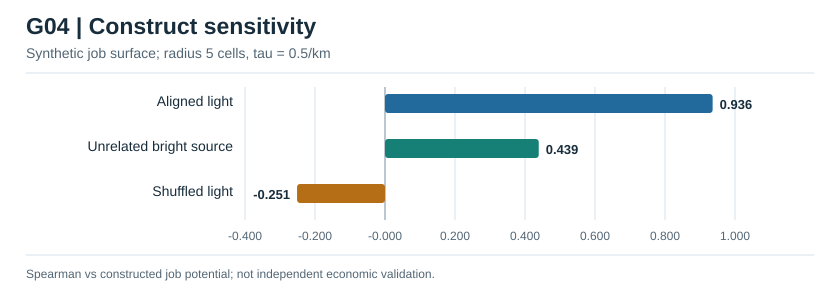

*Figure G04.1. Construct sensitivity against generated employment potential. The aligned light field is deliberately generated from synthetic jobs, not independent economic observations. [Source evidence](evidence/g04_ntl_potential/summary.json).*

**Observed radiance sensitivity in Bao'an (2020, 500 m).** Reuse exactly the existing, A02-checked, **7,148-row** archived cell CSV; **6,186 full core cells** enter the distance kernel and 962 clipped border cells remain in the exported join table with blank potentials. All 7,148 source records have observed A02 status. One noncore row has an invalid field and is excluded, not filled or assigned a fabricated coordinate. The source CSV is not edited or re-extracted. Against the same baseline on the same eligible core cells:

| Radius in grid steps | Max radius | Spearman range across $\tau$ | Top-decile Jaccard range across $\tau$ |
| --- | --- | --- | --- |
| 3 | 1.5 km | 0.9855 to 0.9891 | 0.7813 to 0.8152 |
| 5 | 2.5 km | 0.9984 to 1.0000 | 0.9344 to 1.0000 |
| 8 | 4.0 km | 0.9733 to 0.9985 | 0.7839 to 0.9527 |

Here $\tau\in\{0.25,0.5,1.0\}$ per km. Overall cell ranks remain similar, while identity of the highest-ranked 10% changes more. At baseline, raw potential has rank correlation **0.4085** with the geometry-only expected-exposure term, while the centered potential has **0.1758** with that term. Neither is an independence test and the centered quantity need not be spatially uncorrelated with geometry in realized, spatially structured data. Negative centered values (50.73% of eligible cells at baseline) mean *below the spatial-permutation reference expectation*, not negative employment or negative market access.

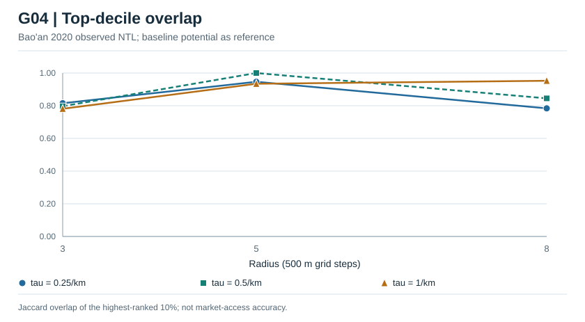

*Figure G04.2. Top-decile Jaccard sensitivity to kernel radius and decay on observed Bao'an 2020 NTL. [Source evidence](evidence/g04_ntl_potential/summary.json).*

**Archived inputs and detailed outputs:** the [reproducible program](g04_ntl_potential_experiment.py), [335-cell synthetic input with generated employment](evidence/g04_ntl_potential/synthetic_input.csv), [1,005 synthetic cell-level baseline results](evidence/g04_ntl_potential/synthetic_cell_results.csv), [all 7,148 Bao'an cell IDs and baseline results](evidence/g04_ntl_potential/baoan_cell_results.csv), [36 scenario-level comparisons](evidence/g04_ntl_potential/sensitivity.csv), and [machine-readable summary, source SHA-256, software versions, definitions and limitations](evidence/g04_ntl_potential/summary.json). The original Bao'an CSV referenced by the summary is already deposited at `validation/evidence/a02_post_pr27/`. The CI job checks exact reproducibility of all five new outputs and leaves historical inputs intact.

**What is complete vs. open:** The archived G04 tests quantify sensitivity to a synthetic jobs-generating mechanism and to distance-kernel settings on observed VIIRS radiance. They do not prove economic meaning. **Economic construct validity remains open, not the ability to calculate the index.** A scientifically defensible economic market-access validation needs a real, independent, georeferenced employment or population surface and defensible transport/commuting costs aligned by place, time and spatial units; ideally also external market outcomes. Synthetic job mass cannot close that gap, and an NTL-only real-data sensitivity cannot identify an exogenous effect. This distinction matters because structural market access is linked to transport costs and markets in [Donaldson and Hornbeck (2016)](https://doi.org/10.1093/qje/qjw002), while exposure recentering for identification uses explicitly defined counterfactual shocks in [Borusyak and Hull (2023)](https://doi.org/10.3982/ECTA19367).

### G06: Pareto tail testing and conditional bootstrap

**Distinguish a Hill estimate from a distributional claim.** The production application estimates a Hill exponent on the largest 10% of positive core-cell NTL values. The existing `ntl.lisa_diagnostics.ks_pareto` reports a **nominal asymptotic KS p-value**, even though the Pareto exponent is estimated using the same sample. T09 already verifies its arithmetic on controlled inputs; **an arithmetic check is not a goodness-of-fit calibration**. G06 does not rerun the original field-extraction tests or change the production estimator, CSV keys, or output values.

**Audit design.** Four tail fractions are **predeclared** at 5%, 10%, 15% and 20% of the positive core cells. For each fraction, the threshold `u` is the `(k+1)`st largest positive NTL value, matching the production Hill convention, and the top `k` observations define the tail sample. We calculate $\widehat\alpha = 1/\overline{\log(x/u)}$ and the KS statistic against the fitted conditional continuous Pareto CDF. Then, **399 independent parametric bootstrap tail samples** are generated conditional on that same `u` and `k`. Crucially, the exponent is **re-estimated in each bootstrap sample**, and its own KS statistic is recalculated. The one-sided upper-tail Monte Carlo GOF p-value uses $`(1+\#{D^{*}\ge D_{\mathrm{obs}}})/(399+1)`$, so the smallest reportable result is **0.0025**, not zero. Approximate binomial 95% intervals reflect Monte Carlo variability of the replicate count.

The cutoff is **conditioned upon, not selected or re-estimated in the bootstrap**. This is a deliberately limited **fixed-k conditional iid reference**. It is **not** the complete Clauset–Shalizi–Newman (2009) pipeline that optimizes the lower cutoff and repeats that step in the null simulation. For real spatially correlated VIIRS pixels, the iid reference p-value is **not** a spatially calibrated field significance test.

**Synthetic controls, 5,000 independent observations each.** The test generates a genuine Pareto parent law with exponent 2.5, a lognormal parent and a shifted exponential parent, with recorded seeds and full 5,000-row input table. The refitted-bootstrap results over the four predeclared fractions were:

| Known synthetic parent | Bootstrap KS p-value range | Typical rival comparison |
| --- | ---: | --- |
| Pareto with true exponent 2.5 | 0.4050 to 0.8075 | Conditional AICc selects Pareto in 3/4 cases, lognormal in 1/4 |
| Lognormal | 0.0025 to 0.0850 | Conditional AICc selects the truncated lognormal in 4/4 cases |
| Shifted exponential | 0.0025 to 0.0500 | Conditional AICc selects shifted exponential in 3/4 cases, truncated lognormal in 1/4 |

Nonrejection at one short cutoff, such as 5% for lognormal (p = 0.085), **does not prove a Pareto law**. The test can lose discrimination when only the most extreme observations are available.

**Observed Bao'an 2020 NTL: bounded conditional-iid reference only.** Reuse the exact 7,148-row A02-verified VIIRS CSV already deposited. There are **6,186 full-core, strictly positive NTL cells**; 962 border cells are retained in the archive join output but excluded from tail fitting. No live data or new economic proxy is introduced.

| Positive core NTL used | Tail size `k` | Hill exponent | Existing asymptotic KS p | Conditional refit-bootstrap KS p | Best conditional AICc |
| --- | ---: | ---: | ---: | ---: | --- |
| Top 5% | 309 | 5.6726 | 0.00665 | 0.0025 | Pareto |
| Top 10% (production cutoff) | 618 | 5.5904 | 0.09511 | 0.0225 | Pareto |
| Top 15% | 927 | 4.6953 | 0.000009 | 0.0025 | Truncated lognormal |
| Top 20% | 1237 | 4.0730 | <0.000001 at displayed precision | 0.0025 | Truncated lognormal |

**Interpretation:** At the default 10% cutoff, the old nominal p-value 0.09511 exceeds 0.05 while the refitted *conditional iid* reference p-value 0.0225 falls below it. These need not support the same conclusion even though both use the same 618 observations. This **does not permit a formal conclusion about the underlying spatial VIIRS field**, because the bootstrap neglects the dependence of neighboring cells and conditions on a selected order-statistic cutoff. With 399 bootstrap replicates, p = 0.0025 means no simulated refitted KS exceeded the observed value, subject to Monte Carlo resolution. In addition, **AICc selection is relative**: at 5% and 10%, Pareto is the least penalized of three tested conditional candidates, even though the conditional bootstrap reference rejects a Pareto-style iid fit at 5% level. There is no contradiction; best among candidates does not imply an adequate absolute fit.

**Rival distributions:** Exponential excesses and lognormal values **truncated below the same `u`** are independently fitted on the **same `k` exceedances** for each case, and compared against Pareto using AICc and descriptive KS differences. This avoids comparing an unconditional lognormal likelihood against a conditional Pareto likelihood. These are not likelihood-ratio significance tests; truncated lognormal parameter estimates are archived separately.

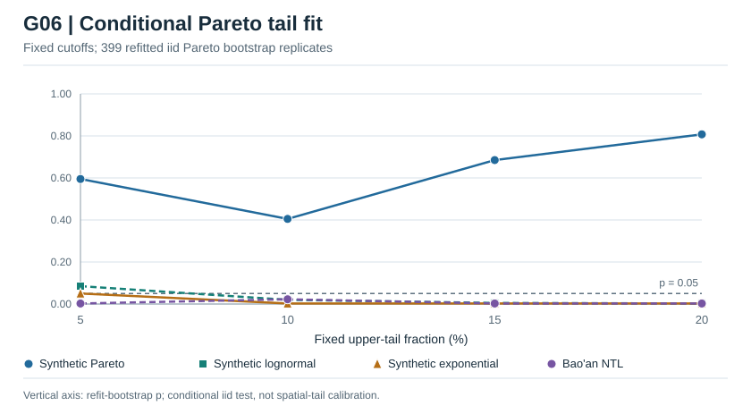

*Figure G06.1. Conditional refitted iid Pareto-bootstrap p-values across four fixed tail fractions; the dashed line is 0.05. [Source evidence](evidence/g06_pareto_tail/summary.json).*

**Complete evidence and replay:** [generator](g06_pareto_tail_experiment.py), [all 5,000 synthetic inputs](evidence/g06_pareto_tail/synthetic_input.csv), [7,148 source Bao'an IDs with full-core/positive rank flags](evidence/g06_pareto_tail/baoan_tail_observations.csv), [all 16 model/cutoff cases](evidence/g06_pareto_tail/tail_cases.csv), [all 6,384 bootstrap draws with refitted exponent and KS](evidence/g06_pareto_tail/bootstrap_replications.csv), and [machine-readable methodology, fitted rivals, full scenario results, software versions and SHA-256 hashes](evidence/g06_pareto_tail/summary.json). The original Bao'an input is retained at `validation/evidence/a02_post_pr27/`. The CI job regenerates and compares **all five new evidence files byte-for-byte** under pinned dependencies.

**Still open:** The results **do not certify NTL Pareto tails** and do not establish a spatial, economic, or causal law. Needed evidence includes a spatially appropriate null generator or correlated-resampling design, temporal measurement checks, and a prespecified or fully bootstrapped cutoff-selection procedure on independent regions. See [Clauset, Shalizi and Newman (2009)](https://doi.org/10.1137/070710111). Existing `power_law_ok` is a **legacy approximate-KS screening flag**, not a field-verified model-fit statement; the current UI explanation warns against overinterpretation.

### G05: NTL-selected center and gradient sensitivity

**What G05 does and does not establish.** The app's `urban_gradient_decay` and `monocentric_r2` are fitted on the same NTL observations used to select the center. The center is the SOL-weighted centroid of the largest eligible significant HH cluster, or a maximum of a combined NTL/neighbour-NTL score when no qualifying HH cluster exists. Next, the app calculates the area-weighted regression of $\log(1+\mathrm{NTL}_i)$ on Euclidean distance from that selected point. This is an **in-sample descriptive gradient**; R² does not validate the economic CBD, prove that a city is monocentric, or establish causal spatial structure. The existing WLS function and the saved historic schema have not changed.

**Part A: known-center synthetic control.** A fixed 25 × 25 grid has a generator center selected **before** drawing any light. It is known exactly **because it was specified in the experiment**, not because a real CBD was observed independently. Three fields share the same baseline noise: a single-center light surface, then that surface plus an unrelated bright source at amplitudes 60 and 170. For each field, the audit runs the production `run_lisa` center selection with Queen weights, 999 permutations, BH-FDR at 0.05, and four-cell minimum clusters. Centers recovered from rounded output distances are checked against the original gradient fit. Every synthetic run selected an eligible largest HH cluster (one, two and one eligible clusters respectively).

| Synthetic light field | NTL-selected center displacement from generator center | R² at known generator center | R² at NTL-selected center | NTL-selected gradient $\gamma$, per km |
| --- | ---: | ---: | ---: | ---: |
| Baseline, no unrelated bright source | 0.025 km | 0.874 | 0.874 | 0.3752 |
| Added bright source, amplitude 60 | 0.090 km | 0.533 | 0.541 | 0.3067 |
| Dominant unrelated bright source, amplitude 170 | 6.335 km | 0.304 | 0.128 | 0.1059 |

In the dominant-artifact design, the selected center moves away from the known generator center and the fitted gradient changes from 0.2579 to 0.1059 per km. **Using the NTL-selected center does not uniformly inflate R²:** in this configuration it **reduces** R² by approximately 0.176, while the moderate-artifact example increases R² by about 0.008. Neither comparison is a universal estimate of estimator bias.

For additional dispersion evidence, 80 seeded replications per field compare the known generator center with the geometry-only centroid, NTL-weighted centroid and brightest cell. Those **960 individual center-fit results** are archived. Their Monte Carlo summaries cover only these fast comparison-center rules. The full production HH selection is rerun for the three deposited synthetic fields, **not** for all 240 Monte Carlo fields; do not apply the repeated-proxy uncertainty to the production HH algorithm.

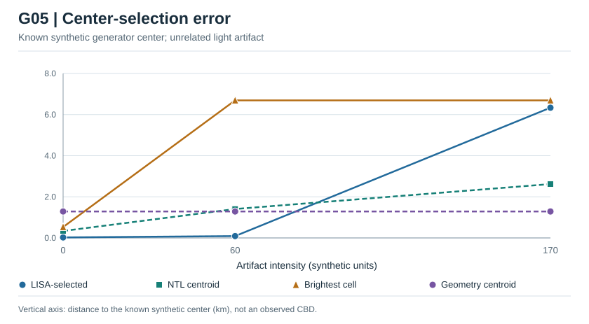

*Figure G05.1. Center error relative to the known synthetic generator center under different unrelated-light intensities. [Source evidence](evidence/g05_ntl_center/summary.json).*

**Part B: observed Bao'an 2020 NTL, no independent economic CBD.** The study reuses the existing 7,148-cell A02-checked VIIRS CSV and fits exactly the same $\log(1+\mathrm{NTL})$ and area-weighted gradient on **6,186 full core cells**. It does **not** re-extract VIIRS or rerun A03/LISA. The historical app-selected center is recovered by multilateration from archived `dist_to_core_km` rounded to 0.001 km; its reconstructed distances have a median absolute discrepancy of **0.254 m** and a 99th-percentile discrepancy of **0.505 m**. This method identifies the **NTL-selected point from a previous output**, not an externally identified CBD.

| Bao'an 2020 center rule | Distance from archived NTL-selected point | Fitted $\gamma$, per km | In-sample R² |
| --- | ---: | ---: | ---: |
| Archived production NTL-selected center | 0 km | 0.02601 | 0.37988 |
| Geometry-only area centroid | 33.000 km | 0.02736 | 0.10613 |
| Same-year NTL-weighted centroid | 22.833 km | 0.04070 | 0.34348 |
| Same-year brightest NTL cell | 9.326 km | 0.02677 | 0.37505 |

These are **sensitivity estimates conditional on one region-year**, not rankings of economic CBD accuracy. The geometry-only centroid is defined without using NTL, but **it is not a verified job center**, and the two other alternative centers are still NTL-dependent. All fits use the same 6,186 cells and outcome, so the differences reflect center definitions rather than a change in the fitted sample. Differences as large as 0.274 in R² warn against treating `monocentric_r2` as an economic monocentricity test.

**Retained, replayable evidence:** [experiment source](g05_ntl_center_experiment.py); [625-cell synthetic inputs and all three brightness fields](evidence/g05_ntl_center/synthetic_input.csv); [1,875 synthetic cell-level LISA classes and distances](evidence/g05_ntl_center/synthetic_cell_results.csv); [960 seeded fast-center replications](evidence/g05_ntl_center/synthetic_replications.csv); [7,148 Bao'an IDs and center distances, with border exclusions preserved](evidence/g05_ntl_center/baoan_cell_results.csv); [19 fixed-field center comparisons](evidence/g05_ntl_center/center_comparison.csv); and [metadata, reconstruction diagnostics, Monte Carlo distributions, hashes and limitations](evidence/g05_ntl_center/summary.json). CI pins the scientific Python libraries and verifies all six files byte-for-byte. The Bao'an source file and all prior G04, G17, G18, A02, A03, V11 and GHSL evidence are unchanged.

**G05 economic validation remains open:** A real CBD or employment/activity center independently observed in or near 2020, with declared coordinates, provenance, support and timing, is needed before interpreting the center differences as **economic** selection bias. A fixed generator point in a synthetic experiment and a geometry-only centroid in a real city are not substitutes. Some urban light profiles may also be polycentric or nonlinear, so an ordinary single-center regression can be a poor description regardless of center choice. For methodological context see [Spatial gradients of urban land density and nighttime light intensity](https://doi.org/10.1057/s41599-023-01884-8).

### G17 spatial-dependence FDR study (bounded simulation)

This is a **two-part synthetic study**, not new VIIRS field validation and not a re-check of the BH step-up arithmetic closed by A03. A valid marginal p-value distribution and dependence among p-values are distinct from the correctness of the BH implementation.

**Part A, known null truth and power:** On a 64-cell (8×8) synthetic grid, compute row-standardized Queen or Rook neighbors and Gaussian fields of the form $z=D^{-1/2}(I-\rho W)^{-1}\epsilon$. Rescaling by exact marginal standard deviations makes each null score standard normal; the two-sided Gaussian p-values remain marginally valid even when the spatial scores depend on one another. Use $\rho\in\{0,0.5,0.8,-0.5\}$, 400 replications per weight, correlation and scenario, and $\alpha=0.05$. In a separate alternative, add a fixed mean shift of 2.75 standard deviations to the same nine predeclared central cells. The 55 remaining nulls are known true by construction. Here, **empirical FDR** is the average over replicates of false rejections divided by $\max(1,\text{all rejections})$; **power** is the proportion of nine injected signals detected. BY uses BH at $\alpha/H_{64}$ where $H_{64}=\sum_{i=1}^{64}1/i$.

| Part A measure across 8 spatial settings | BH | BY |
| --- | ---: | ---: |
| All-null empirical FDR | 0.0475 to 0.0575 | 0.0075 to 0.0175 |
| Fixed nine-cell signal, empirical FDR | 0.0353 to 0.0483 | 0.0087 to 0.0164 |
| Fixed nine-cell signal, detection power | 0.4222 to 0.4467 | 0.2194 to 0.2544 |

These are finite-simulation estimates, with Monte Carlo standard errors and 95% intervals in the [summary](evidence/g17_spatial_fdr/summary.json). A value such as 0.0575 from 400 all-null replicates is **not** by itself evidence that nominal 0.05 was violated. The filter parameter $\rho$ is the generator parameter, not an estimate of the app's cross-sectional lag-correlation indicator. The observed BY power reduction is specific to this signal size and set of dependencies.

**Part B, the actual Local Moran conditional-permutation method:** Generate positive lognormal light fields on the same fixed grid; apply the production `local_moran` and `bh_reject` routines, plus the BY threshold, with 999 conditional permutations, $\alpha=0.05$, 24 replications for each combination of Queen/Rook and $\rho\in\{0,0.8,-0.5\}$. For $\rho=0$, cells are identically and independently distributed, so spatial randomization is exchangeable and all local association null hypotheses hold. Under this all-null case neither BH nor BY rejected in 24/24 replications for either weight. This limited observation **does not prove** exact FDR control.

Under a correlated background with $\rho=0.8$ and no planted mean shift, BH rejected at least one cell in 16/24 Queen runs but 1/24 Rook runs; BY rejected in none of these 24-run groups. **These are not false discovery counts:** a correlated background itself violates the random-placement null and may produce genuine local spatial association. There is no validated per-cell true-null map for these runs, so the archived summary marks their FDR as `null`.

**P-value granularity:** With 999 two-sided permutations, the minimum reported pseudo p is 0.002 for 64 tests. Even the smallest p cannot trigger the step-up threshold at rank one. The earliest potentially feasible rank is three for BH and thirteen for BY in this setup. This discrete threshold materially limits power and must be reported when interpreting the LISA stress results.

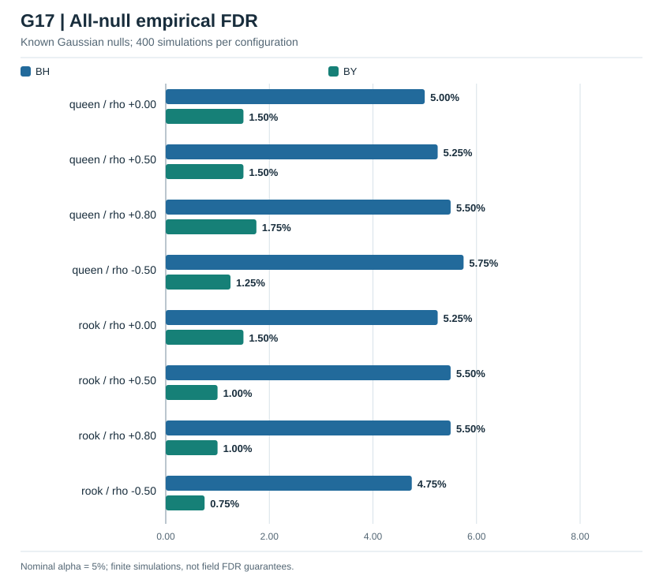

*Figure G17.1. Empirical BH/BY FDR for the all-null Gaussian configurations. These are finite-simulation estimates, not field guarantees. [Source evidence](evidence/g17_spatial_fdr/summary.json).*

**Evidence and replay:** The full synthetic design and predeclared injection mask are in [design.csv](evidence/g17_spatial_fdr/design.csv), all **6,544 individual simulation records** in [replicates.csv](evidence/g17_spatial_fdr/replicates.csv), and scenario summaries, uncertainty, assumptions and SHA-256 digests in [summary.json](evidence/g17_spatial_fdr/summary.json). The [generator](g17_spatial_fdr_experiment.py) uses fixed seeds and pinned NumPy, pandas and SciPy in CI. Run `OPENBLAS_NUM_THREADS=1 OMP_NUM_THREADS=1 python validation/g17_spatial_fdr_experiment.py --verify` from repository root to compare generated outputs with every retained artifact.

**Unresolved G17 claim:** Neither positive spatial dependence nor BH step-up correctness proves the formal PRDS condition for LISA pseudo p-values. BY's arbitrary-dependence guarantee presumes valid null p-values; it **does not repair invalid spatial permutations**. Before a real-world nominal FDR claim, define the scientific null, the full tested family, how spatial nuisance dependence is handled and what ground truth or valid null calibration supports the claim. See [Benjamini and Yekutieli (2001)](https://doi.org/10.1214/aos/1013699998) and the [GeoDa Local Spatial Autocorrelation guidance](https://geodacenter.github.io/workbook/6a_local_auto/lab6a.html).

#### G17: Source-independence null calibration on reference raster geometry

**Scientific object and rationale.** Conditional cell permutation tests random placement of cell values. Source-pixel independence is a different null when cells share pixels (G23). Marginal p validity and BH/BY arithmetic must remain distinct.

**Data, calculation and reference.** Use the first complete 8×8 Bao'an core window in sorted lattice order (64 cells, 102 pixels). Generate 999 reference and 400 test iid Gaussian source fields, seed 171723; extract using normalized overlap weights. Compute sample-standardized Local I with Queen mean lag. Compare the simulated source reference with conditional cell permutations sampling neighbors without replacement. Use doubled inclusive smaller-tail plus-one p capped at one; apply raw/BH/BY at alpha 0.05.

**Results.**

| Measure (400 test fields, 25,600 cell tests) | Cell permutation | Source reference |
| --- | ---: | ---: |
| Marginal p ≤ 0.05 | 10.5547% | 5.1836% |
| Raw: fields with any rejection | 394 | 385 |
| BH: fields with any rejection | 21 | 2 |
| BY: fields with any rejection | 0 | 0 |
| BH any-rejection rate under source null | 5.25% | 0.5% |

Marginal p frequency differs from the fraction of fields with any rejection. Under the all-null source design the latter is empirical FDR for that null.

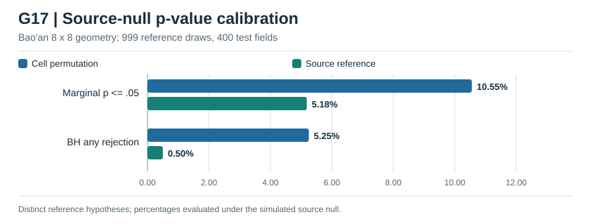

*Figure G17.2. Marginal rejection frequency and BH any-rejection frequency evaluated under the simulated source-pixel null. The two methods use different reference hypotheses. [Source evidence](evidence/g20_g23_g17_raster_summary.json).*

**Archived evidence.** [Source-null simulation program](g17_source_support_null.py), [result JSON and source SHA-256](evidence/g20_g23_g17_raster_summary.json).

**Verified scope and unresolved claims.** One window, one iid source model, shared reference draws across test fields. The 0.002 p floor limits BH/BY, especially BY. The comparison does not establish BH failure for the cell random-placement null or certify field FDR. Extend across geometries, resolutions, source covariance and reference sizes; specify the scientific null.

### G18 synthetic evidence (bounded result)

**Additional bounded G18 field evidence from Qimen 2016:** all 49 truly zero app cells show observation support and negative-radiance metadata; all 47 with source-raster overlap also match zero after clipping. No `no_observation` cell exists among 9,143 app cells. This checks the **negative-to-zero source mechanism**, not policy sensitivity under genuine missingness. Alignment uses an indirect 2020 raster lattice and leaves 23 cropped edge cells uncovered; it does not prove exact internal 2016 app geotransform. See [method, exclusions and source digests](evidence/README.md#g10g18-qimen-2016-observed-zeros-and-negative-radiance).

This experiment is based on a fully specified **synthetic** 12×12 grid at 500 m, not a real VIIRS or A02 scene. The controlled support mask has 106 observed-positive cells, 28 genuinely observed zeros and 10 unobserved cells that carry legacy filled zeros. All three runs use Queen neighbors, 999 conditional permutations, seed 42, alpha 0.05; the following outputs use BH-FDR.

| Analysis population and zero policy | Tested cells | HH | LL |
| --- | ---: | ---: | ---: |
| Known-support locations, positive NTL only | 106 | 22 | 21 |
| Known-support locations, including observed zero | 134 | 21 | 17 |
| All locations, naively treating unknown-support zeros as observed | 144 | 18 | 13 |

Including observed zeros changed 50/134 classes on the common known-support domain (including 28 formerly DARK cells); 45/134 neighbor counts and 92/106 comparable pseudo p-values also changed. Inappropriately including the 10 unknown-support cells changed 9/134 classes, 28/134 neighbor counts and 112/134 comparable pseudo p-values **among the truly supported locations**. In the naive run, all 10 unknown-support cells entered the local test family. Separate unadjusted results are stored in the evidence CSV.

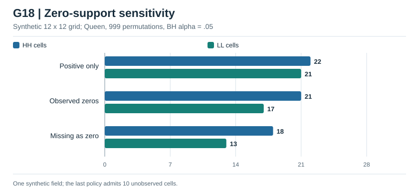

*Figure G18.1. HH and LL counts under three support policies on the controlled 12 × 12 synthetic field. [Source evidence](evidence/g18_zero_support/summary.json).*

**Scope restriction:** The fixed seed does not pair identical Monte Carlo draws across runs with different tested populations, so some p-value variation may reflect permutation-stream changes as well as the altered sample. This demonstrates possible specification sensitivity under one controlled synthetic field, **not** a measured bias magnitude in a real locality, proof of which policy is universally correct, or empirical FDR control. The safe audit runs subset the observed geography instead of feeding NaNs to the existing `run_lisa` (whose full Gini calculation rejects NaN). Consequently, the normalization population and tested family also change. Existing V11/GHSL/A02/A03/A04 validations are untouched, and the production default still excludes zero NTL cells from LISA.

**Retained evidence:** [generator](g18_zero_support_experiment.py), [input and support mask](evidence/g18_zero_support/synthetic_input.csv), [all cell-level results](evidence/g18_zero_support/cell_comparison.csv) and [machine-readable summary, software versions and SHA-256 identities](evidence/g18_zero_support/summary.json). The CI job runs the generator and checks all three archived outputs for exact reproducibility.

**G18 field validation remains open:** Select a genuine locality with independently verified observation-support metadata, distinguish measured zeros and missing coverage, and repeat a sensitivity comparison with preregistered interpretation and coverage thresholds.

#### G10/G18: Observed zeros, negative radiance and observation support

**Scientific object and rationale.** A02 quality fields distinguish observed radiance, missing support and values clipped to zero. An exported zero does not establish measured darkness.

**Data, calculation and reference.** Screen the five cell exports (Qimen 2014/2016/2020, Bao'an 2020, Shanghai 2020) for status, observed fraction, valid months, missing-stat flag, negative fraction and exported zeros. Inspect finite `cf_cvg` values in the Bao'an 2020 and Qimen 2016 support rasters. Do not classify pixels outside the AOI mask as missing VIIRS observations.

**Results.**

| Export | Records | Full reported support |
| --- | ---: | ---: |
| Qimen 2014 | 9,143 | 100% |
| Qimen 2016 | 9,143 | 100% |
| Qimen 2020 | 9,143 | 100% |
| Bao'an 2020 | 7,148 | 100% |
| Shanghai 2020 | 886 | 100% |
| Total | 35,463 | 100% |

No missing-stat flag or below-three-month cell occurs. All 8,909 Bao'an and 12,202 Qimen finite support pixels have positive cf_cvg. Qimen 2016 has 56 exported zeros and 2,487 cells with positive negative-radiance fraction. Exported zeros may reflect rounding and do not replace the 49 verified zero cells in the earlier G18 comparison.

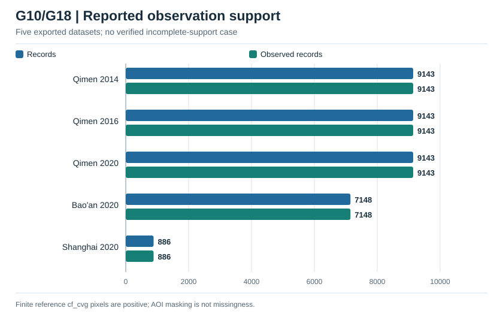

*Figure G10/G18.2. All five exported datasets report full observation support. Absence of missing cases does not establish correctness under incomplete support. [Source evidence](evidence/g19_g29_independent_audit.json).*

**Archived evidence.** [Independent CSV and numerical-check program](g19_g29_independent_audit.mjs), [result JSON](evidence/g19_g29_independent_audit.json); [Raster and geometry reference program](g20_g23_raster_audit.py), [result JSON and source SHA-256](evidence/g20_g23_g17_raster_summary.json).

**Verified scope and unresolved claims.** These samples establish reported support, not a genuine missing-observation case or the field magnitude of zero-fill bias. An independently verified incomplete-support scene and matched geometry are still needed.

### G19: Missingness and zero-fill propagation into NTL statistics

**Scientific object and rationale.** The raster and zonal paths use `median.unmask(0.0)` and `fillna(0.0)`. Quality flags alone do not alter the statistics computed from the filled values.

**Data, calculation and reference.** Use four equal-area cells with the third unobserved. Compare legacy [10,20,0,30] with observed [10,20,30]. Mean is the sum divided by the count; Gini is the sum of all pairwise absolute differences divided by twice the squared count times the mean. Only the analysis population changes.

**Results.**

| Policy | Cells | Mean NTL | Gini |
| --- | ---: | ---: | ---: |
| Missing cell filled with zero | 4 | 15 | 0.416666667 |
| Observed cells only | 3 | 20 | 0.222222222 |

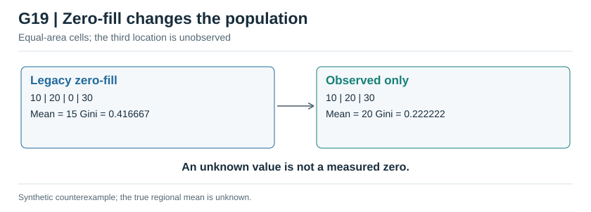

*Figure G19.1. Synthetic equal-area example: filling an unobserved cell with zero changes both the analysis population and the computed statistics. [Source evidence](evidence/g19_g29_independent_audit.json).*

**Archived evidence.** [Independent CSV and numerical-check program](g19_g29_independent_audit.mjs), [result JSON](evidence/g19_g29_independent_audit.json).

**Verified scope and unresolved claims.** The counterexample establishes sensitivity of mean and Gini, not the true missing value, true regional mean or universal bias direction. Test all production SOL, mean, Gini, lit fraction, Global/Local Moran and supported area under legacy, observed-only and prespecified support policies on a verified incomplete scene.

### G20: Pixel alignment and tile mosaic integrity

**Scientific object and rationale.** Common CRS and pixel size do not establish a common pixel origin. Different transforms or masks at seams can alter zonal inputs. An offline test isolates mosaicking from retrieval.

**Data, calculation and reference.** Split the Bao'an 2020 VIIRS Median raster into four integer pixel windows with source-derived affine transforms. Merge using `rasterio.merge(method='first')`. Compare shape, transform, finite mask and absolute value differences; treat paired NaNs as equivalent for raw-array comparison.

**Results.**

| Comparison | Result |
| --- | --- |
| Mosaic shape (rows × columns) | 109 × 217 |
| Affine transform and finite mask | Identical |
| Finite values compared | 8,909 |
| Maximum absolute difference | 0 |
| Raw mismatch after NaN equivalence | 0 |

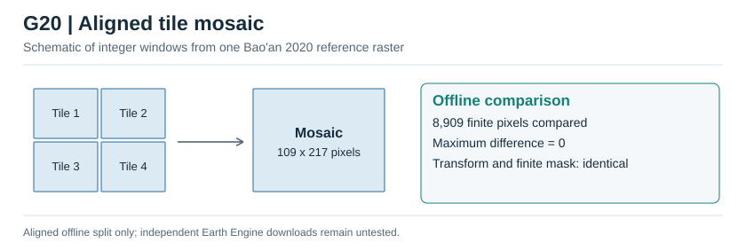

*Figure G20.1. Schematic of the offline aligned split and mosaic experiment. It is not an independently downloaded Earth Engine tile comparison. [Source evidence](evidence/g20_g23_g17_raster_summary.json).*

**Archived evidence.** [Raster and geometry reference program](g20_g23_raster_audit.py), [result JSON and source SHA-256](evidence/g20_g23_g17_raster_summary.json).

**Verified scope and unresolved claims.** Aligned offline mosaicking is verified in this case. Independent Earth Engine requests may not share the same lattice. Hold AOI, year, product and native affine fixed and compare single, split and native-aligned downloads across all bands, masks, seams and polygon means. See [Earth Engine image exports](https://developers.google.com/earth-engine/guides/exporting_images).

### G26: Common observation support in space-time dynamics

**Scientific object and rationale.** Entry, exit, Markov transitions and lag changes require comparable observations. A missing baseline filled with zero can create a false dark-to-lit transition.

**Data, calculation and reference.** Use t0=[10,0,0,5] and t1=[10,8,0,5]; the first baseline zero represents missingness, the second is observed. Entry is the number of initial zero cells becoming positive divided by the initial zero count in the selected domain. Join each pair of Qimen exports by grid_id and compare geographic/projected centroids and reported area.

**Results.**

| Synthetic domain | Entry / initial zeros | Entry rate |
| --- | ---: | ---: |
| Legacy zero-fill | 1/2 | 50% |
| Common observed support | 0/1 | 0% |

| Qimen year pair | Matched IDs | Identical exported centroids/area | Positive to exported zero | Exported zero to positive |
| --- | ---: | ---: | ---: | ---: |
| 2014–2016 | 9,143 | 9,143 | 56 | 0 |
| 2014–2020 | 9,143 | 9,143 | 0 | 0 |
| 2016–2020 | 9,143 | 9,143 | 0 | 56 |

All paired records report full observation support.

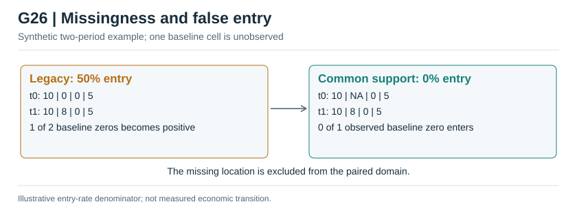

*Figure G26.1. Controlled temporal example comparing entry under zero-fill and common observation support. [Source evidence](evidence/g19_g29_independent_audit.json).*

**Archived evidence.** [Independent CSV and numerical-check program](g19_g29_independent_audit.mjs), [result JSON](evidence/g19_g29_independent_audit.json).

**Verified scope and unresolved claims.** Synthetic mechanism and exported grid attributes are confirmed; exact polygon identity, field missingness and economic transition are not. Test an actual incomplete two-year scene on common support, including Markov, lag and extensive margins, and report excluded area.

### G11: UTM area accuracy relative to ellipsoidal area

**Scientific object and rationale.** Projected area enters edge screening, area weights and SOL. UTM is not equal-area, so compare actual polygons rather than nominal grid size.

**Data, calculation and reference.** For every exported Bao'an and Qimen polygon, calculate planar area in its declared UTM CRS and WGS84 ellipsoidal area using `pyproj.Geod`, with geodesic segments between vertices. Summarize abs(A_UTM/A_geod - 1).

**Results.**

| Site | Cells | Mean relative absolute difference | Maximum |
| --- | ---: | ---: | ---: |
| Bao'an | 7,148 | 0.13057% | 0.19250% |
| Qimen | 9,143 | 0.07141% | 0.07907% |

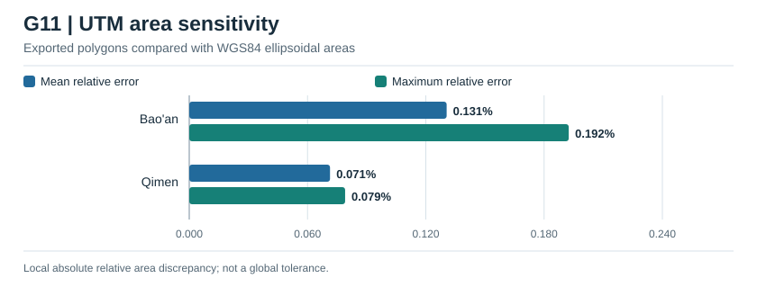

*Figure G11.1. Mean and maximum relative absolute discrepancy between projected and ellipsoidal areas; two exported polygon datasets only. [Source evidence](evidence/g20_g23_g17_raster_summary.json).*

**Archived evidence.** [Raster and geometry reference program](g20_g23_raster_audit.py), [result JSON and source SHA-256](evidence/g20_g23_g17_raster_summary.json).

**Verified scope and unresolved claims.** Local area discrepancies are measured, not universal tolerances. Distances, multiple UTM zones, polar regions and the dateline remain untested. G21 addresses raster intersection weighting, a distinct question.

### G21: Angular versus physical raster intersection weighting

**Scientific object and rationale.** For equal-angular-size pixels in EPSG:4326, coverage fractions are proportional to angular overlap. Physical area varies with location, so the two weighted means are not mathematical identities.

**Data, calculation and reference.** Build source pixel polygons from the affine transform, intersect the exact exported polygons and exclude nonfinite pixels. Sum radiance times overlap area divided by total overlap, once with angular area and once with WGS84 ellipsoidal area. Compare cell-level absolute differences, Spearman ranks and SOL over physically supported area in km². Bao'an uses VIIRS Median 2020, Qimen uses the `clipped_median` band of RAW_SUPPORT 2016. Intersection uses make_valid, buffer(0), and 1e-11 degree precision; ellipsoidal areas use geodesic segments between vertices.

**Results.**

| Measure | Bao'an 2020 | Qimen 2016 |
| --- | ---: | ---: |
| Comparable finite cells | 7,147 | 9,143 |
| Geometric support ≥ 0.999 | 7,103 | 9,117 |
| Mean absolute difference | 0.000009862 | 0.000000114 |
| 95th percentile absolute difference | 0.000034017 | 0.000000225 |
| Maximum absolute difference | 0.000299313 | 0.000018815 |
| Spearman rho | 0.9999999998 | 0.9999999993 |
| Angular-mean SOL | 34196.306051 | 115.380656 |
| Physical-mean SOL | 34196.307125 | 115.380622 |

The 0.999 threshold stratifies geometric support; it is not a VIIRS observation-quality standard.

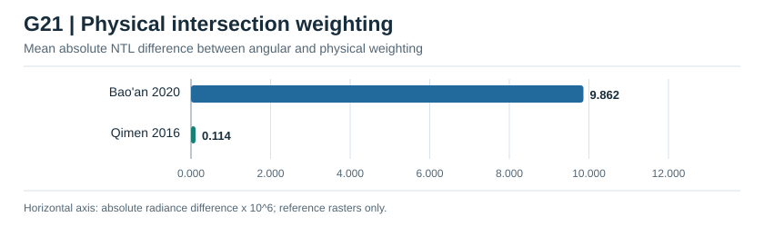

*Figure G21.1. Mean absolute NTL difference between angular and physical raster-intersection weighting, plotted in millionths of the radiance unit. [Source evidence](evidence/g20_g23_g17_raster_summary.json).*

**Archived evidence.** [Raster and geometry reference program](g20_g23_raster_audit.py), [result JSON and source SHA-256](evidence/g20_g23_g17_raster_summary.json).

**Verified scope and unresolved claims.** Small differences are measured on these two reference rasters, not sensor error, a rerun of V11 or a universal equivalence result. Finite-raster overlap is not cf_cvg; supported-area SOL is not production SOL. Extend to different latitudes and larger geometries as needed. See [exactextract operations](https://isciences.github.io/exactextract/operations.html).

### G22/A07: Direct extraction, block aggregation and MAUP zoning

**Scientific object and rationale.** Scale and zoning change observation units. Aggregating 500 m means equals direct coarse extraction only under compatible geometry and weights. Regional SOL conservation does not imply hotspot conservation.

**Data, calculation and reference.** Use the union of exported Bao'an polygons, not an independent administrative boundary. Construct UTM grids at 1000/1500/2000 m with origin zero or a half-cell shift in both axes, clip to the AOI and exclude slivers ≤0.0001 m². Directly extract from the same raster; for aligned grids compare with support-area-weighted 500 m means. Compare regional SOL and mean across six configurations. The reference does not use production block weighting.

**Results.**

| Cell size (m) | Origin shift (m) | Cells | Supported cells |
| --- | ---: | ---: | ---: |
| 1000 | 0 | 1,921 | 1,920 |
| 1000 | 500 | 1,912 | 1,912 |
| 1500 | 0 | 913 | 913 |
| 1500 | 750 | 902 | 902 |
| 2000 | 0 | 539 | 539 |
| 2000 | 1000 | 540 | 540 |

| Aligned size | Mean absolute direct–aggregate difference | Maximum |
| --- | ---: | ---: |
| 1000 m | 0.000022939 | 0.000279087 |
| 1500 m | 0.000049633 | 0.000540609 |
| 2000 m | 0.000074602 | 0.000415689 |

Six SOL values range 34196.307188–34196.307441 and means 20.733703468–20.733703659. A separate four-equal-cell example with one fine HH cell yields 100% coarse-block any-overlap but 25% actual area overlap; `coarse_covered_by_fine` and actual area overlap are different estimands.

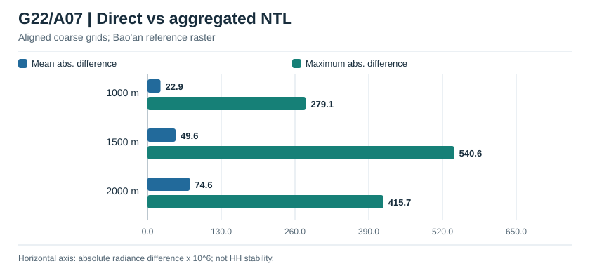

*Figure G22.1. Aligned direct-extraction versus support-weighted aggregation differences, in millionths of the radiance unit. This does not measure HH stability. [Source evidence](evidence/g20_g23_g17_raster_summary.json).*

**Archived evidence.** [Independent CSV and numerical-check program](g19_g29_independent_audit.mjs), [result JSON](evidence/g19_g29_independent_audit.json); [Raster and geometry reference program](g20_g23_raster_audit.py), [result JSON and source SHA-256](evidence/g20_g23_g17_raster_summary.json).

**Verified scope and unresolved claims.** Near-integral conservation is established for this reference design only. Production block weights, direct-grid LISA and HH overlap remain open. Compare matched raster support, compatible LISA settings and polygon-intersection area Jaccard.

### G23: Spatial dependence induced by shared source pixels

**Scientific object and rationale.** A nominal 500 m analysis grid is not a set of independent sensor observations. Shared source pixels can produce covariance even when the pixel field is independent.

**Data, calculation and reference.** Construct W from angular pixel–cell overlaps normalized to unit row sums. For independent unit-variance source pixels x, y=Wx has covariance WWᵀ; pair correlation is the row dot product divided by row norms. The ideal control uses 400 independent uniform 25×25 rasters, 24×24 output, aligned or shifted half a pixel on both axes. The actual-geometry experiment uses 6,185 Bao'an core cells (area ≥99% nominal, geometric support ≥0.999), 400 iid Gaussian fields, seed 20261125. Calculate binary Rook Global Moran after centering the extracted values.

**Results.**

| Configuration | Mean Moran | Empirical 2.5th percentile | Empirical 97.5th percentile |
| --- | ---: | ---: | ---: |
| Ideal aligned | -0.001514 | -0.060801 | 0.056433 |
| Ideal half-pixel shift | 0.496455 | 0.441207 | 0.550105 |
| Actual Bao'an reference geometry | 0.209232 | 0.190961 | 0.228331 |

All 23,900 directed Rook edges in the Bao'an sample share at least one source pixel. Mean expected pair correlation is 0.230268; the 95th percentile is 0.415925. In the ideal shifted case neighboring cells share two of four equally weighted pixels.

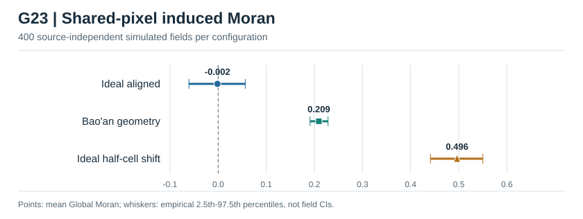

*Figure G23.1. Mean Global Moran and empirical 2.5th–97.5th percentiles from 400 simulated source-independent fields per configuration. Whiskers are not field confidence intervals. [Source evidence](evidence/g20_g23_g17_raster_summary.json).*

**Archived evidence.** [Independent CSV and numerical-check program](g19_g29_independent_audit.mjs), [result JSON](evidence/g19_g29_independent_audit.json); [Raster and geometry reference program](g20_g23_raster_audit.py), [result JSON and source SHA-256](evidence/g20_g23_g17_raster_summary.json).

**Verified scope and unresolved claims.** The mechanism is established on real reference geometry with simulated radiance, not a field Moran bias estimate, sensor PSF, or a universal correction to subtract from observed Moran. Empirical percentiles describe simulated fields, not confidence intervals for observed NTL. G17 extends this question to the Local Moran reference distribution.

### G24: Global Moran versus Moran scatterplot slope

**Scientific object and rationale.** The Moran scatterplot slope corresponds to Global Moran only under compatible samples, transformations and weight conventions. The all-cell raw Global I and positive-core LISA slope are distinct.

**Data, calculation and reference.** Reconstruct Queen from exported projected centroids using floor(coordinate/500). Calculate binary all-cell raw Global I and intercept OLS slope of mean neighbor lag on raw deviations among positive core focal cells with at least one neighbor; repeat with log NTL.

**Results.**

| Site 2020 | All-cell raw Global I | Positive-core raw slope | Positive-core log slope |
| --- | ---: | ---: | ---: |
| Qimen | 0.817250 | 0.800781 | 0.866488 |
| Bao'an | 0.903654 | 0.921101 | 0.962057 |
| Shanghai | 0.810675 | 0.802565 | 0.830273 |

**Archived evidence.** [Independent CSV and numerical-check program](g19_g29_independent_audit.mjs), [result JSON](evidence/g19_g29_independent_audit.json).

**Comparison on the scatterplot's data domain.** The regression in `ntl/lisa_ui.py` uses rows with nonmissing `ntl_z_lit` and `lisa_lag_z`; `run_lisa` exports both to four decimals. Independently reconstruct positive core members (area ≥99% of nominal) from Bao'an and Shanghai 2020 CSVs, standardize using the members' mean and sample SD, build Queen neighbors, and screen focal cells by degree. Calculate mean focal Local I, row-standardized Global I over members with untested rows set to zero, and intercept OLS slope on focal after rounding z and lag to four decimals. JavaScript rounding approximates NumPy rounding and need not agree at ties.

| Site | minK | Transform | Mean Local I | Global I (untested rows zero) | Rounded-column slope |
| --- | ---: | --- | ---: | ---: | ---: |
| Shanghai | 1 | Raw | 0.801442 | 0.802565 | 0.802564 |
| Shanghai | 4 | Raw | 0.797679 | 0.798796 | 0.800380 |
| Shanghai | 4 | Log | 0.821366 | 0.822517 | 0.826898 |
| Bao'an | 1 | Raw | 0.920898 | 0.921047 | 0.921100 |
| Bao'an | 4 | Raw | 0.916000 | 0.916148 | 0.924092 |
| Bao'an | 4 | Log | 0.952249 | 0.952403 | 0.961792 |

When all members are focal (Shanghai minK=1), the unrounded slope equals row-standardized Global I to numerical precision. Mean Local I differs by its sample-SD and member-count normalization. Once focal rows are removed, an intercept regression on a subset and Global I normalization over members are distinct. The slope should not be equated with all-region Global I or `moran_I_lit` (mean Local I).

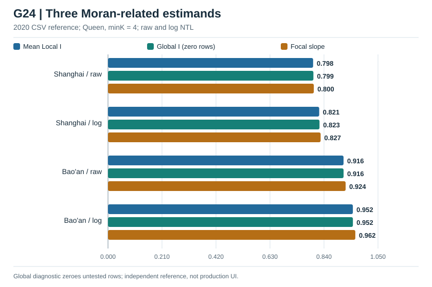

*Figure G24.1. Mean Local I, the row-standardized zero-row Global I diagnostic and the reconstructed focal scatterplot slope; minK = 4. Independent CSV reference, not a live UI result. [Source evidence](evidence/g24_g25_g27_estimand_reference.json).*

**Additional evidence.** [Estimand reference program](g24_g25_g27_estimand_reference.mjs), [setting-level results](evidence/g24_g25_g27_estimand_reference.json).

**Verified scope and unresolved claims.** The reconstructed CSV columns confirm distinct estimands; the production Python function and Altair UI have not been executed in this test. Compare both functions directly on matched settings and qualify slope interpretation rather than changing a formula solely because the estimand differs. The zero-row diagnostic is not Global I on the focal induced graph.

### G25: High-High area denominator on the tested domain

**Scientific object and rationale.** Members may include eligible graph cells that are not tested after the minimum-neighbor screen. If `hh_area_share_of_tested` means tested-area share, a members denominator can differ from its label.

**Data, calculation and reference.** Construct Queen on positive core cells from the CSV, count members and focal at minK=1 and minK=4, and compare their summed areas. For a fixed HH numerator, the two ratios coincide only when the denominators coincide.

**Results.**

| Site 2020 | Members | Focal (minK=4) |
| --- | ---: | ---: |
| Qimen | 8,532 | 8,513 |
| Bao'an | 6,186 | 6,158 |
| Shanghai | 715 | 712 |

At minK=1 Bao'an has 6,186 members and 6,185 focal, a 0.25 km² difference. At minK=4 focal/member area is 0.995482857.

**Archived evidence.** [Independent CSV and numerical-check program](g19_g29_independent_audit.mjs), [result JSON](evidence/g19_g29_independent_audit.json).

**Quantification with a nonzero HH numerator.** Use the G24 reconstruction for Bao'an and Shanghai 2020, 999 conditional neighbor samples without replacement, and JavaScript PRNG seed 42. P-values use the doubled inclusive smaller tail, plus-one correction and cap at one; identify positive z/lag with BH significance at alpha 0.05. Divide the same HH area by members and focal area, isolating the denominator effect from classification changes.

| Site | minK | Transform | HH cells (BH) | HH / members (%) | HH / focal (%) |
| --- | ---: | --- | ---: | ---: | ---: |
| Shanghai | 1 | Raw | 77 | 10.7687 | 10.7687 |
| Shanghai | 4 | Raw | 77 | 10.7687 | 10.8141 |
| Shanghai | 4 | Log | 90 | 12.5870 | 12.6400 |
| Bao'an | 1 | Raw | 1027 | 16.6023 | 16.6049 |
| Bao'an | 4 | Raw | 1042 | 16.8448 | 16.9213 |
| Bao'an | 4 | Log | 1719 | 27.7890 | 27.9151 |

For Bao'an minK=4 log NTL, 429.740468 km² HH is divided by 1546.441985 km² members or 1539.456485 km² focal; the difference is approximately 0.1261 percentage points. Equal denominator areas yield equal shares. HH classifications are independent reference calculations, not archived production labels or the NumPy RNG stream.

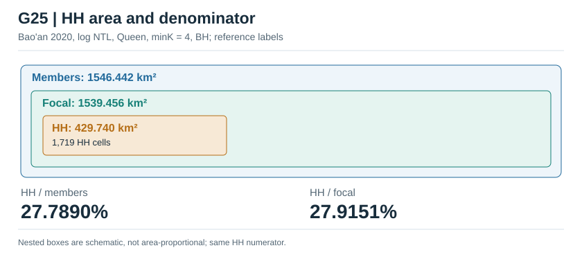

*Figure G25.1. Nested analysis populations for Bao'an 2020, log NTL and minK = 4. Box sizes are schematic, and both shares use the same HH numerator. [Source evidence](evidence/g24_g25_g27_estimand_reference.json).*

**Additional evidence.** [Estimand reference program](g24_g25_g27_estimand_reference.mjs), [raw/BH counts, areas and ratios](evidence/g24_g25_g27_estimand_reference.json).

**Verified scope and unresolved claims.** The denominator effect is quantified using reference labels on observed exports. A production regression with islands and varied minK remains necessary, and the label or denominator must explicitly match the estimand.

### G27: Analysis specification comparability in region-year panels

**Scientific object and rationale.** Rows with the same region, year and cell size may use different statistical settings, confounding measurement change with temporal change.

**Data, calculation and reference.** Inspect KEY_COLS and same-key replacement in `ntl/lisa_ui.py`. Specify a method fingerprint including weights, log, alpha, FDR, permutations, seed, support, algorithm version and boundary identity. The counterexample uses conflicting configurations; source geometry identity across years is a separate condition.

**Results.**

Static inspection confirms same-key replacement despite possible method differences. G26 confirms exported Qimen coordinate/area alignment, not polygon hash identity or method equivalence.

**Archived evidence.** [Independent CSV and numerical-check program](g19_g29_independent_audit.mjs), [result JSON](evidence/g19_g29_independent_audit.json).

**Key-collision counterexample.** Construct two hypothetical records with key CHN, reference, 2020, 500 m. A has 499 permutations, raw NTL and assigned HH share 0.15; B has 999 permutations, log NTL and assigned share 0.08. Independently reproduce the same-key removal and new-row append rule, then add record C with year 2021. A is replaced by B; after C, two rows B and C remain. The assigned HH shares distinguish records and are not LISA results or measured economic change.

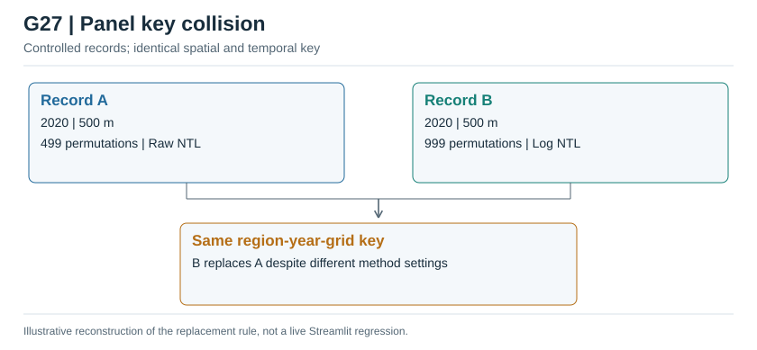

*Figure G27.1. Controlled key-collision reconstruction: different analysis specifications have the same region-year-grid key, so B replaces A. [Source evidence](evidence/g24_g25_g27_estimand_reference.json).*

**Additional evidence.** [Key-rule reconstruction](g24_g25_g27_estimand_reference.mjs), [counterexample input and resulting rows](evidence/g24_g25_g27_estimand_reference.json).

**Verified scope and unresolved claims.** Same-key replacement is confirmed in an independent reproduction, not a live UI/production test or a fingerprint implementation. Test conflicting specifications across years, polygon hashes and prevention of incompatible panel series.

### G28: Spatial bootstrap block size and interval coverage

**Scientific object and rationale.** Five-cell blocks and 200 resamples are algorithm settings, not evidence of nominal 95% interval coverage. Dependence ranges can differ across urban and rural settings.

**Data, calculation and reference.** Estimate dependence range using a correlogram or variogram; vary block sizes and replicates and report block count, valid replicates, percentiles and sensitivity. In repeated known-parameter simulations calculate the fraction of valid intervals containing truth. Evaluate coverage and Monte Carlo uncertainty, not minimum interval width.

**Results.**

**Known-truth coverage design.** Generate two independent standard Gaussian fields A and E on a 20 × 20 grid. For spatial dependence apply the same Gaussian smoothing kernel to both, with periodic boundary conditions; kernel SD is 0, 1 or 2 cells (0 means no smoothing). Construct B as 0.6 times A plus the square root of (1 − 0.6²) times E. Equal marginal variances and independence of A and E imply Pearson correlation 0.6, hence bivariate-normal population Spearman correlation 6/pi times arcsin(0.6/2) = 0.581920104. This is the population target, not an estimated sample coefficient.

Use 120 independent field pairs per design, seed 271128, and 200 bootstrap draws per field. Reproduce the fixed-origin nonoverlapping block partition and same-number block resampling of `block_bootstrap_rho`; recalculate Spearman ranks (average ties) on each concatenated resample and take the 2.5th and 97.5th percentiles. Test block sides 1, 2, 4, 5 cells. A 10-cell side gives four blocks and is excluded by the production minimum of five blocks. This is a vectorized independent reference, not a production import.

| Kernel SD (cells) | Block side | Blocks | Intervals containing truth / 120 | Coverage (%) | Mean interval width |
| --- | ---: | ---: | ---: | ---: | ---: |
| 0 | 1 | 400 | 113 | 94.17 | 0.135668 |
| 0 | 2 | 100 | 113 | 94.17 | 0.134333 |
| 0 | 4 | 25 | 113 | 94.17 | 0.132027 |
| 0 | 5 | 16 | 109 | 90.83 | 0.127445 |
| 1 | 1 | 400 | 63 | 52.50 | 0.131316 |
| 1 | 2 | 100 | 84 | 70.00 | 0.201810 |
| 1 | 4 | 25 | 96 | 80.00 | 0.241167 |
| 1 | 5 | 16 | 95 | 79.17 | 0.254773 |
| 2 | 1 | 400 | 31 | 25.83 | 0.130763 |
| 2 | 2 | 100 | 61 | 50.83 | 0.240598 |
| 2 | 4 | 25 | 89 | 74.17 | 0.374397 |
| 2 | 5 | 16 | 96 | 80.00 | 0.400860 |

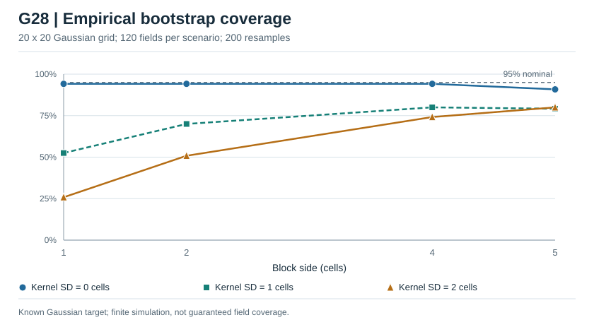

*Figure G28.1. Empirical coverage of bootstrap intervals by block side and Gaussian smoothing scenario. The dashed line is the nominal 95% target. [Source evidence](evidence/g28_block_coverage_reference.json).*

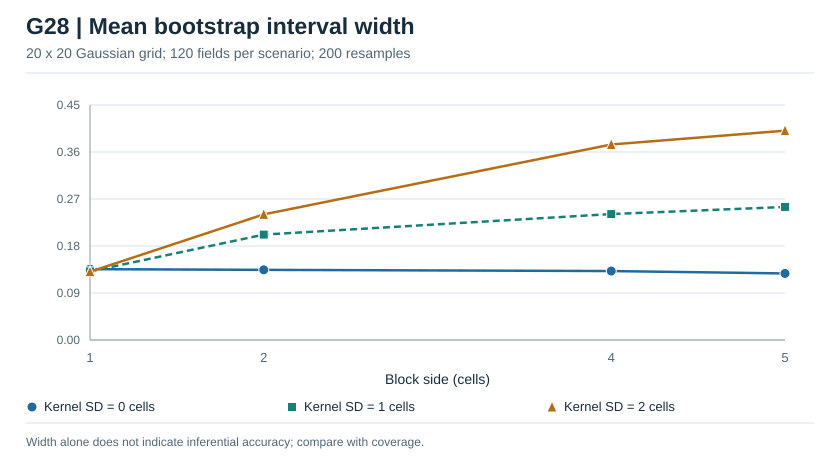

*Figure G28.2. Mean interval width for the same bootstrap design. A narrow interval alone does not establish adequate coverage. [Source evidence](evidence/g28_block_coverage_reference.json).*

**Interpretation.** As dependence increases, cellwise resampling yields narrow intervals with poor coverage. Larger blocks improve coverage in some designs, but do not guarantee 95%; the default five-cell side yields 90.83%, 79.17%, and 80.00% in the three scenarios. With 120 fields the Monte Carlo SE is approximately the square root of coverage times (1−coverage) divided by 120; small differences are not a block ranking. Kernel sigma is the simulation smoothing parameter, not an empirically measured Bao'an dependence range.

**Archived evidence.** [Calibration program](g28_block_coverage_reference.py), [design, coverage and width JSON](evidence/g28_block_coverage_reference.json).

**Verified scope and unresolved claims.** Coverage is quantified for three known Gaussian designs; direct production comparison and field-specific calibration remain open. Increase replications, test irregular domains, empirical dependence ranges and resample count sensitivity. Existing intervals remain conditionally descriptive, not guaranteed 95% coverage.

### G29: Equivalence of documented and production p-value conventions

**Scientific object and rationale.** Absolute-tail counting and twice the smaller tail differ under asymmetric reference distributions. A general illustration must not be mistaken for the implemented estimator.

**Data, calculation and reference.** Set observed Local I to 2 and nine simulated values [-5,-4,-3,-2,-1,0,1,2,3]. Absolute-tail counting gives six values of magnitude at least 2; add one and divide by ten. The smaller inclusive tail contains two values at least 2; add one, divide by ten, double and cap at one.

**Results.**

| Convention | p-value |
| --- | ---: |
| Absolute tail plus one | 0.7 |
| Doubled smaller tail plus one | 0.6 |

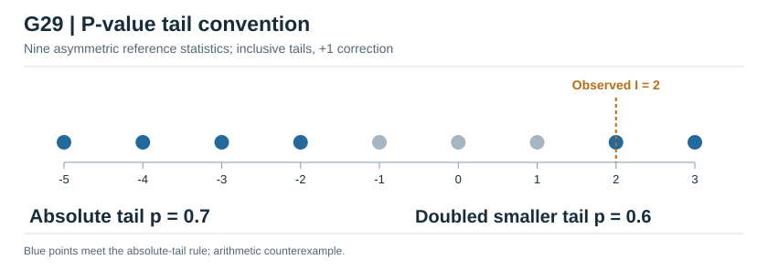

*Figure G29.1. Asymmetric nine-value reference distribution. Blue points meet the absolute-tail rule; the doubled-smaller-tail convention gives a different p-value. [Source evidence](evidence/g19_g29_independent_audit.json).*

**Archived evidence.** [Independent CSV and numerical-check program](g19_g29_independent_audit.mjs), [result JSON](evidence/g19_g29_independent_audit.json).

**Verified scope and unresolved claims.** An arithmetic counterexample establishes non-equivalence, not which null is calibrated. Review all documented and implemented conventions. Existing equations remain unchanged.

### New validation acceptance criteria

- **G04/G05/G06:** retain independent input sources, spatial units, model definitions, seed, comparison metrics, cell-level results and sensitivity tables. Distinguish mathematical identity from economic construct validation.
- **G17:** preregister null-generating processes and nominal alpha; report empirical false discoveries, realized FDR, power and uncertainty over simulations. Do not treat a correct BH function as proof of FDR control for all spatial dependence structures. Background: [Benjamini and Yekutieli (2001)](https://doi.org/10.1214/aos/1013699998).
- **G18:** distinguish truly observed zero from no observation using verified A02 support fields; repeat only the alternative zero-inclusion specification, not the previously completed A03 reference tests.
- **A02/A07 remaining:** test a real incomplete-coverage scene and directly extracted coarse-grid raster respectively. Never re-open the completed Bao'an observed case or V11 raster comparison merely because a neighboring question remains.

- **G06:** for spatial-null extension of conditional bootstrap, reselect cutoff and refit alpha within each replicate, compare rival distributions over common support and measure rejection frequency.
- **G04/G05:** match independent economic references in time and spatial support; 2026 OSM is not 2020 economic ground truth. Compare population/employment potential, transport friction, top-decile overlap and held-out activity centers.
- **G03, label semantics:** `ntl_class_label` describes radiance classes rather than uncalibrated economic or land-use categories. Numeric class codes and radiance thresholds are distinct from the label interpretation.
- **G03/G09/G13/G14:** retain conditions for radiance thresholds, multi-period Markov stability, epoch alignment and robustness thresholds in the [scientific closure register](scientific_closure_register.json).

